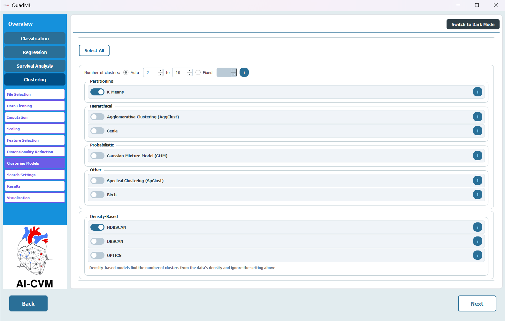
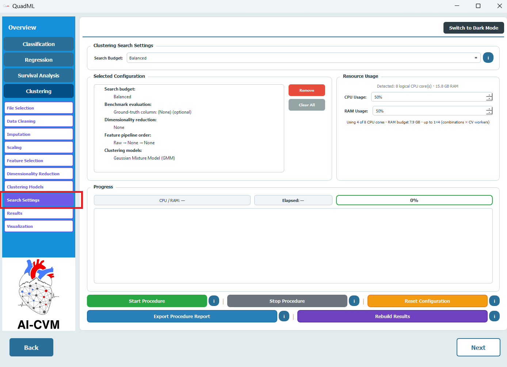
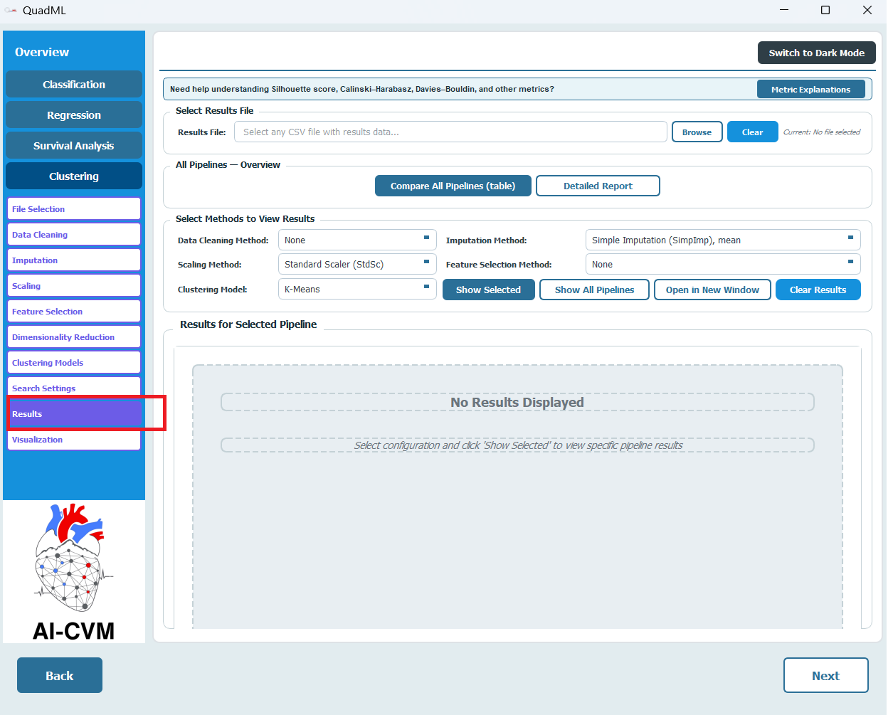
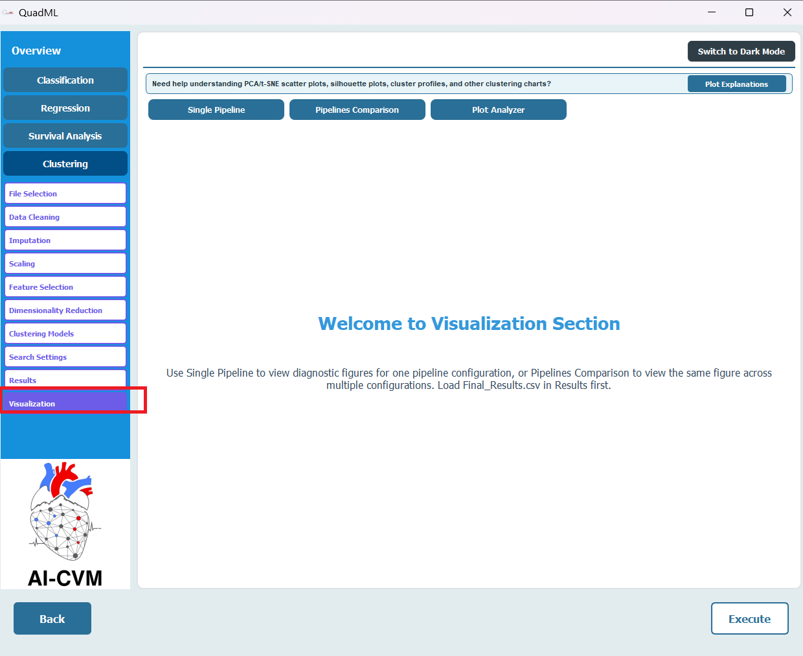
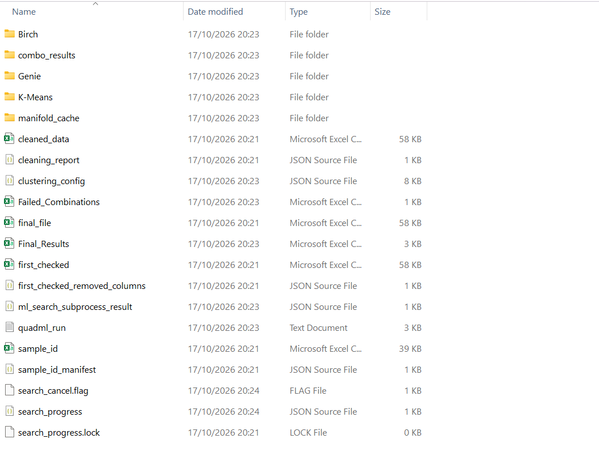

# Clustering — end-to-end walkthrough

Follow this once with a small `.csv` or `.xlsx` of mostly **numeric** features. No label is required. Keep every step minimal so the first run finishes quickly. For “why” and edge cases, open the linked step pages.

---

## 1. Start

1. Open QuadML → **Clustering** → **File Selection**.
2. **Select File → Browse** — choose your dataset (header row required).
3. **Output Directory → Browse** — choose a **parent** folder. Each run creates a dated subfolder `YYYY-MM-DD_HH-MM-SS`.
4. Leave **Benchmark Label** on **(None)** unless you have a known class column for ARI / NMI / FMI only (not used for ranking).
5. Optional: **Column Removal** (no External Test Data or ID Column row in Clustering).

Details: [File Selection](01-file-selection.md).

---

## 2. Preprocess (keep it small)

Use **one** choice per step so the search stays short:

| Step | First-run choice |
|------|------------------|
| [Data Cleaning](02-data-cleaning.md) | **None** (Exact Duplicate Rows on; Missing / Outlier Threshold off) |
| [Imputation](03-imputation.md) | **Simple Imputation** |
| [Scaling](04-scaling.md) | **Standard Scaler** |
| [Feature Selection](05-feature-selection.md) | **None** |
| [Dimensionality Reduction](06-dimensionality-reduction.md) | **None** |

Leave extra methods unchecked until you need them.

---

## 3. Models

1. **Clustering Models:** enable **K-Means** only (you can leave Agglomerative / DBSCAN off for a minimal first run) ([Clustering Models](07-clustering-models.md)).
2. **Number of clusters:** **Auto** (leave the default min–max range on the cluster-count panel).

If you leave DBSCAN on, the Density-Based panel shows the notice that density models ignore Number of clusters.

---

## 4. Run

1. Open **Search Settings**.
2. Set **Fast** budget, CPU/RAM **50 / 50**.
3. Review the selected configuration tree — it should list only the choices above.
4. Click **Start Procedure**.
5. Wait until the progress box finishes. Use **Stop Procedure** only if you need to cancel.

Details: [Search Settings](08-search-settings.md).

---

## 5. Read output

1. **Results:** open **Metric Explanations**. For K-Means, compare Silhouette with CH / DB and check cluster sizes. (If you also ran DBSCAN or GMM, read DISCO or BIC on those rows — do not force one index across paradigms. DBCV is a secondary report.) ([Results](09-results.md))
2. **Visualization:** Feature Space or Reduced Components for the chosen pipeline; Elbow if you want to inspect *k*; Cluster Profile Heatmap (z-scored colours) to interpret segments. For HDBSCAN, try HDBSCAN Condensed Tree; for density roles, Core / Border / Noise ([Visualization](10-visualization.md)).

There is **no** Interpretability step in Clustering.

Success: `Final_Results.csv` and assignment/profile CSVs under `Your Folder\YYYY-MM-DD_HH-MM-SS\`.

---

## Variants (not part of this walkthrough)

Configure these on the listed pages and re-run:

| Variant | Where |
|---------|--------|
| Benchmark Label (ARI / NMI / FMI) | File Selection |
| Density-Based models (DBSCAN / OPTICS / HDBSCAN) | Clustering Models |
| Fixed number of clusters | Clustering Models → Number of clusters |
| Extra imputers / scalers / FS / DR / models | Respective steps |
| Thorough search budget | Search Settings |

---

## Related pages

- [Introduction](00-introduction.md)
- [Clustering documentation index](index.md)
