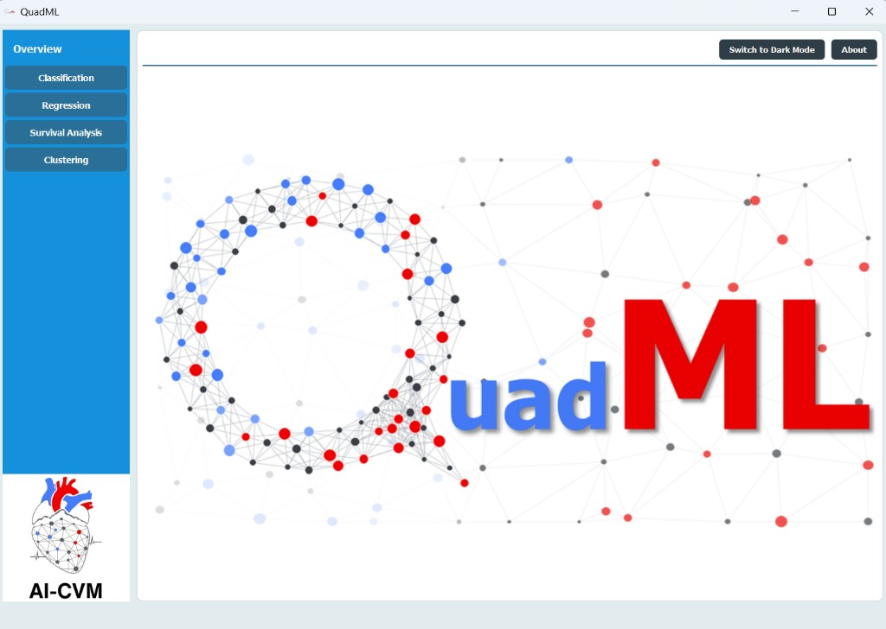

# Getting started — First run

---

## Launch

1. Start QuadML:
   - **Source:** `python src/quadml_entry.py` (after [Install from source](02-install-from-source.md))
   - **Windows:** `QuadML.exe` / Start Menu shortcut ([Install Windows executable](03-install-windows-exe.md))
   - **macOS:** `QuadML.app` — Right-click → Open the first time ([macOS notes](04-macos-notes.md))
2. Confirm the window title **QuadML** and the Welcome logo.
3. Optional: **Switch to Dark Mode** / **Switch to Light Mode**, or open **About**.
4. Expand one mode on the left: **Classification**, **Regression**, **Survival Analysis**, or **Clustering**.

---

## Minimal path to a first successful search

5. Open **File Selection**.
6. **Browse** a `.csv` or `.xlsx` file (see [Prepare the data](07-prepare-the-data.md)).
7. Set **Output Directory** to a writable folder you own.
8. Set mode roles (label / target / duration+event / clustering features) and Record ID if needed.
9. Leave Cleaning at **None** or choose one method; Active 'Correlation Analysis' and 'Missing / Outlier Threshold' if you need; keep a short Imputation + Scaling list and one or two models.
10. Open **Parameter Tuning** (or **Search Settings** in Clustering).
11. Use **Balanced** (or **Fast**) budget and default Resource Usage → **Start Procedure**.
12. When finished, open **Results**.

For a mode-specific first configuration, use that mode’s overview and walkthrough.

---

## What “success” looks like

- Progress on Parameter Tuning / Search Settings completes without a hard crash.
- A **dated subfolder** appears under your Output Directory.
- `Final_Results.csv` (and usually `combo_results/`) exist in that folder.
- **Results** shows at least one combination row.

---

## One search at a time

Do not start a second mode’s search while another is running. Stop or wait, then switch modes.

---

## Where to go next

- [Shared walkthrough](../shared/walkthrough.md)
- [Classification walkthrough](../classification/walkthrough.md)
- [Prepare the data](07-prepare-the-data.md)
- [Troubleshooting](08-troubleshooting.md)
