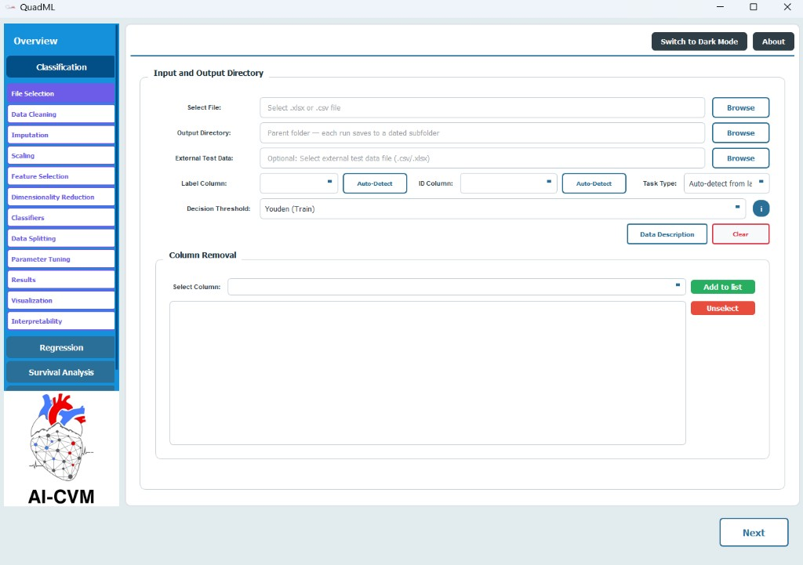

# Getting started — Prepare the data

QuadML reads tabular files from **File Selection**. Supported formats: **`.csv`** and **`.xlsx`**.

Full click-path detail: [Shared — File Selection](../shared/02-file-selection.md) and the mode File Selection pages.

---

## File layout (all modes)

| Expectation | Detail |
|-------------|--------|
| One row per sample / observation | Columns = features (+ roles below) |
| Header row | Column names in the first row |
| Numeric features | Prefer numeric columns for ML stages; categoricals are encoded in shared preprocessing |
| Missing values | Allowed — choose Imputation methods for search. Unambiguous tokens (`NA`, `null`, blank, …) become missing at load. Ambiguous tokens such as `none` / `-` are **not** wiped from label / duration / event columns, so class values like `none` stay intact |
| ID column | Optional **Record ID**, or **No ID Column** → synthetic `sample_1`, `sample_2`, … |

---

## Mode-specific columns

| Mode | Required roles on File Selection |
|------|----------------------------------|
| **Classification** | **Label Column**; **Task Type** (auto / binary / multi-class). Binary: **Decision Threshold** (Youden / Prevalence / Manual / 0.5) for hard-label metrics |
| **Regression** | Numeric **Target** column |
| **Survival Analysis** | **Duration** and **Event / Censor** columns; **Event Coding**; **Duration Unit**; **Eval. Horizons** |
| **Clustering** | Feature columns only (no supervised label) |

Optional **External Test Data**: same schema as the main file for the roles you use. Required when **Train on all data** is on in Data Splitting (supervised modes that support it).

---

## File Selection helpers

- **Column Removal** — exclude non-feature columns before modeling.
- **Data Description** — after a successful load, opens a pandas-style summary; export CSV/Excel if needed.
- **Clear** — clears the current file selections.

---

## Output Directory

- Choose a **parent** folder you can write to.
- Each **Start Procedure** creates a **dated subfolder** (`YYYY-MM-DD_HH-MM-SS`) with `Final_Results.csv`, pipelines, plots, etc.
- Do not point Output Directory at a read-only location (e.g. Program Files).

---

## Practical first-dataset advice

- Start with a **small** table (hundreds of rows, modest columns) to validate the path.
- Prefer a clear, single label / target / duration–event definition.
- Remove unused identifier-only columns via **Column Removal**, or leave them out of the feature set.
- Keep combination counts small until you trust the run folder layout.

---

## Excel tips

- Prefer one clean table on the first sheet (openpyxl default path).
- Avoid merged cells and multiple tables on one sheet.

---

## Common mistakes

- Wrong label / target selected (metrics look nonsense)
- Survival duration / event swapped or wrong **Event Coding**
- Forgetting **Output Directory** before Start Procedure
- **Train on all data** without External Test Data when the mode requires it
- Putting outcome columns into Column Removal by mistake

---

## Mode manuals

- [Classification — File Selection](../classification/01-file-selection.md)
- [Regression — File Selection](../regression/01-file-selection.md)
- [Survival — File Selection](../survival/01-file-selection.md)
- [Clustering — File Selection](../clustering/01-file-selection.md)
