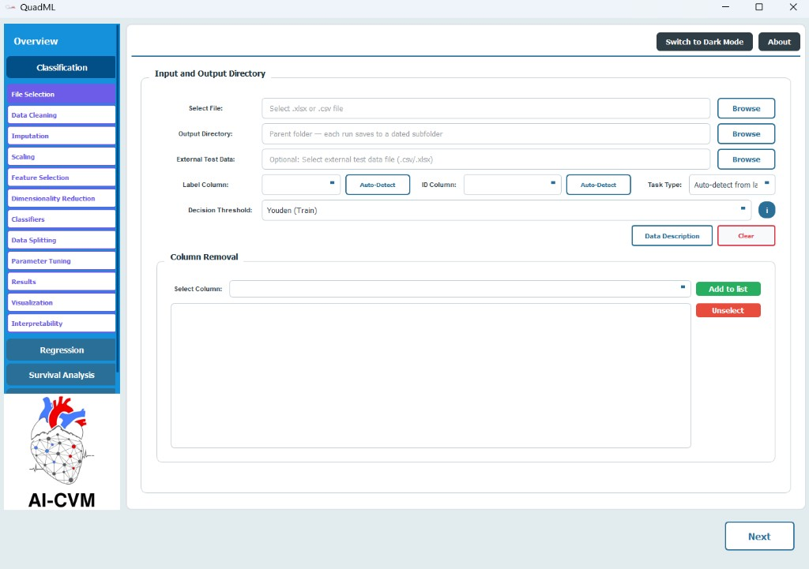

# Installation

Get QuadML running on your computer in minutes. Most users should install the **packaged app** for Windows, macOS, or Linux — no Python setup required. Use **From source** only if you maintain or develop the application and already have the full source tree.

**Get the app:** [ai-cvm.org/QuadML](https://ai-cvm.org/QuadML/) · **Project page:** [https://github.com/AI-in-Cardiovascular-Medicine/QuadML](https://github.com/AI-in-Cardiovascular-Medicine/QuadML)

---

## System requirements (all platforms)

| Resource | Guidance |
|----------|----------|
| OS | Windows 10/11 (64-bit), macOS (Apple Silicon), or Linux (64-bit, glibc ≥ 2.35 for packaged builds) |
| CPU | Multi-core recommended |
| RAM | 8 GB minimum; 16 GB+ for larger searches, survival, or DeepSurv |
| Disk | Space for dated run folders under your Output Directory |
| Display | Desktop resolution suitable for the main window + left nav |

Resource Usage defaults are often **50% CPU / 50% RAM** so the machine stays usable during a search.

---

## Install by platform

=== "Windows"

    ### Packaged app (recommended)

    1. Download the Windows installer (`.exe`) from [ai-cvm.org/QuadML](https://ai-cvm.org/QuadML/).
    2. Run the installer and follow the wizard.
    3. Launch **QuadML** from the Start Menu or desktop shortcut.

    **Portable folder:** if you received a full `QuadML` folder instead of Setup, keep the folder intact and run `QuadML.exe` from it. Do **not** move the `.exe` alone — search needs `QuadML_Worker.exe` and `_internal` beside it.

    Writable caches/logs: `%LOCALAPPDATA%\QuadML`. Pipeline outputs go to the **Output Directory** you set in the app.

    ### From source (Windows)

    Use this only if you have the **application** repository (not the documentation-only GitHub repo).

    ```powershell
    python -m venv .venv
    .\.venv\Scripts\Activate.ps1
    python -m pip install -U pip
    pip install -r requirements.txt
    python src\verify_quadml_bundle.py
    python src\quadml_entry.py
    ```

    Python **3.9–3.12**. Use a project `.venv`, not Anaconda base. Pin details: [Python requirements](../developers/python-requirements.md).

=== "macOS"

    ### Packaged `.app` (Apple Silicon)

    1. Download `QuadML-macOS.app.zip` from [ai-cvm.org/QuadML](https://ai-cvm.org/QuadML/) or the project’s GitHub Releases (when published).
    2. Extract and place `QuadML.app` somewhere convenient (e.g. Applications).
    3. First launch: **Right-click → Open** (unsigned build; confirm Gatekeeper).
    4. Later launches can use double-click once allowed.

    Use the current **arm64** build. An older Intel `.app` may trigger Rosetta (“Finding software”) when a search worker starts.

    Writable data: `~/Library/Application Support/QuadML` (logs, pycox data).

    ### From source (macOS Apple Silicon)

    Use this only if you have the **application** repository.

    ```bash
    python3 -m venv .venv
    source .venv/bin/activate
    python -m pip install -U pip
    pip install -r requirements-mac.txt
    python src/verify_quadml_bundle.py
    python src/quadml_entry.py
    ```

    Use **`requirements-mac.txt`** (PyQt5 arm64 pin). Do **not** install from `requirements.txt` alone on Apple Silicon.

    On Mac, Resource Usage may soft-throttle under memory pressure. Packaged-Mac SurvSHAP Compute may run serial (**H11**) and be slower than on Windows/Linux — see [Python requirements](../developers/python-requirements.md) and [Build and package](../developers/build-and-package.md) if you maintain builds.

=== "Linux"

    ### Packaged builds

    From the Linux build / [ai-cvm.org/QuadML](https://ai-cvm.org/QuadML/) when published:

    | Artifact | How to use |
    |----------|------------|
    | `QuadML-Linux-portable.tar.gz` | Unpack and run `./QuadML/QuadML` (keep `QuadML_Worker` + `_internal`) |
    | `quadml_*_amd64.deb` | `sudo apt install ./quadml_*_amd64.deb` → `quadml` command / menu entry |

    Packaged Linux builds need **glibc ≥ 2.35** (ubuntu-22.04 or newer).

    ### From source (Linux)

    Use this only if you have the **application** repository.

    ```bash
    python3 -m venv .venv
    source .venv/bin/activate
    python -m pip install -U pip
    pip install -r requirements.txt
    python src/verify_quadml_bundle.py
    python src/quadml_entry.py
    ```

=== "From source"

    ### When to use source

    - You are developing or packaging QuadML
    - You have the **application** source tree (repo root with `requirements.txt` / `requirements-mac.txt` and `src/`)

    The **public documentation repository** on GitHub does **not** contain the application source. For contributor access, see [About QuadML](10-about.md) and [Contributing](../developers/contributing.md).

    ### Steps (summary)

    1. Obtain the application repository and open a terminal at the repo root.
    2. Create and activate a `.venv` (Python 3.9–3.12).
    3. Install pins: `requirements.txt` (Windows/Linux) or `requirements-mac.txt` (macOS Apple Silicon).
    4. Run `python src/verify_quadml_bundle.py`.
    5. Launch with `python src/quadml_entry.py`.

    Dependency pins and conflicts: [Python requirements](../developers/python-requirements.md). Packaging: [Build and package](../developers/build-and-package.md).

---

## First run

1. Launch QuadML (exe / `.app` / `quadml_entry.py`).
2. Confirm the Welcome screen; optionally set light/dark theme.
3. Expand a task: **Classification**, **Regression**, **Survival Analysis**, or **Clustering**.
4. **File Selection** → browse a `.csv` / `.xlsx` → set **Output Directory** (writable parent folder).
5. Set task roles (label / target / duration+event / clustering features).
6. Keep preprocessing small; pick one or two models.
7. **Parameter Tuning** or **Search Settings** → **Fast** or **Balanced** → **Start Procedure**.
8. When finished, open **Results**.

**Success**: a dated subfolder `YYYY-MM-DD_HH-MM-SS` under Output Directory with `Final_Results.csv`.

Only **one** search may run at a time — Stop or wait before starting another mode.

Mode overviews: [Classification](../classification/00-introduction.md) · [Regression](../regression/00-introduction.md) · [Survival](../survival/00-introduction.md) · [Clustering](../clustering/00-introduction.md)

---

## Prepare your data (short)

| Expectation | Detail |
|-------------|--------|
| Formats | `.csv` or `.xlsx` with a header row |
| Rows / columns | One row per sample; columns = features (+ outcome roles) |
| Missing values | Allowed — choose Imputation later |
| Output Directory | Writable **parent** folder; each run creates a dated subfolder |

| Task | Required roles |
|------|----------------|
| Classification | Label Column (+ Task Type / Decision Threshold as shown) |
| Regression | Numeric target (Label Column in the GUI) |
| Survival | Duration + Event / Censor (+ coding, horizons) |
| Clustering | Features only; optional Benchmark Label |

Optional **External Test Data** (supervised modes) must match feature/outcome columns. Details remain on each task’s **File selection** page.



---

## Common mistakes

- Looking for results under Program Files — use **Output Directory**
- Copying only `QuadML.exe` without the rest of the freeze folder
- On Mac: installing with `requirements.txt` instead of `requirements-mac.txt`
- Starting a second search while another is running
