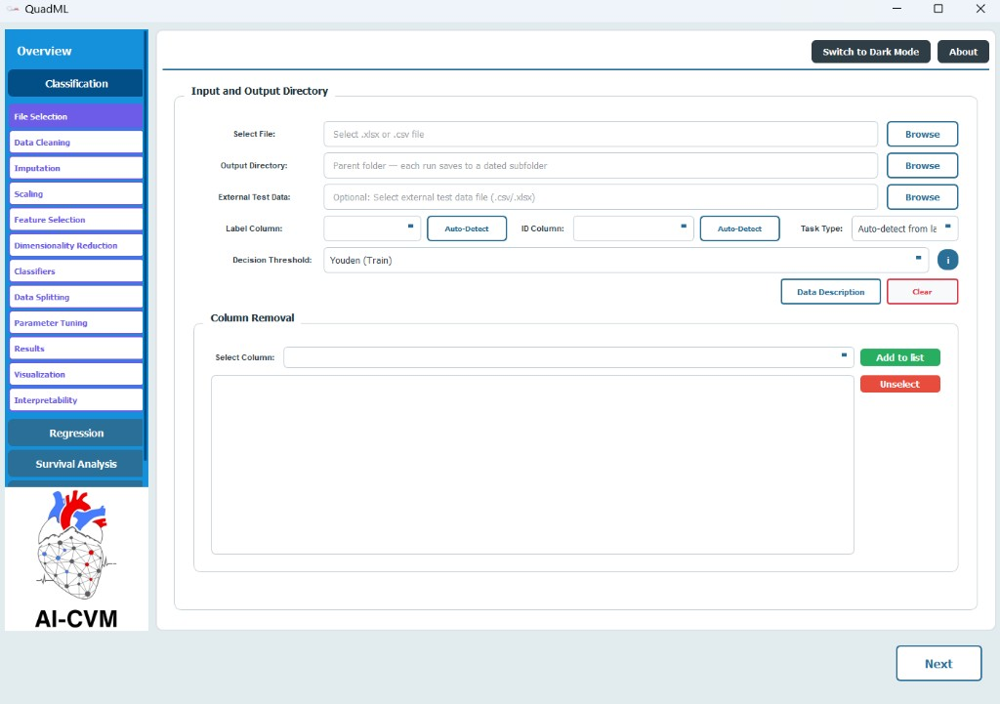

# Getting started — Quick start walkthrough

End-to-end path from a clean machine to the first Results table.

---

## A. Install

**Option 1 — Source**

1. [System requirements](01-system-requirements.md)
2. [Install from source](02-install-from-source.md) — venv → platform requirements → verify → `quadml_entry.py`
   - Windows / Linux: `pip install -r requirements.txt`
   - macOS (Apple Silicon): `pip install -r requirements-mac.txt`
3. Optional pin details: [Python requirements](06-python-requirements.md)

**Option 2 — Windows exe**

1. [System requirements](01-system-requirements.md)
2. Download / install from [www.ai-cvm.org](https://www.ai-cvm.org) — [Install Windows executable](03-install-windows-exe.md)

**Option 3 — macOS `.app`**

1. [macOS notes](04-macos-notes.md) — CI-built `QuadML.app` (Right-click → Open the first time)

**Option 4 — Linux portable / `.deb`**

1. [System requirements](01-system-requirements.md) — artifacts from the Linux build (see [Build / package](09-build-and-package.md))

---

## B. First launch

2. [First run](05-first-run.md) — Welcome → optional theme / **About** → expand **Classification**, **Regression**, **Survival Analysis**, or **Clustering**.

---

## C. Data

3. Prepare a small `.csv` / `.xlsx` — [Prepare the data](07-prepare-the-data.md).

4. **File Selection:** Select File + **Output Directory** + mode roles (label / target / duration+event / clustering features) + Record ID if needed. Optional: External Test Data, Column Removal, **Data Description**.

---

## D. Short pipeline

5. Cleaning **None** (or one method); short Imputation + Scaling; **None** FS/DR if shown.
6. One or two models only.
7. Split 80/20 (supervised) or Clustering **Search Settings** defaults.
8. **Parameter Tuning** / **Search Settings:** **Fast** or **Balanced** budget, default Resource Usage → **Start Procedure** → wait → **Results**.

Success: dated run folder under Output Directory with `Final_Results.csv` (and usually `combo_results/`).

Details: [Shared walkthrough](../shared/walkthrough.md) or a mode walkthrough.

---

## E. If something fails

9. [Troubleshooting](08-troubleshooting.md)
10. Source: re-check [Python requirements](06-python-requirements.md) and `verify_quadml_bundle.py`
11. Mid-run crash / incomplete CSV: **Rebuild Results** on Parameter Tuning / Search Settings (from finished `combo_results/*.json`)

---

## F. Optional packaging

Maintainers only: [Build and package](09-build-and-package.md) — Windows Setup, macOS `.app`, Linux portable / `.deb`.

---

## About

[About](10-about.md)
