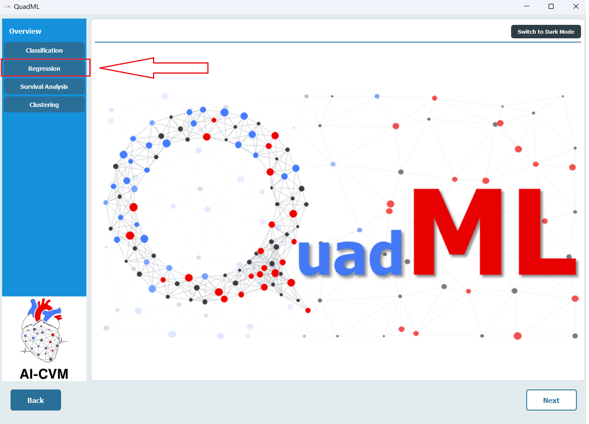
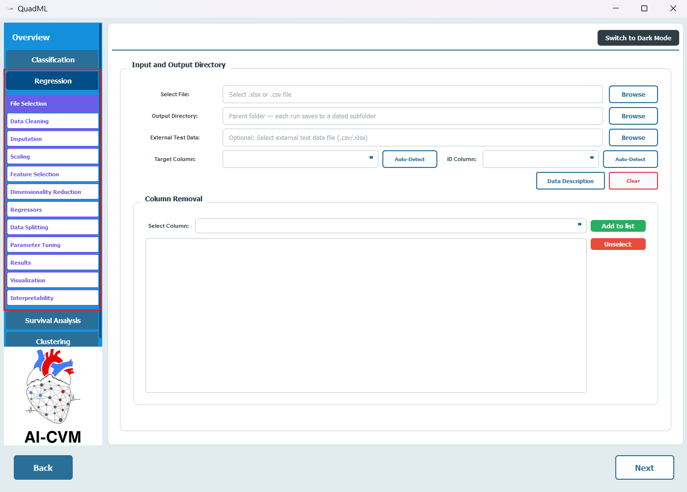

# Regression — Introduction

**Regression** predicts a **numeric** value for each row in a tabular dataset. Typical examples are a lab measurement, score, dose, price, or any continuous clinical or research outcome.

In QuadML, Regression builds and compares full pipelines: you choose cleaning, imputation, scaling, feature selection, dimensionality reduction, and regressors; the search tries every combination you enable, then reports error and fit metrics (MAE, RMSE, R², …), residual plots, and explanations. There is no class label, Task Type, or Decision Threshold. Everything runs locally — no data is uploaded.

Use this mode when the outcome is continuous. For discrete categories use Classification; for time-to-event data use Survival Analysis; for unlabeled grouping use Clustering.

---

## Workflow map

After you click **Regression** on the left, the nested steps are:

| Order | Step | Role |
|------:|------|------|
| 1 | File Selection | Load data, numeric **Target Column**, ID, output folder |
| 2 | Data Cleaning | Outlier / hygiene options (applied at Start Procedure) |
| 3 | Imputation | Fill missing values (searched combinations) |
| 4 | Scaling | Scale features (searched combinations) |
| 5 | Feature Selection | Rank / drop original features |
| 6 | Dimensionality Reduction | Compress remaining features (no LDA) |
| 7 | Regressors | Choose regression models |
| 8 | Data Splitting | Train/Test (or Train on all + External) |
| 9 | Parameter Tuning | Search settings + **Start Procedure** |
| 10 | Results | Pipeline metrics (`Final_Results.csv`) |
| 11 | Visualization | Metric charts and residual diagnostics |
| 12 | Interpretability | Explain a loaded fitted pipeline |

---

## What is different from Classification

- **Label Column** is continuous (no classes)
- No **Task Type**, no **Decision Threshold**
- No class-imbalance panel on Parameter Tuning
- No **Stratified K-Fold** in CV choices
- No **LDA** on Dimensionality Reduction
- No Naive Bayes; models include Linear / Ridge / Lasso / Elastic Net / SVR, etc.
- Metrics are error / fit / correlation measures (MAE, RMSE, R², …)
- PDP / ICE are available (not limited to binary tasks)

---

## Suggested first configuration

- One dataset with a numeric target, Output Directory set
- Cleaning: **None** (or IQR if needed)
- Imputation: **Simple Imputation**
- Scaling: One method like **Standard Scaler**
- Feature Selection: **Desired Method**
- Dimensionality Reduction: **None**
- Regressors: two models (e.g. Linear Regression + Random Forest)
- Split: 80/20, Train on all data **off**
- Parameter Tuning: Random Search, Fast budget → **Start Procedure**

Then follow the [walkthrough](walkthrough.md).
