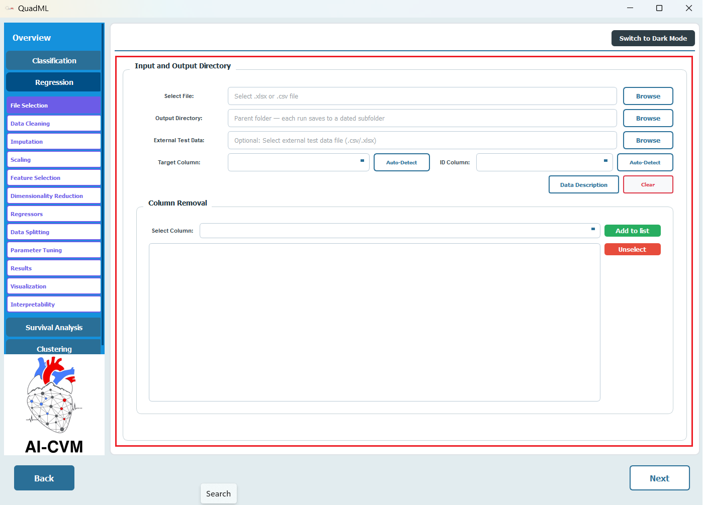
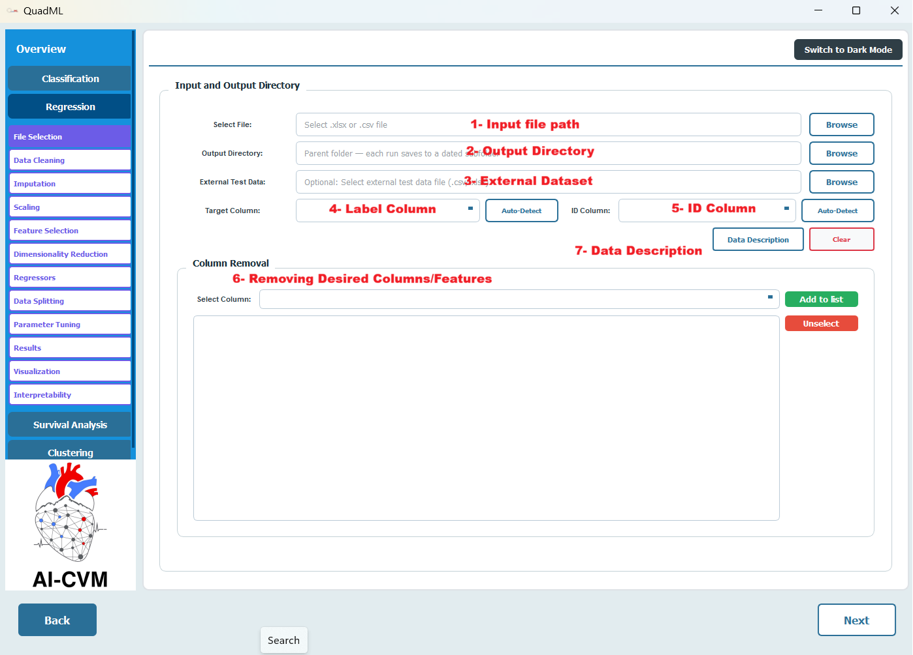

# Regression — File Selection

**Where**: Regression → **File Selection**

**Attention**: This is the first step. Nothing is written to the run folder until **Start Procedure** on Parameter Tuning.

## What you need

- A file with **.csv** or **.xlsx** format (first row = column names)
- A **numeric Target Column** (the continuous value to predict)
- A writable **Output Directory** (parent folder; each run creates a dated subfolder `YYYY-MM-DD_HH-MM-SS`)

See also [Prepare the data](../getting-started/07-prepare-the-data.md).

---

## What to click

### Input and Output Directory

1. **Select File → Browse** — choose the main dataset (`Select .xlsx or .csv file`).
2. **Output Directory → Browse** — choose a parent folder (`Parent folder — each run saves to a dated subfolder`).
3. Optionally **External Test Data → Browse** — second file with the **same feature columns** and the same numeric target column (required later if **Train on all data** is on).

### Label and ID

4. **Label Column** — select or type the numeric outcome; use **Auto-Detect** if the name is obvious (`target`, `y`, `label`, score names, …).
5. **ID Column** — optional record ID. Choose **No ID Column** to force synthetic IDs (`sample_1`, `sample_2`, …). Use **Auto-Detect** for common ID names.

There is **no Task Type** and **no Decision Threshold** in Regression (those are Classification-only).

### Column Removal and helpers

6. **Column Removal** — pick columns to exclude from modeling (**Add to list** / **Unselect**). Columns in the removal list are dropped when you start the procedure, not merely by listing them.
7. **Data Description** — after load, shows a pandas-style summary; can export CSV/Excel.
8. **Clear** — clears selected files and Output Directory so you can choose new ones.

---

## What is written to disk

Nothing yet. The dated run folder is created when you click **Start Procedure**.

---

## Common mistakes

- Starting without an **Output Directory**
- Using a categorical / class column as the target (use **Classification** instead)
- External test file with different column names than the main file
- Leaving ID-only columns in as features instead of setting **ID Column** or using **Column Removal**
