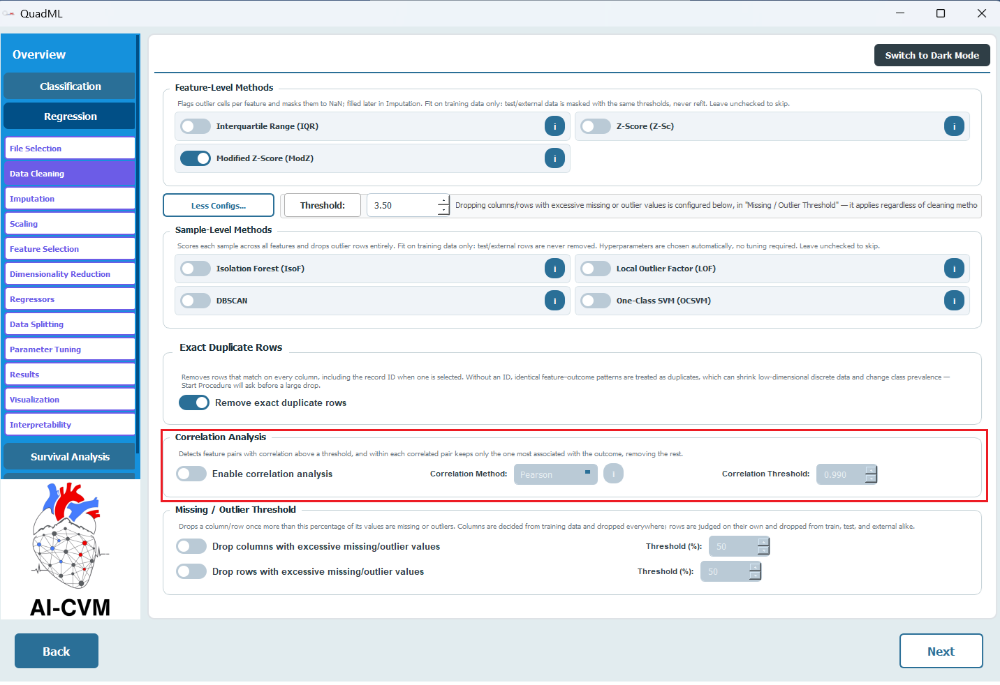
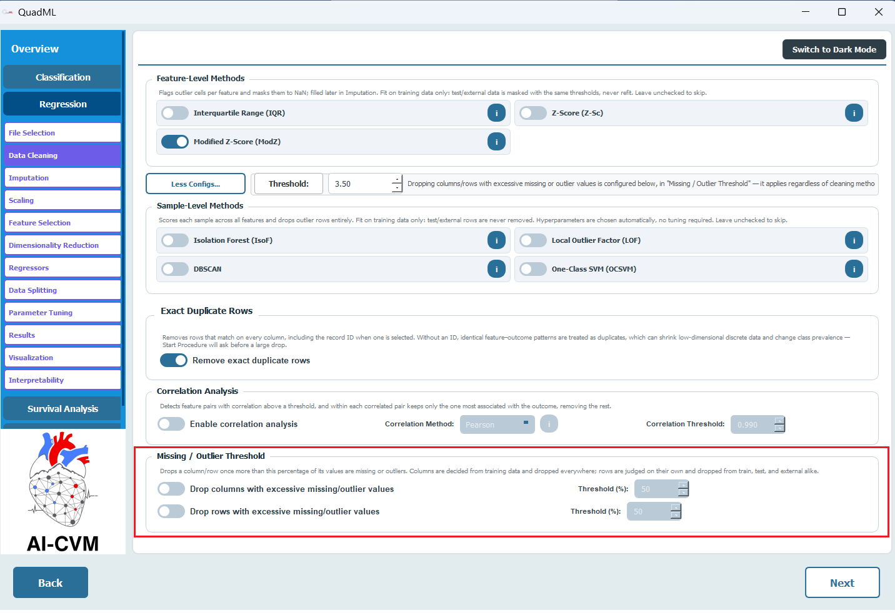

# Regression — Data cleaning

**Where**: Regression → **Data Cleaning**

Optional outlier handling and hygiene before modeling. Applied at **Start Procedure**.

--8<-- "_snippets/data-cleaning.md"

Feature-level methods mask outlier cells to NaN (filled later in Imputation); sample-level methods drop entire outlier rows:

**More Configs…** opens thresholds for the selected feature-level method (for example Modified Z-Score):

**Correlation Analysis** finds highly correlated feature pairs (Pearson or Spearman) and keeps the member of each pair that is more associated with the continuous target:

**Missing / Outlier Threshold** drops columns or rows whose share of missing or outlier values exceeds the percentage you set:

## Common mistakes

- Expecting the preview to change before **Start Procedure**
- Feature-level cleaning without Imputation for new NaNs
- Low correlation thresholds that drop many useful features
