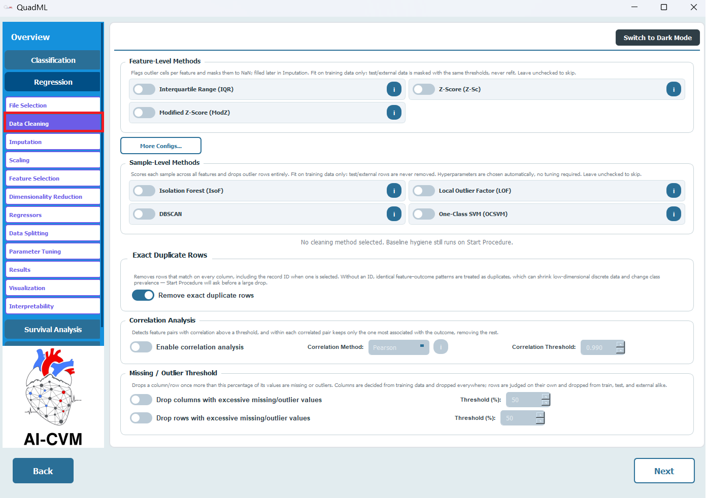

# Regression — Data cleaning

**Where**: Regression → **Data Cleaning**

Optional outlier handling and hygiene before modeling. Applied at **Start Procedure**.

--8<-- "_snippets/data-cleaning.md"

## Common mistakes

- Expecting the preview to change before **Start Procedure**
- Feature-level cleaning without Imputation for new NaNs
- Low correlation thresholds that drop many useful features
