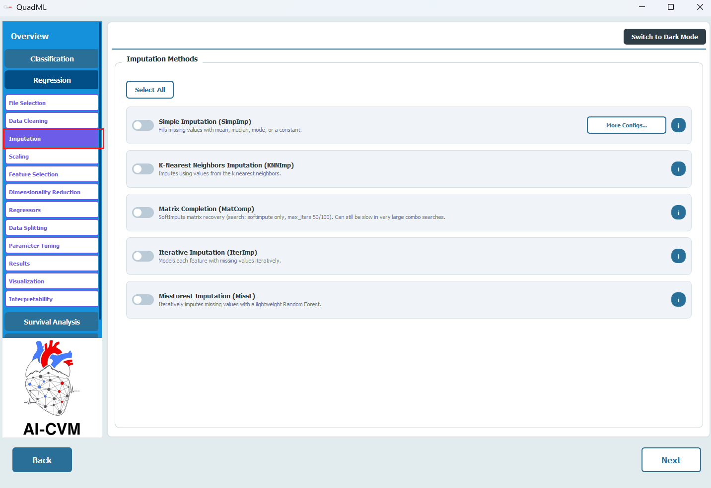
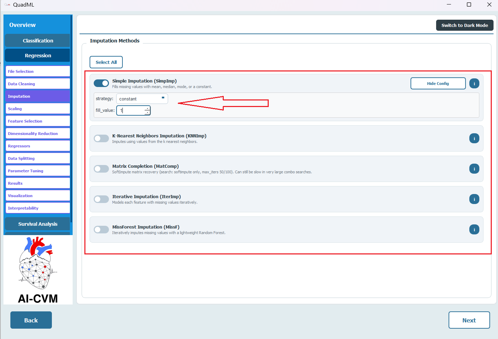

# Regression — Imputation

**Where**: Regression → **Imputation**

Fills missing feature values so every searched pipeline has complete inputs for scaling and modeling.

--8<-- "_snippets/imputation.md"

**More Configs…** on Simple Imputation opens the strategy options (for example constant fill):

## Common mistakes

- Checking every imputer with every scaler and model (product explosion)
- Assuming **mean** is the Simple Imputation default — QuadML default is **median**
- Feature-level cleaning without any imputer for the NaNs it creates
