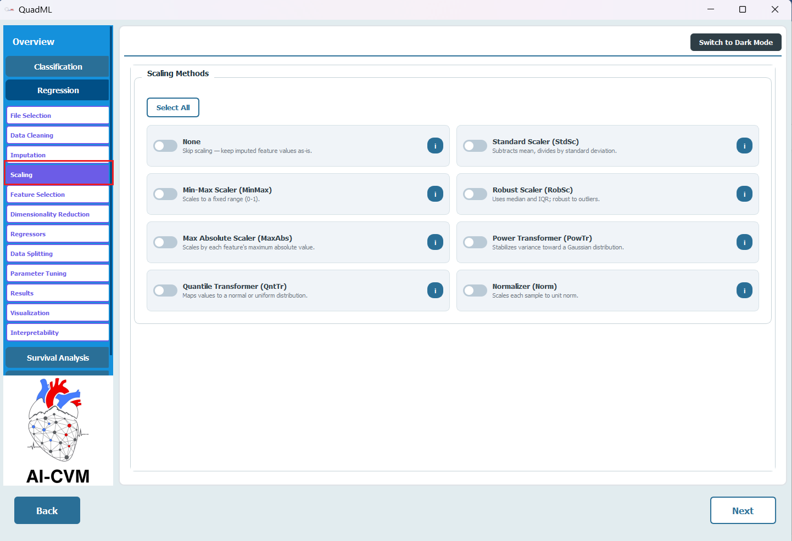

# Regression — Scaling

**Where**: Regression → **Scaling**

Rescales features before Feature Selection and Dimensionality Reduction. Linear models and SVR usually need scaling; many trees work with **None**.

--8<-- "_snippets/scaling.md"

## Common mistakes

- Linear / SVM-style models with only **None** on mixed-scale features
- Selecting every scaler on the first run
- Forgetting **None** when you want a tree-model baseline
