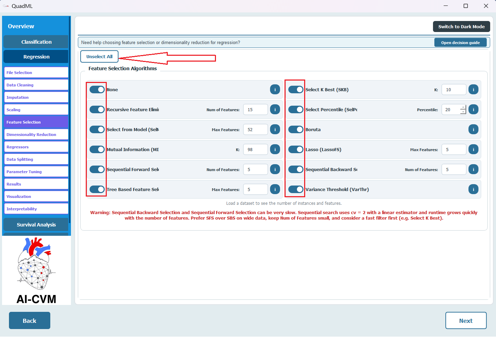
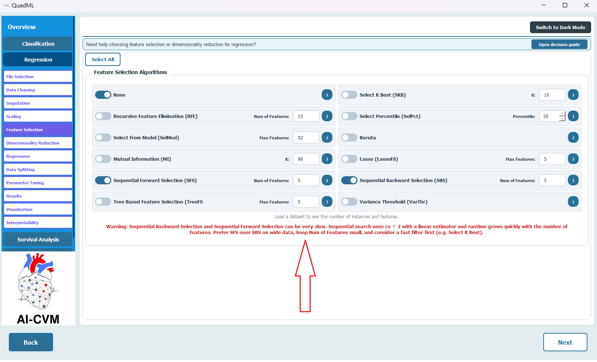
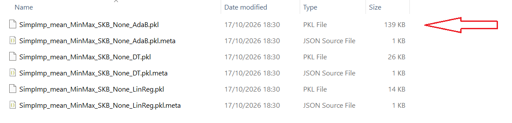

# Regression — Feature Selection

**Where**: Regression → **Feature Selection**

**Feature Selection** ranks or drops **original** feature columns so each searched pipeline can keep a subset (or all) of the predictors. It is crossed with every checked Dimensionality Reduction method on the next page (FS × DR). DR methods such as PCA are **not** chosen here — they belong on **Dimensionality Reduction**.

**None** means keep all eligible features after imputation and scaling (skip selection). On very wide datasets, prefer a filter (for example Select K Best) instead of **None** alone if run time becomes too large.

---

## Methods

| Method | Short form | Short idea |
|--------|------------|------------|
| **None** | None | Keep every eligible feature |
| **Select K Best** | SKB | Top *k* features by univariate score vs the target |
| **Recursive Feature Elimination** | RFE | Iteratively remove weakest features |
| **Select Percentile** | SelPct | Keep a percentage of top-scoring features |
| **Select from Model** | SelMod | Keep features important to a model |
| **Boruta** | Boruta | All-relevant selection via shadow features (`boruta` package) |
| **Mutual Information** | MI | Rank by mutual information with the target |
| **Lasso** | LassoFS | Shrinkage-based selection |
| **Variance Threshold** | VarThr | Drop near-constant features |
| **Sequential Forward Selection** | SFS | Greedy add features (can be slow) |
| **Sequential Backward Selection** | SBS | Greedy remove features (can be slow) |
| **Tree Based Feature Selection** | TreeFS | Importance from a tree model |

**Not shown in Regression FS** (DR page or other modes): PCA, ICA, Kernel PCA, LDA, Correlation Thresholding, Feature Agglomeration, Laplacian Score.

---

## What to click

1. Toggle the methods to include. Keep **None** as a baseline unless the feature count makes a full-feature search too expensive.
2. Click **?** / **i** on a method for a plain-language description and link.
3. Use **More Configs** where available (*k*, percentile, estimator, …).
4. Use **Select All** / **Unselect All** if needed — expect cost warnings for expensive methods.

Every selected Feature Selection method is crossed with every selected Dimensionality Reduction method (FS × DR).

**Warning:** Sequential Forward Selection (SFS) and Sequential Backward Selection (SBS) can be very slow. Prefer SFS over SBS on wide data, keep **Num of Features** small, and consider a fast filter first (for example Select K Best).

---

## What is written to disk

Selected-feature CSVs and the fitted selector live in the dated run folder. Interpretability **Load files** should use the selected-features CSVs that match the `.pkl`.

Pipeline filenames use the short forms from the list above (for example `SKB` for Select K Best) between scaling and the model name.

---

## Common mistakes

- Turning off **None** so you never see a full-feature baseline (when the dataset is small enough)
- Leaving **None** on with a very high feature count and a long model list
- Putting PCA on this page — it is on **Dimensionality Reduction**
- Loading Interpretability files from a different run or combination than the model `.pkl`
- Enabling SFS/SBS with a large feature budget on the first smoke run
