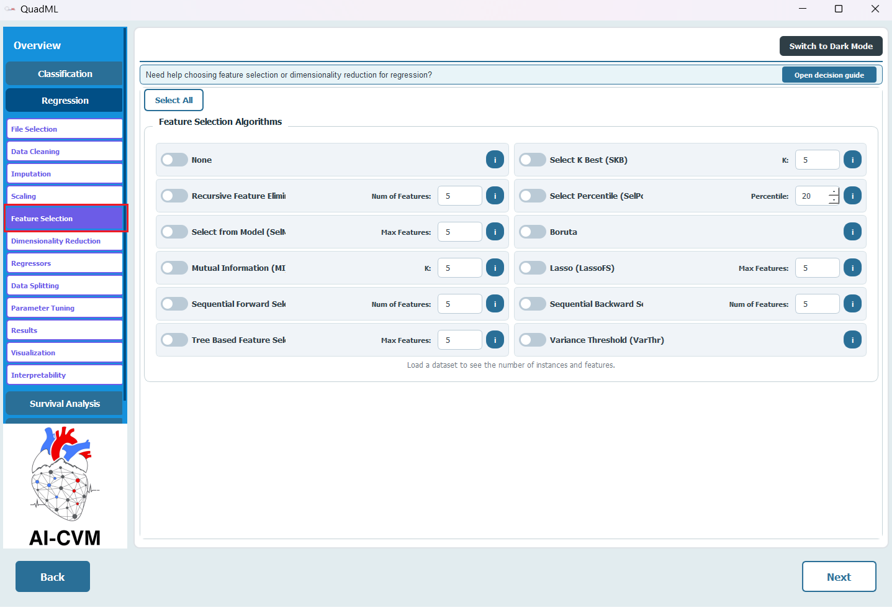

# Regression — Feature selection

**Where**: Regression → **Feature Selection**

Ranks or drops original predictors against the numeric target. Crossed with DR (FS × DR).

--8<-- "_snippets/feature-selection.md"

**Regression note:** Supervised / filter selectors target the continuous outcome. PCA belongs on Dimensionality Reduction.

Method cards and per-method settings (for example *k*, percentile, or max features):

**Unselect All** and the in-app warning about slow Sequential Forward/Backward search:

## Common mistakes

- Turning off **None** when you still want a full-feature baseline
- Enabling SFS/SBS with a large feature budget on a smoke run
- Confusing this step with PCA (that is Dimensionality Reduction)
