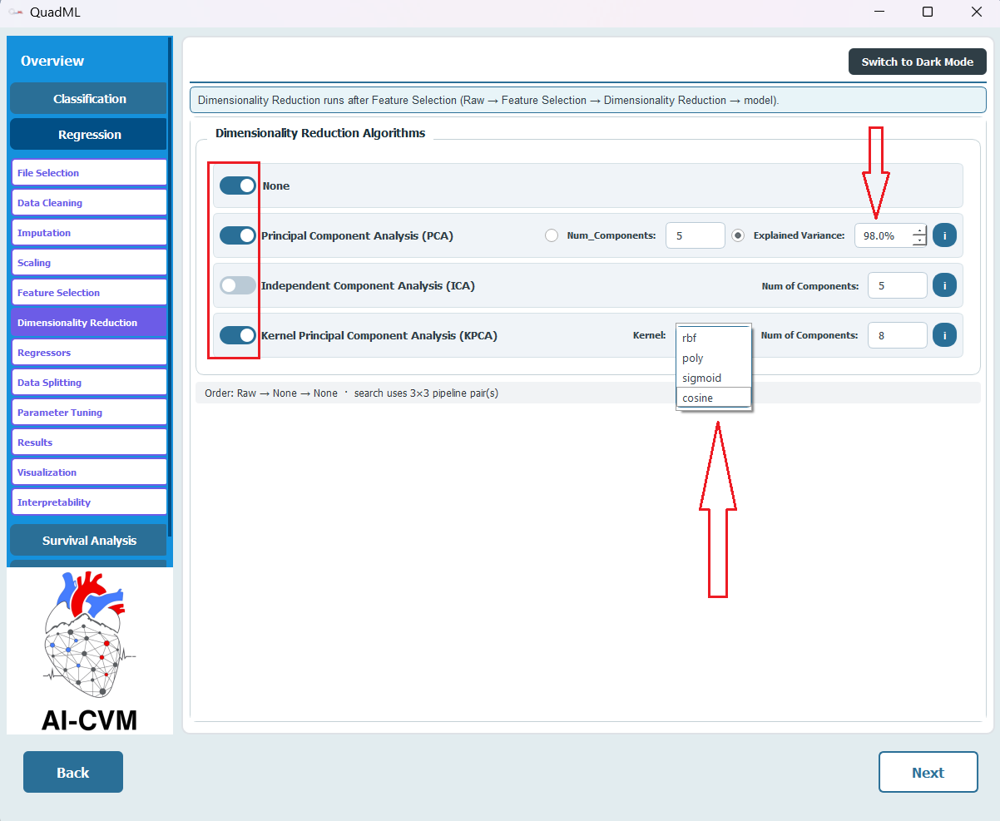

# Regression — Dimensionality Reduction

**Where**: Regression → **Dimensionality Reduction**

**Dimensionality Reduction (DR)** compresses the features that remain **after** Feature Selection into a smaller space (or leaves them unchanged). Order in the pipeline is: `Raw → Feature Selection → Dimensionality Reduction → Regressor`. Every checked FS method is crossed with every checked DR method (FS × DR).

**None** means no extra projection for that pipeline branch. **LDA is not available** in Regression (Classification-only).

---

## Methods

| Method | Short form | Notes |
|--------|------------|--------|
| **None** | None | Skip DR; keep the post–Feature Selection columns |
| **Principal Component Analysis** | PCA | Unsupervised linear components; set **Num_Components** or **Explained Variance** |
| **Independent Component Analysis** | ICA | Unsupervised independent components |
| **Kernel Principal Component Analysis** | KPCA | Nonlinear kernel PCA (for example rbf, poly, sigmoid, cosine) |

Every FS × DR pair is legal in Regression. If you leave DR empty, the search defaults that step to **None**.

For a first run, keep **None** (and add PCA only if you already know you want components).

---

## What to click

1. Toggle the DR methods to include. Prefer **None** unless you intend to search compressed spaces.
2. Click **i** for method notes, defaults, and library links.
3. Use the on-card controls where shown (number of components, explained variance for PCA, kernel for KPCA).

---

## What is written to disk

Component transformers are stored with each combination’s pipeline (`.pkl`). Results labels use `PCA`, `ICA`, `KPCA`, or `No DR`.

When DR is **None**, Interpretability can show original (pre-scale) feature names on some plots while the model still uses scaled inputs. After PCA / ICA / KPCA, explanations use the **compressed component** space.

---

## Common mistakes

- Looking for **LDA** in Regression (it is Classification-only)
- Selecting many DR methods on the first run without **None**
- Confusing Feature Selection (rank/drop original columns) with DR (project into components)
