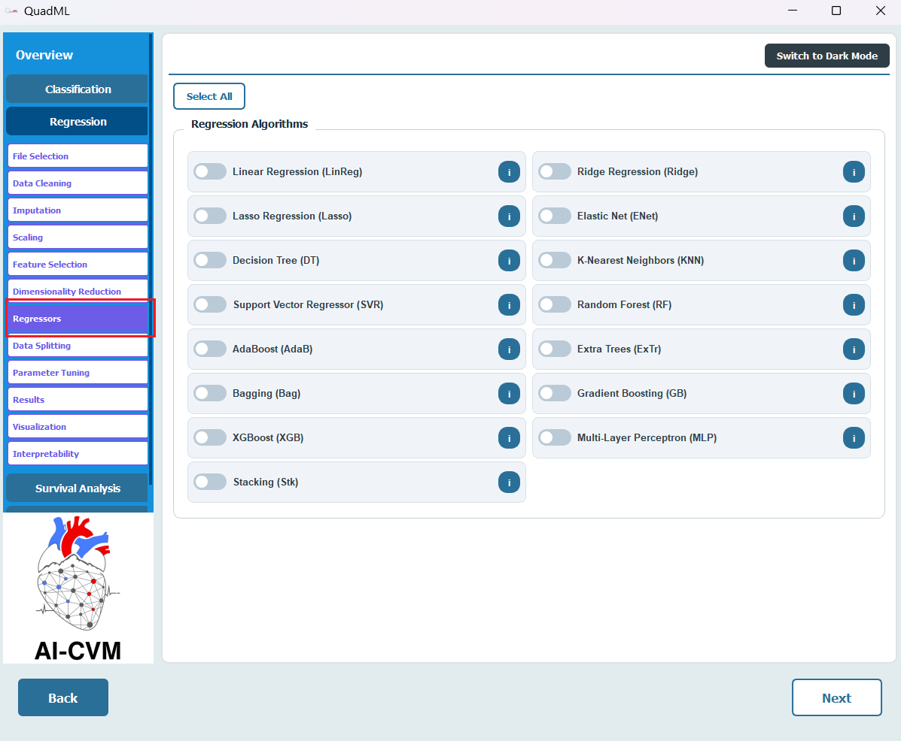

# Regression — Regressors

This step picks the **regression algorithms** that map features to a continuous target. Each checked regressor is trained and evaluated as part of the search; hyperparameters for those models are explored later on **Parameter Tuning**, not typed by hand here.

Every selected regressor is crossed with every Imputation × Scaling × Feature Selection × Dimensionality Reduction combination you enabled earlier, so the total number of pipelines is a product of those choices.

## Regressors

| Regressor | How it works | Short code |
|-----------|--------------|------------|
| **Linear Regression** | Fits a linear combination of features to the target | LinReg |
| **Ridge Regression** | Linear model with L2 shrinkage | Ridge |
| **Lasso Regression** | Linear model with L1 shrinkage (can zero coefficients) | Lasso |
| **Elastic Net** | Linear model with a mix of Lasso and Ridge penalties | ENet |
| **Decision Tree** | A series of yes/no rules on the features | DT |
| **K-Nearest Neighbors** | Predicts from the most similar rows in the training data | KNN |
| **Support Vector Regressor** | Finds a margin-based fit in feature space | SVR |
| **Random Forest** | Averages many decision trees on random subsets | RF |
| **Extra Trees** | Like Random Forest, with more randomly chosen splits | ExTr |
| **Bagging** | Averages many copies of a model on resampled data | Bag |
| **AdaBoost** | Builds models one after another, focusing on mistakes | AdaB |
| **Gradient Boosting** | Builds trees sequentially, each correcting previous errors | GB |
| **XGBoost** | Optimized, regularized gradient boosting | XGB |
| **Multi-Layer Perceptron** | A small neural network | MLP |
| **Stacking** | Combines several models with a final model | Stk |

**Tip:** Runtime grows with every option selected. **Stacking** and **Multi-Layer Perceptron** are much slower.

## Common mistakes

- Enabling every regressor plus every imputer / scaler / FS / DR method
- Expecting Stacking or MLP to finish as fast as Linear Regression
