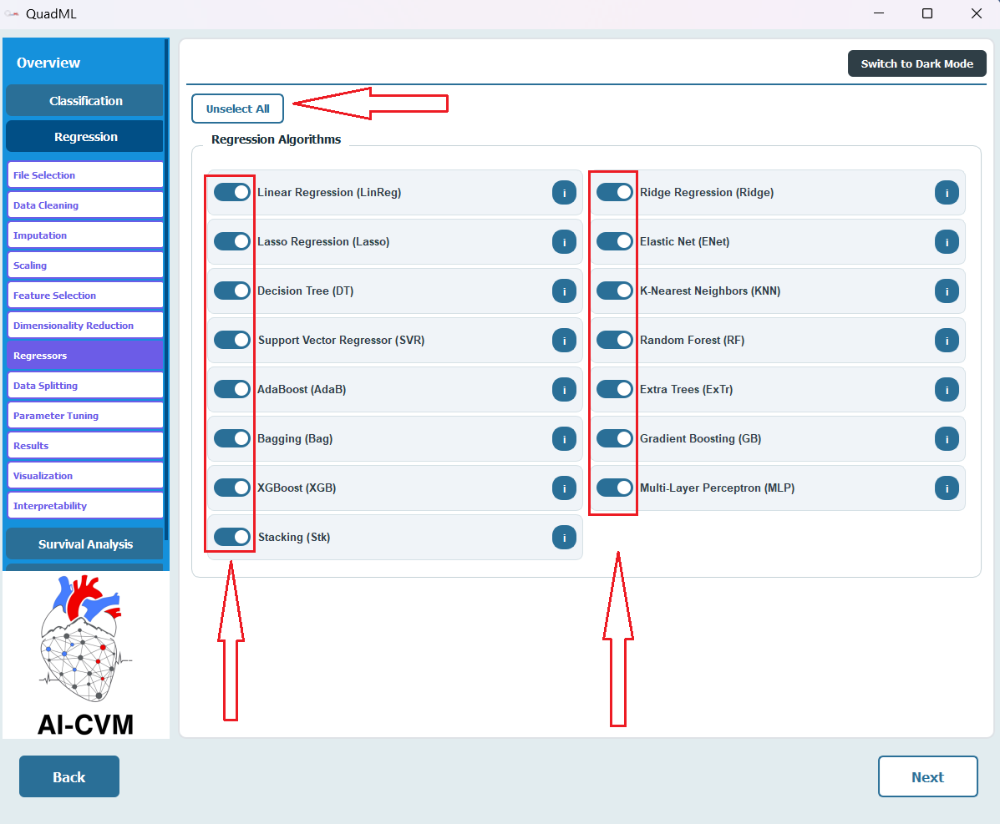

# Regression — Regressors

**Where**: Regression → **Regressors**

**Regressors** are the models that predict the numeric **Target Column**. Check one or more models; each checked model is crossed with every Imputation × Scaling × Feature Selection × Dimensionality Reduction combination you enabled earlier. Hyperparameters are explored later on **Parameter Tuning** (Grid or Random Search), not typed by hand as the main workflow on this page.

Linear models and **SVR** usually need Scaling; many tree ensembles can work with **None** scaling. For a first run, two or three models is enough (for example **Linear Regression** + **Random Forest**).

---

## Models (GUI names)

| GUI name | Short code on Results |
|----------|----------------------|
| Linear Regression | LinReg |
| Ridge Regression | Ridge |
| Lasso Regression | Lasso |
| Elastic Net | ENet |
| Decision Tree | DT |
| K-Nearest Neighbors | KNN |
| Support Vector Regressor | SVR |
| Random Forest | RF |
| AdaBoost | AdaB |
| Extra Trees | ExTr |
| Bagging | Bag |
| Gradient Boosting | GB |
| XGBoost | XGB |
| Multi-Layer Perceptron | MLP |
| Stacking | Stk |

Stacking and MLP are typically slower than Linear Regression or a small Random Forest.

---

## What to click

1. Toggle models to include (or **Select All** / **Unselect All**).
2. Click **i** on a card for how the method works in QuadML, search notes, and a library link.
3. Continue to **Data Splitting** and **Parameter Tuning** to set the split and start the search.

---

## What is written to disk

Fitted regressors live inside saved pipelines (`.pkl`) under the dated run folder, named by combination (including short codes for earlier steps and the model).

---

## Common mistakes

- Enabling every regressor plus every imputer / scaler / FS / DR method on a large dataset — the product grows multiplicatively
- Expecting **Stacking** or **MLP** to finish as fast as Linear Regression
- Running linear models or SVR with **None** scaling only when feature ranges differ a lot
