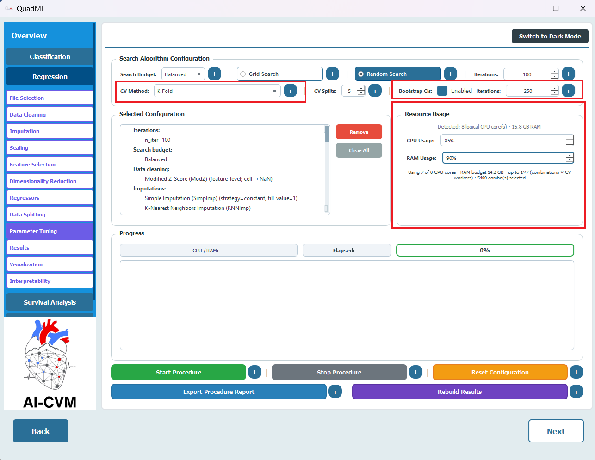
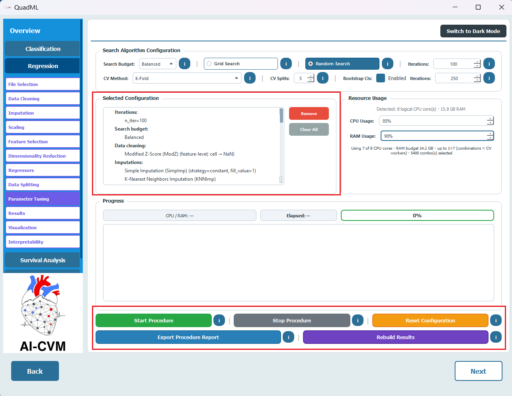

# Regression — Parameter tuning

**Where**: Regression → **Parameter Tuning**

Sets search budget and algorithm, then starts the run. No Imbalance Handling or Stratified K-Fold for regression task.

--8<-- "_snippets/search-run.md"

Selected configuration tree and **Start** / **Stop** / **Reset** / **Export** / **Rebuild Results**:

--8<-- "_snippets/start-stop-resources.md"

**Tip:** Check the configuration tree before Start. Use **Fast** or **Balanced** for first runs.

## Common mistakes

- Starting with every method checked — combination count is a product
- Ignoring Resource Usage on large searches
- Changing File Selection roles after configuring without re-checking the tree
- Closing the app instead of **Stop**
- Setting CPU/RAM to 100% on a machine you still need for other work
- Starting again without noticing a new dated folder was created
