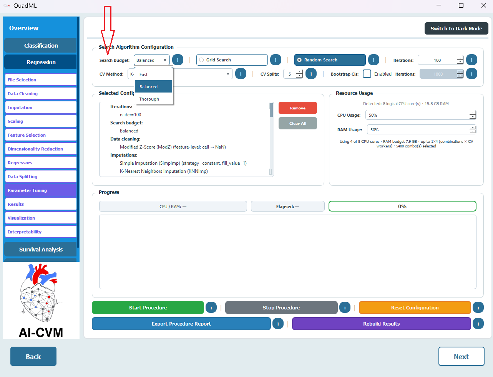

# Regression — Parameter Tuning

**Where**: Regression → **Parameter Tuning**

On **Parameter Tuning** you set the search budget, algorithm, and cross-validation, then start the combinatorial run over the Imputation × Scaling × Feature Selection × Dimensionality Reduction × Regressor choices from the earlier steps. There is **no** Imbalance Handling panel and **no** Stratified K-Fold (those are Classification-oriented).

---

## What to click

### Search controls

1. **Search Budget:** Fast / Balanced / Thorough — scales Random Search `n_iter` and suggested CV folds. It does **not** remove methods you already checked.
2. **Search algorithm:** **Grid Search** or **Random Search** (Random Search has **Iterations** / `n_iter`).
3. **Cross-validation** method and number of splits (used inside Train). Typical Regression choices include **K-Fold** and **Shuffle Split** — not stratified class folds.

For a first run, **Fast** or **Balanced** with Random Search is enough.

### Bootstrap CIs and resources

4. Optional **Bootstrap CIs** — 95% percentile intervals on scalar metrics (MAE, RMSE, R², …). Enable here and re-run; QuadML resamples the evaluation split and reuses stored predictions (does not refit models). Residual plots stay point-only.
5. **Resource Usage:** CPU % and RAM % (default 50 / 50).

### Configuration tree and run

6. Review the **selected configuration** tree (every imputer × scaler × FS × DR × regressor you checked).
7. **Start Procedure** — reads data, cleans, searches, writes **`Final_Results.csv`**.
8. **Stop Procedure** — cancels; partial combo results may remain.
9. If the procedure stops or crashes mid-run, click **Rebuild Results** to rebuild `Final_Results.csv` from finished `combo_results/*.json` files.
10. Other actions as labeled: **Reset Configuration**, **Export Procedure Report**, **Rebuild Results**.

In the **Progress** card you can see combinations running or finishing, the progress bar, and live CPU/RAM information.

Click **i** next to Start Procedure, search budget, CV, and bootstrap for the in-app wording.

---

## What is written to disk

In the dated run folder under your **Output Directory**:

- `Final_Results.csv` — one row per pipeline combination
- `combo_results/` JSON (can rebuild the CSV if a run is interrupted)
- Fitted pipelines (`.pkl`), prepared data, plot caches
- Procedure report (if exported)

---

## Common mistakes

- Starting with every method checked — combination count is a product
- Looking for Imbalance Handling or Stratified K-Fold (Classification-oriented)
- Changing File Selection columns after a long configure pass without checking the tree
- Closing the app instead of **Stop Procedure** when you need an orderly cancel
