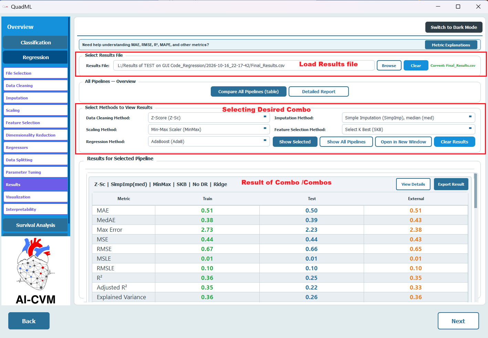
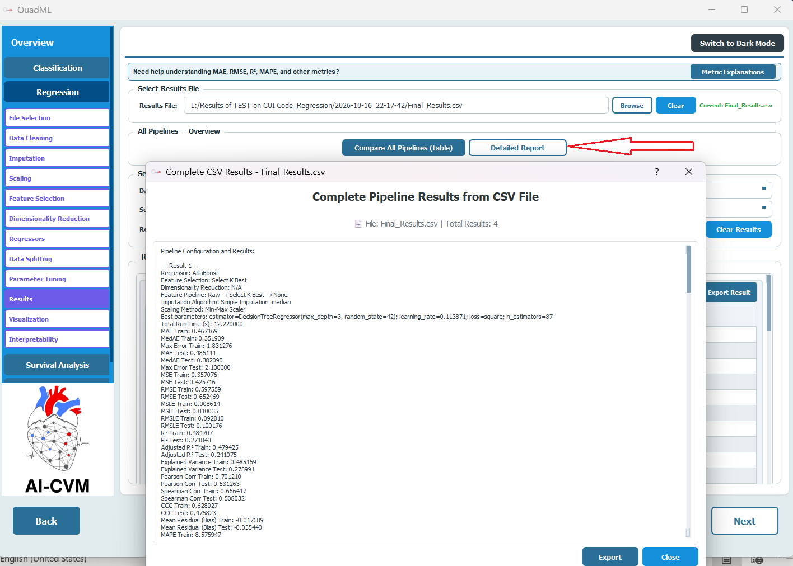
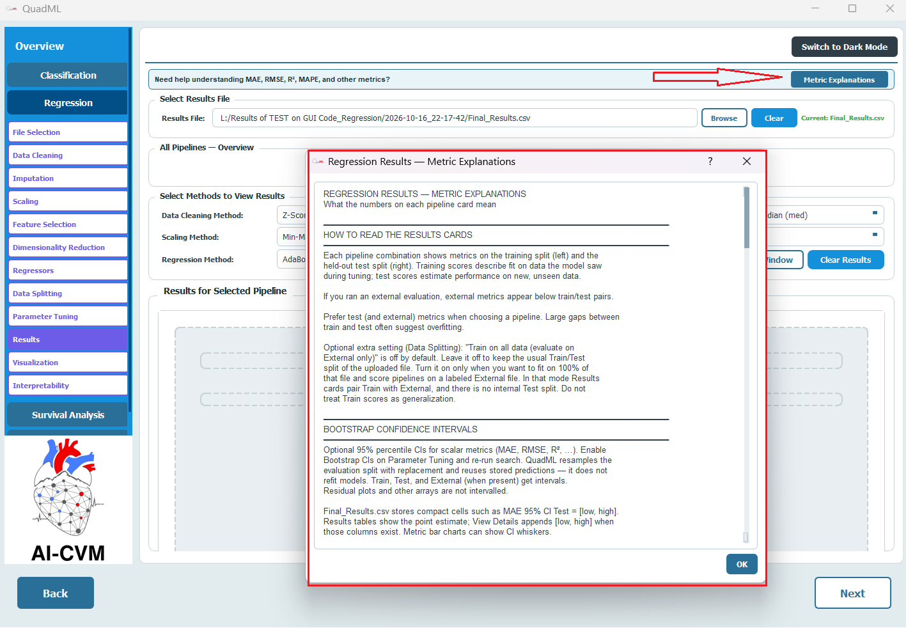

# Regression — Results

**Where**: Regression → **Results**

After **Start Procedure** finishes, **Results** loads `Final_Results.csv` from the dated run folder and shows each searched pipeline combination with its Train and Test metrics (or External metrics when Train on all data is on), so you can compare, filter, and open detailed reports. You can also **Browse** an older run folder that already contains `Final_Results.csv` (or combo JSON) to reload and inspect previous results without starting a new search.

---

## What to click

1. Confirm the results file. QuadML looks for **`Final_Results.csv`** in the run folder. You can **Browse** another folder that contains that CSV or combo JSON.
2. Read the pipeline cards: **Train** on the left, **Test** on the right (or **External** when Train-on-all-data is on).
3. Click **Metric Explanations** on the top bar for the full, in-app metric text.
4. Use overview actions as labeled, for example:
   - **Compare All Pipelines (table)**
   - **Detailed Report**
   - **Show Selected** / **Show All Pipelines** / **Open in New Window** / **Clear Results**
5. Filter by cleaning, imputation, scaling, feature selection, DR, and regressor as shown on the page.

---

## How to read metrics (summary)

- Prefer **Test** (or **External** in train-on-all mode) when choosing a pipeline.
- Large Train vs Test gaps often mean overfitting.
- Do not treat Train scores as generalization.

### Core metrics (names as in the app)

**Lower is better:** MAE, MedAE, Max Error, MSE, RMSE, MSLE, RMSLE, MAPE, sMAPE.

**Higher is better:** R², Adjusted R², Explained Variance, Pearson Corr, Spearman Corr, CCC.

**Near zero is ideal:** Mean Residual (Bias) — the sign shows systematic over- vs under-prediction.

Optional **Bootstrap CIs** (if enabled on Parameter Tuning) appear as intervals on scalar metrics; residual plots stay point-only.

For full definitions and the quick comparison guide, open **Metric Explanations** in the app.

| Goal | Metrics to prioritize |
|------|------------------------|
| Interpretable error in target units | MAE, MedAE, RMSE |
| Penalize large outliers | RMSE, MSE |
| Scale-free comparison | R², Adjusted R² |
| Agreement + calibration | CCC |
| Relative error | MAPE, sMAPE |

---

## What is written to disk

You are reading files already written by the search (`Final_Results.csv`, combo JSON, pipelines). Export extra CSV or report files from the Results buttons if you need a copy elsewhere.

---

## Common mistakes

- Opening a `Final_Results.csv` from a different mode (for example Classification) or an older run
- Picking the highest Train R² while Test error is poor
- Comparing R² across different target scales as if they were absolute quality
- Treating MAPE / sMAPE as reliable when the target is near zero
