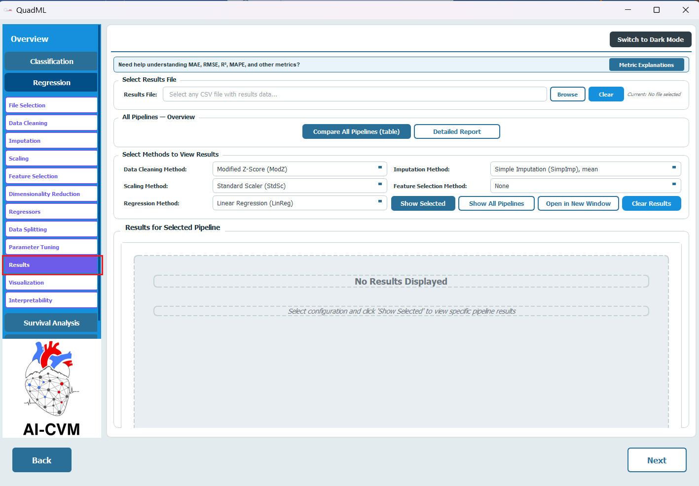

# Regression — Metrics

**Where**: Regression → **Results**

Compare searched pipelines using Train / Test (or External) metrics. Prefer **Test** or **External**.

--8<-- "_snippets/results-usage.md"

## Error metrics (lower is better)

| Metric | What it means | Better |
|--------|---------------|--------|
| MAE | Mean absolute error in target units | Lower |
| MedAE | Median absolute error (robust to outliers) | Lower |
| RMSE | Root mean squared error (penalizes large errors) | Lower |
| MSE | Mean squared error | Lower |
| MAPE / sMAPE | Relative / symmetric percentage error | Lower |
| Max Error | Worst single absolute residual | Lower |

## Fit / agreement (higher is better, unless noted)

| Metric | What it means | Better |
|--------|---------------|--------|
| R² | Variance explained (can be negative if worse than mean) | Higher |
| Adjusted R² | R² with a complexity penalty | Higher |
| Explained Variance | Similar to R² without bias term | Higher |
| Pearson / Spearman Corr | Correlation of predictions with the target | Higher |
| CCC | Concordance correlation (agreement + calibration) | Higher |
| Mean Residual (Bias) | Average signed error | Near **zero** |

Open **Metric Explanations** in the app for full definitions. Large Train vs Test gaps often mean overfitting.

## Common mistakes

- Comparing runs from different Output Directory dated folders without noting File Selection changes
- Expecting Bootstrap CI columns when Bootstrap was off for that run
- Opening a `Final_Results.csv` from a different mode
- Picking by Train metrics while held-out scores are poor
