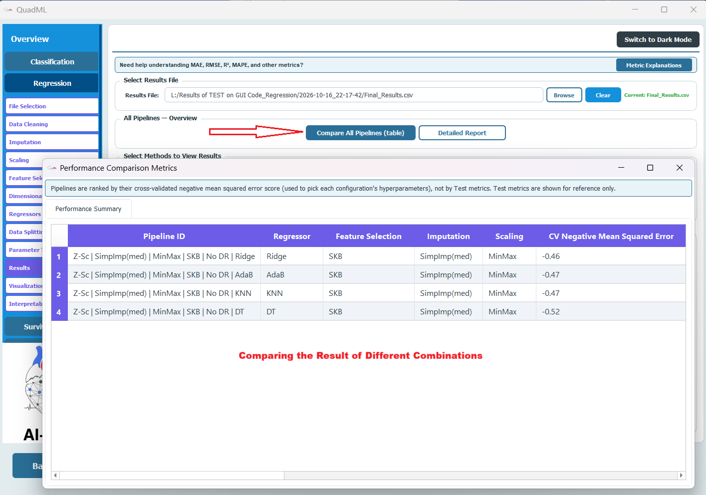

# Regression — Metrics

Shows Train / Test (or External) scores for every searched pipeline after **Start Procedure** (or **Rebuild Results**). Load `Final_Results.csv` from the output run folder, then filter by cleaning, imputation, scaling, feature selection, dimensionality reduction, and regression model to open the metric cards. You see error metrics in target units (**MAE**, **MedAE**, **RMSE**, **MSE**, **MAPE** / **sMAPE**, **Max Error**) and fit / agreement metrics (**R²**, **Adjusted R²**, **Explained Variance**, **Pearson** / **Spearman**, **CCC**, **Mean Residual**). Prefer held-out **Test** or **External** scores when choosing a model; check error in target units first, then R² / correlation among pipelines with acceptable error—do not rank by R² alone when residuals or bias matter. Open **Metric Explanations** in the app for full definitions.

--8<-- "_snippets/results-usage.md"

Browse or confirm `Final_Results.csv` for the output run folder, then filter pipelines and open Train / Test / External metrics:

**Compare All Pipelines (table)** ranks configurations by CV score (Test metrics are for reference):

**Detailed Report** opens the full CSV-style metric view for a pipeline:

## Error metrics (lower is better)

| Metric | What it means | Better |
|--------|---------------|--------|
| MAE | Mean absolute error in target units | Lower |
| MedAE | Median absolute error (robust to outliers) | Lower |
| RMSE | Root mean squared error (penalizes large errors) | Lower |
| MSE | Mean squared error | Lower |
| MAPE / sMAPE | Relative / symmetric percentage error | Lower |
| Max Error | Worst single absolute residual | Lower |

## Fit / agreement (higher is better, unless noted)

| Metric | What it means | Better |
|--------|---------------|--------|
| R² | Variance explained (can be negative if worse than mean) | Higher |
| Adjusted R² | R² with a complexity penalty | Higher |
| Explained Variance | Similar to R² without bias term | Higher |
| Pearson / Spearman Corr | Correlation of predictions with the target | Higher |
| CCC | Concordance correlation (agreement + calibration) | Higher |
| Mean Residual (Bias) | Average signed error | Near **zero** |

Prefer held-out **Test** / **External** scores; large Train vs Test gaps often mean overfitting. When prediction error in target units matters, check MAE / RMSE / MedAE first, then R² / CCC among acceptable rows. Open **Metric Explanations** in the app for full definitions.

## Common mistakes

- Comparing runs from different Output Directory dated folders without noting File Selection changes
- Expecting Bootstrap CI columns when Bootstrap was off for that run
- Opening a `Final_Results.csv` from a different mode
- Picking by Train metrics while held-out scores are poor
