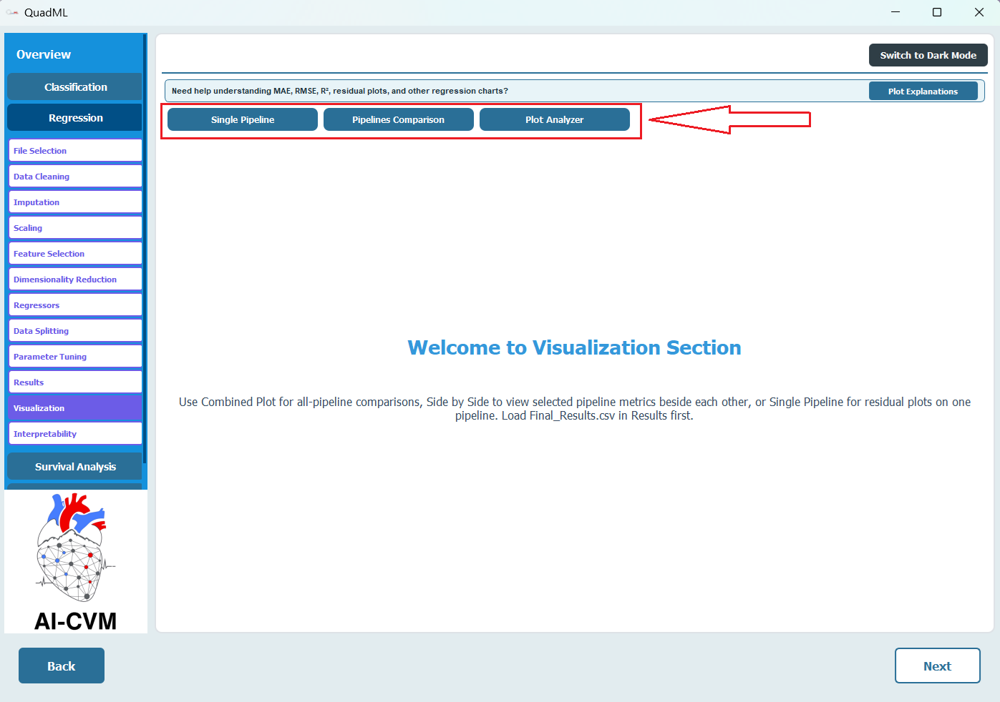
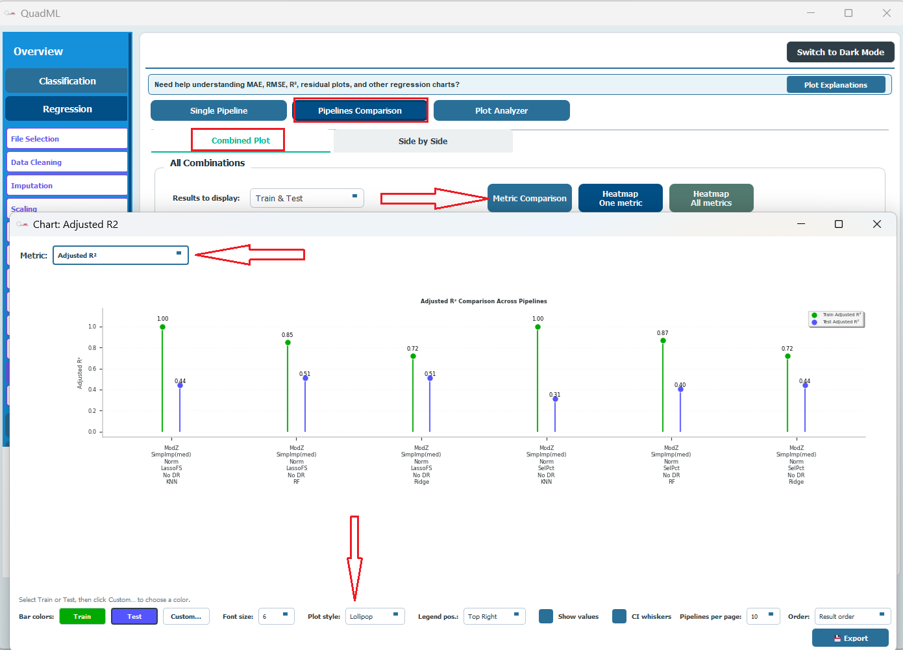
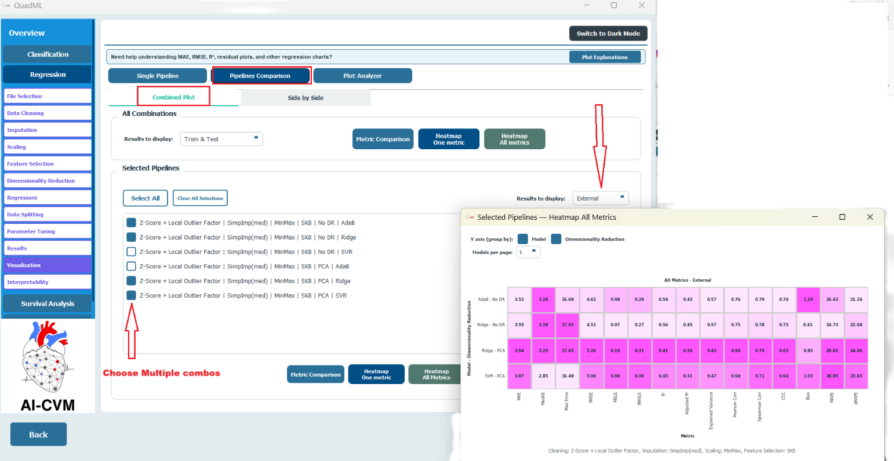
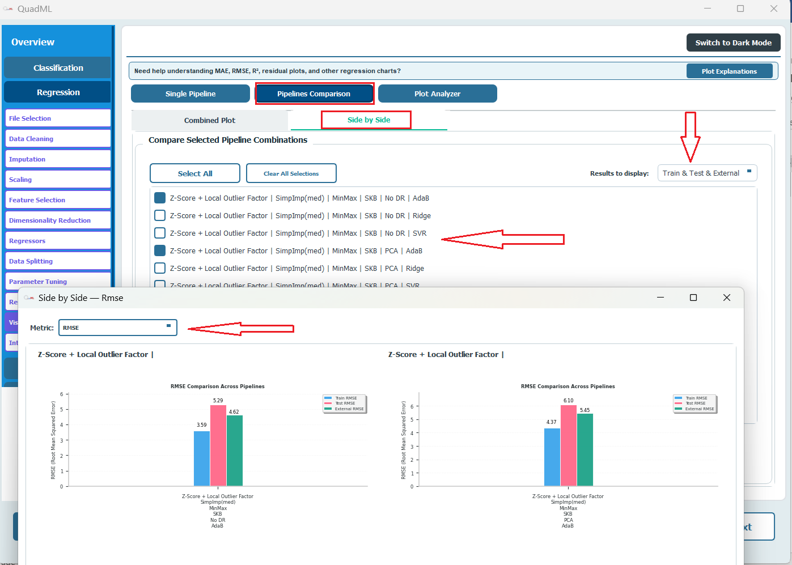
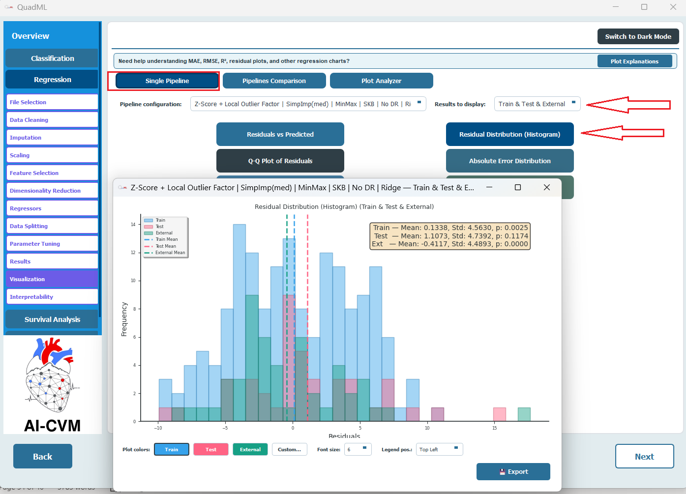
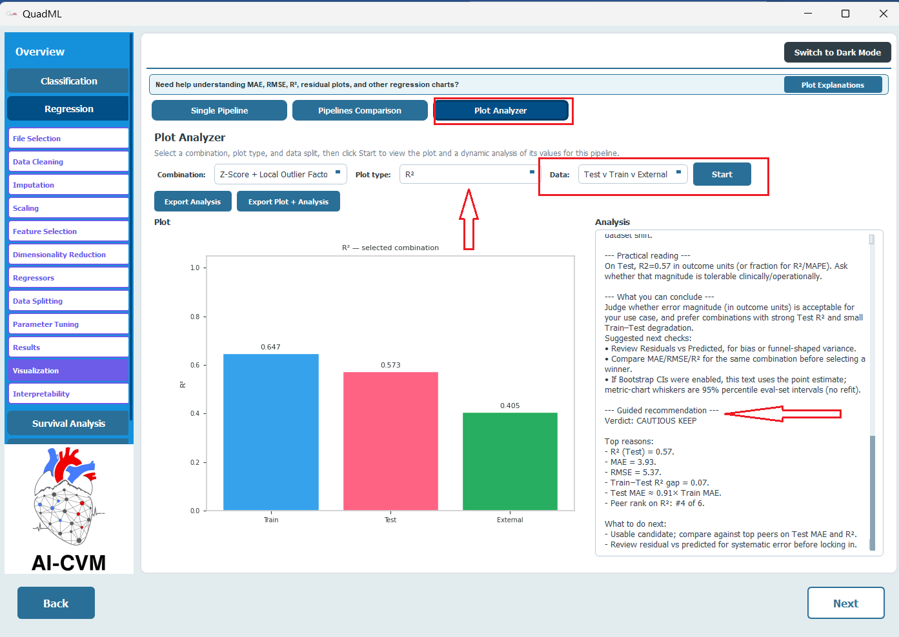

# Regression — Visualization

**Where**: Regression → **Visualization**

**Visualization** turns the finished search into plots. Load **`Final_Results.csv`** in **Results** first; charts read metrics and saved plot data from that dated run folder. Prefer **Test** or **External** when judging generalization (Train plots alone are not enough).

---

## What to click

1. Choose which results to display (**Train**, **Test**, **External**, or combined splits).
2. Open charts from the available groups (all pipelines, compare selected, or one pipeline).
3. Click **Plot Explanations** on the top bar for the full in-app plot text.
4. Use **Analyze** (Plot Analyzer) on a figure for a structured reading of the current plot.
5. Where shown, use Plot style (Bar / Lollipop / Dot) and CI whiskers for metric charts.

---

## Chart groups (what you will find)

### Performance metric charts (many pipelines)

These charts summarize **all** (or many) searched pipelines at once, so you can rank combinations before shortlisting.

| Chart | What it shows |
|-------|----------------|
| Single-metric plots | One scalar metric across pipelines — for example MAE, RMSE, R², MAPE (and related metrics offered in the GUI) |
| Metrics comparison / overlays | Several pipelines or metrics together |
| Heatmaps (where offered) | Metric values across preprocessing × regressor grids |

### Compare selected pipelines

These use the same chart families as the all-pipelines performance views, but only for pipelines you add to the **comparison list** — typically a short shortlist from Results. Use Compare Selected / Pipelines in One Plot when you want side-by-side or overlay views of a few finalists without the full search clutter.

### One-pipeline diagnostic plots

These charts focus on a **single** selected pipeline (not the full search or the comparison list). Choose Train, Test, External, or combined panels; prefer Test when judging generalization.

| Plot | What it shows |
|------|----------------|
| Residuals vs Predicted | Residual cloud vs predicted values ŷ (core fit diagnostic) |
| Residual Distribution (histogram) | Spread of residuals, often with a normal overlay |
| Q-Q Plot of Residuals | Sample vs theoretical quantiles (normality check) |
| Prediction Error Distribution | Histogram of absolute errors \|y − ŷ\| |

---

## Analyzing plots

To decide whether a chart looks acceptable or should be rejected, use **Plot Analyzer** on the open figure for a structured reading.

---

## Bootstrap CI whiskers

Metric bar / lollipop / dot charts can show 95% bootstrap CIs when Parameter Tuning had Bootstrap CIs enabled. Heatmaps and residual diagnostic plots stay point-only.

---

## Quick guide — which plot to open

| Goal | Start with |
|------|------------|
| Rank many pipelines | MAE / RMSE / R² charts |
| Shortlist finalists | Compare Selected / Pipelines in One Plot |
| Check fit assumptions | Residuals vs Predicted, Q-Q |
| Error magnitude | Absolute error distribution, MAE chart |
| Relative error reporting | MAPE chart |

For full plot wording, use **Plot Explanations** in the app. Metric definitions stay under Results → **Metric Explanations**.

---

## Common mistakes

- Comparing plots from two different dated run folders
- Reading a Train residual plot as performance on new data
- Missing External plots when External evaluation was never enabled
- Ranking pipelines on Train MAE / R² alone when Test is available
