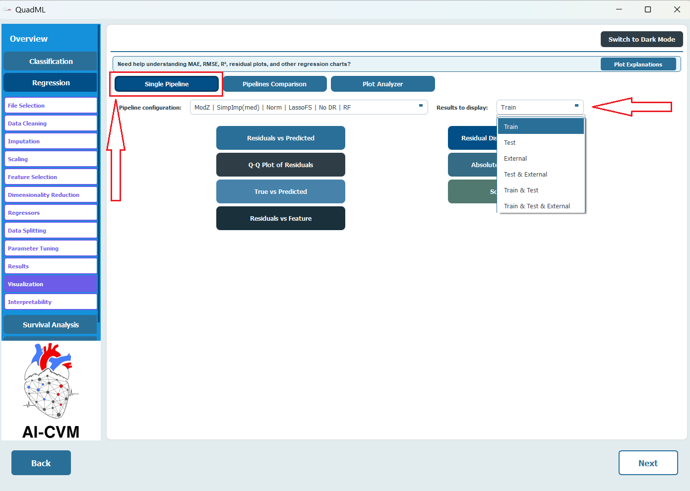
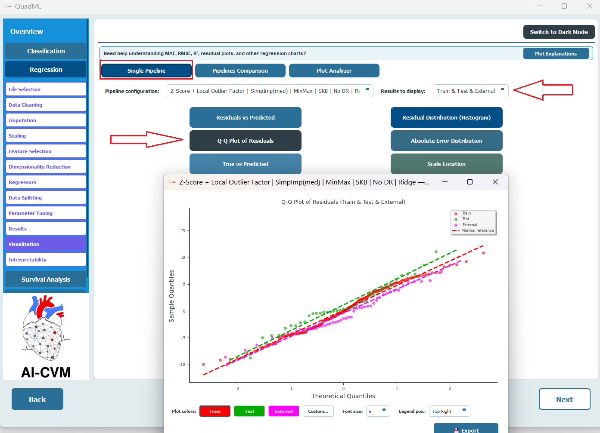
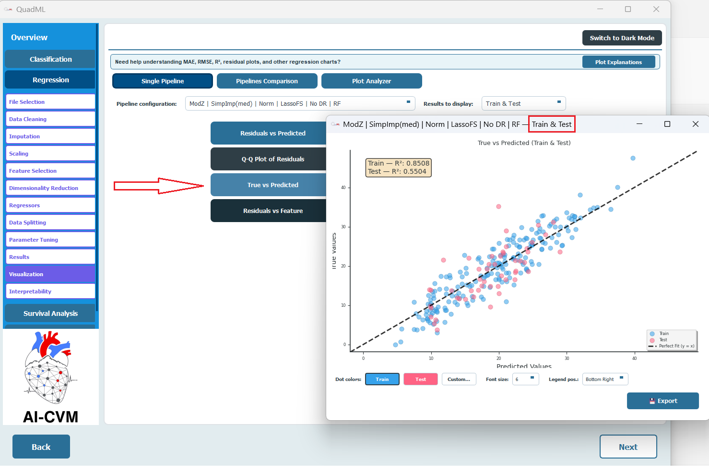
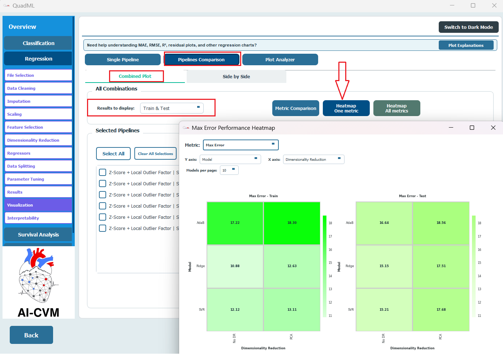

# Regression — Visualization

Shows residual and fit charts for the pipelines you already scored on **Results**, error diagnostics, agreement with the target, and metric comparisons across combinations. Load `Final_Results.csv` in **Results** first, then open **Visualization** and choose **Single Pipeline** (one configuration’s residual plots), **Pipelines Comparison** (MAE / RMSE / R² bars and heatmaps across combinations), or **Plot Analyzer**. Prefer **Test** or **External** when judging generalization. You can plot residuals vs predicted, residual and absolute-error distributions, Q–Q plots, true vs predicted, scale-location, and residuals vs a chosen feature. Use **Plot Explanations** and **Analyze** for in-app help.

--8<-- "_snippets/visualization-usage.md"

Choose **Single Pipeline**, **Pipelines Comparison**, or **Plot Analyzer**:

**Single Pipeline** pick a pipeline and set **Results to display** (prefer **Test** or **External**):

## Residual diagnostics

| Plot | What it shows |
|------|----------------|
| Residuals vs Predicted | Structure or bias in errors |
| Residual Distribution | Spread of residuals (histogram) |
| Q–Q Plot of Residuals | Residuals vs a normal reference |
| Absolute Error Distribution | Spread of absolute prediction errors |
| Scale-Location | √\|standardized residuals\| vs predicted (heteroscedasticity) |
| Residuals vs Feature | Residuals against a feature you pick |

Residuals vs Predicted:

Q–Q plot of residuals:

Residual distribution (histogram):

## Fit / agreement

| Plot | What it shows |
|------|----------------|
| True vs Predicted | Agreement with the target (45° reference line) |

True vs Predicted:

## Comparing pipelines

Click on **Pipelines Comparison** and then select **Pipelines in One Plot** and click on select combinations, then open a metric chart:

| Plot | What it shows |
|------|----------------|
| Single-metric plots | One metric (for example MAE, RMSE, R²) across pipelines |
| Metrics comparison | Several metrics together |
| Heatmaps | Metric values across preprocessing × model grids |
| Side by Side | Same plot type next to each other |

Heatmap of one metric (model × dimensionality reduction):

Heatmap of all metrics for selected pipelines:

**Side by Side** comparison for selected pipelines:

## Plot Analyzer

**Plot Analyzer** adds a plain-language reading next to the chart:

Use **Plot Explanations** / **Analyze** for in-app help. Residual and fit plots often need **Single Pipeline** views.

## Common mistakes

- Opening Visualization before any successful combination finished
- Mixing plots from an older dated folder after starting a new run
- Reading Train-only plots as trustworthy absolute performance
