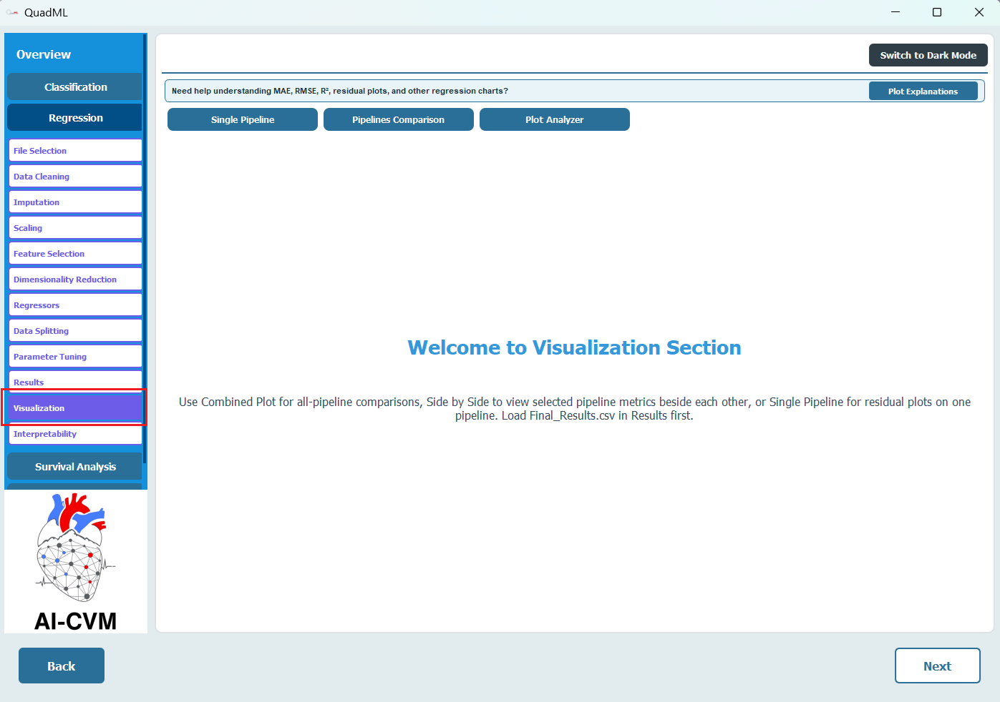
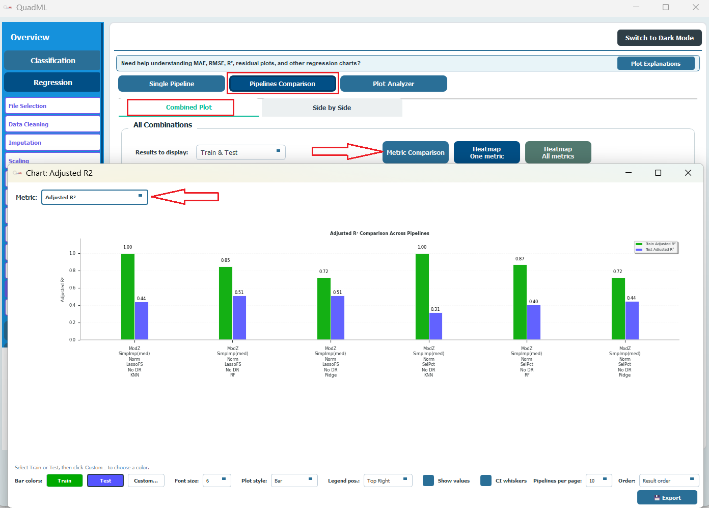
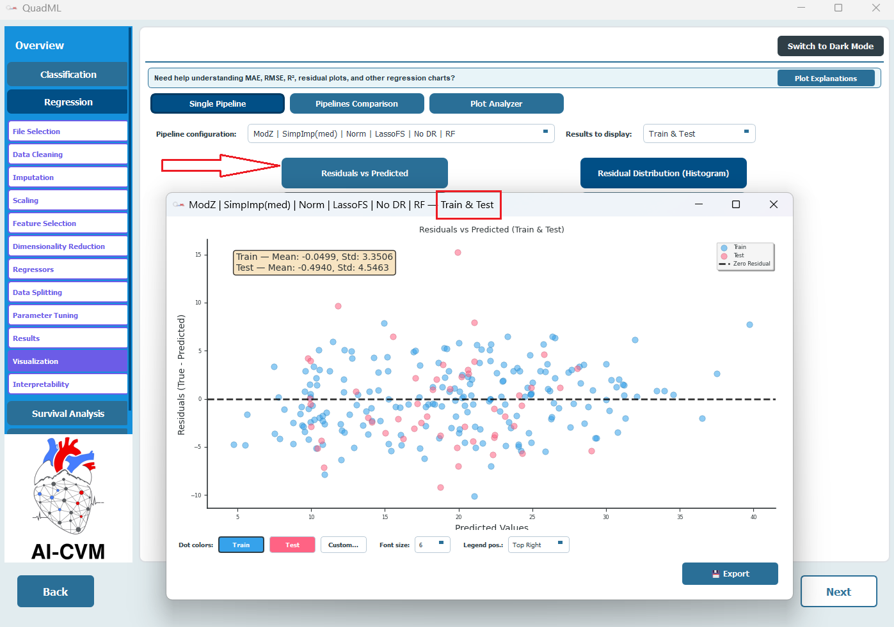

# Regression — Visualization

Plots for comparing pipelines and inspecting residual diagnostics on one selected pipeline. Load Final_Results.csv file in **Results** first.

--8<-- "_snippets/visualization-usage.md"

Choose **Single Pipeline**, **Pipelines Comparison**, or **Plot Analyzer**:

**Single Pipeline** — pick a pipeline and set **Results to display** (prefer **Test** or **External**):

## Comparing pipelines

| Plot | What it shows |
|------|----------------|
| Single-metric plots | One metric (e.g. MAE, RMSE, R²) across pipelines |
| Metrics comparison | Several metrics together |
| Heatmaps (where offered) | Metric values across preprocessing × model grids |

**Pipelines Comparison** → Combined Plot → Metric Comparison (for example Adjusted R²):

Heatmap of one metric (model × dimensionality reduction):

Heatmap of all metrics for selected pipelines:

**Side by Side** comparison for selected pipelines:

## One pipeline

| Plot | What it shows |
|------|----------------|
| Residuals vs Predicted | Structure or bias in errors |
| Predicted vs Actual | Agreement with the target |
| Residual distribution | Spread of errors |
| Other residual / QQ-style views | As offered in the GUI |

Residuals vs Predicted:

True vs Predicted:

Q-Q plot of residuals:

Residual distribution (histogram):

**Plot Analyzer** adds a plain-language reading next to the chart:

Use **Plot Explanations** / **Analyze** for in-app help.

## Common mistakes

- Opening Visualization before any successful combination finished
- Mixing plots from an older dated folder after starting a new run
- Reading Train-only plots as trustworthy absolute performance
