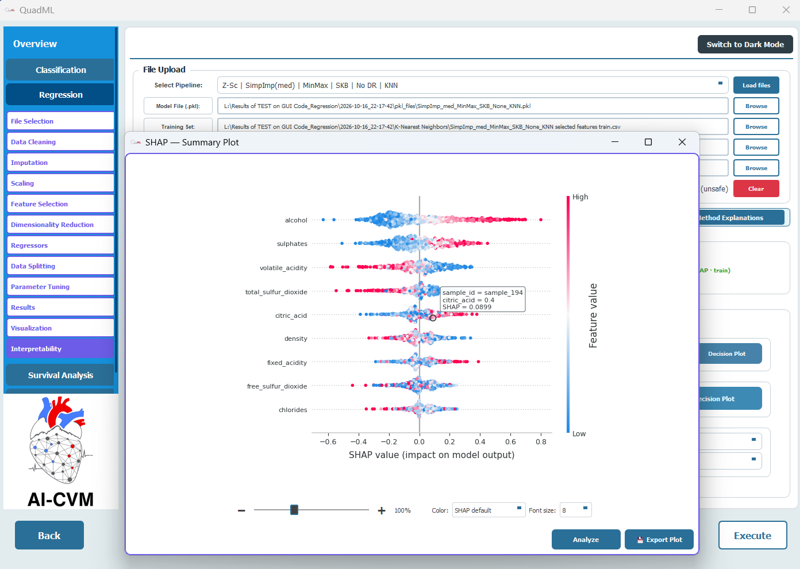
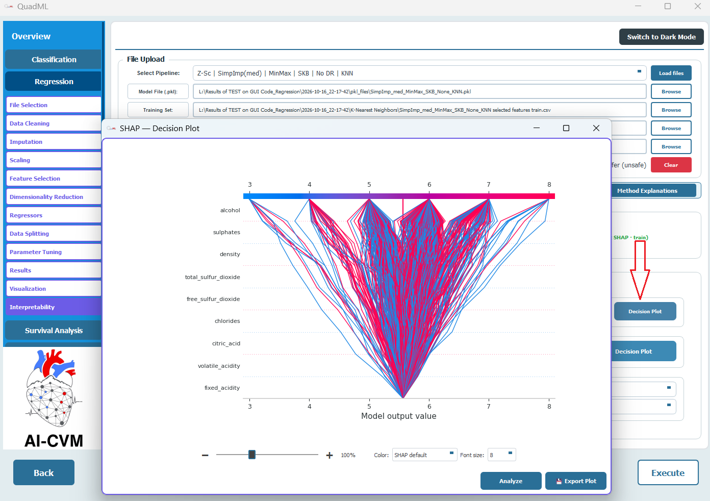
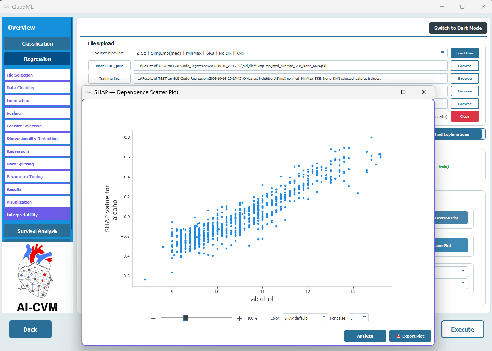
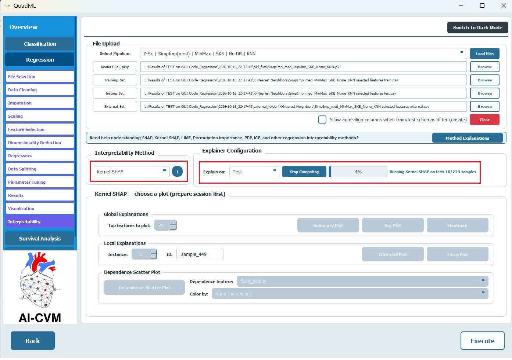
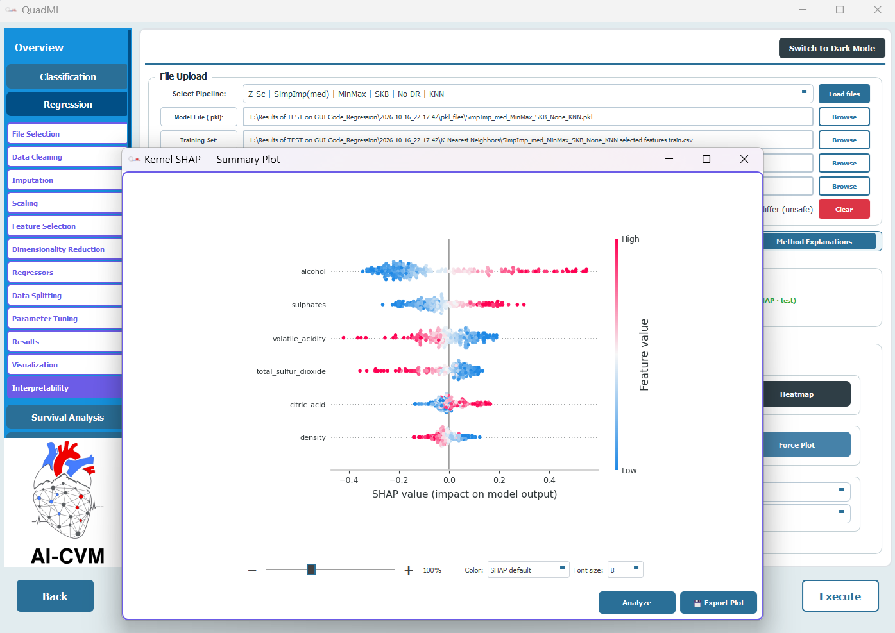
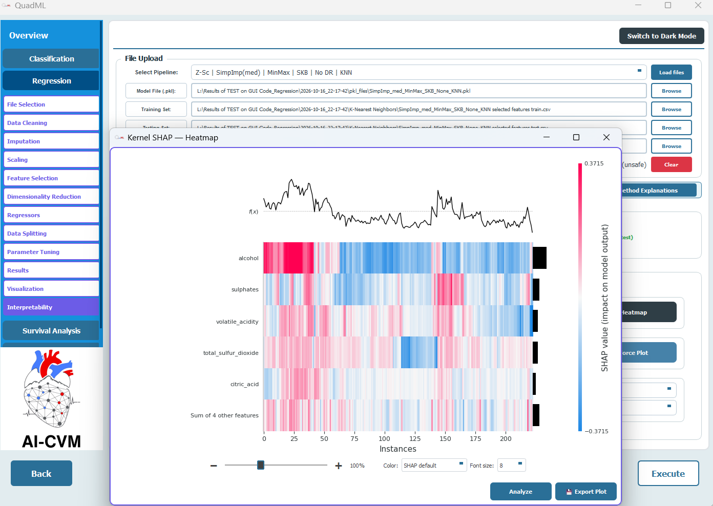
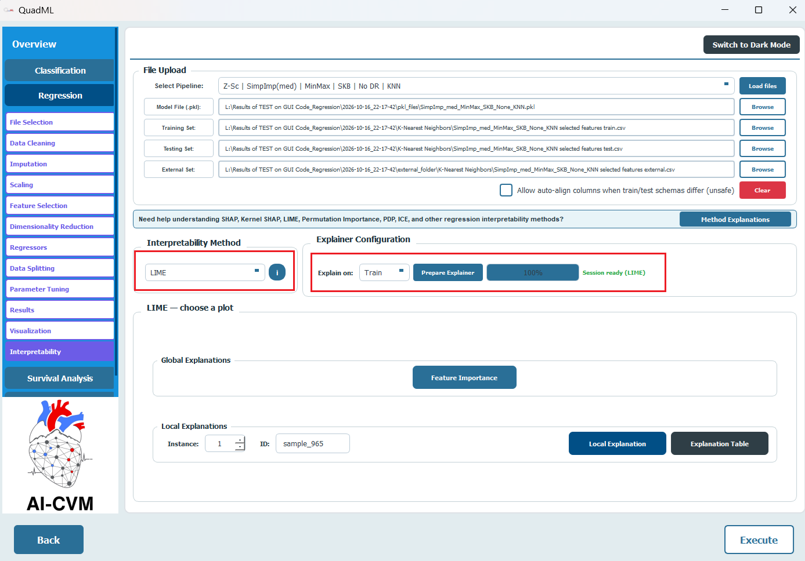
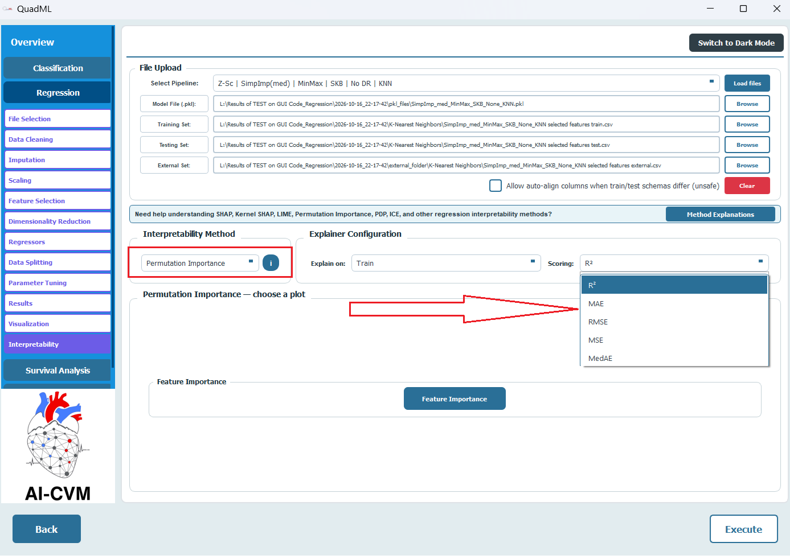
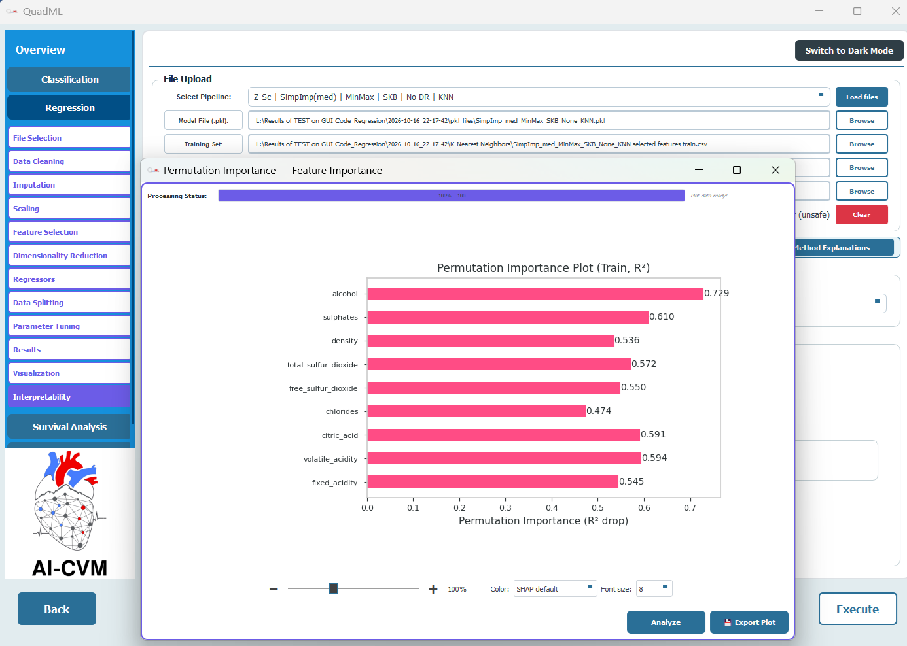
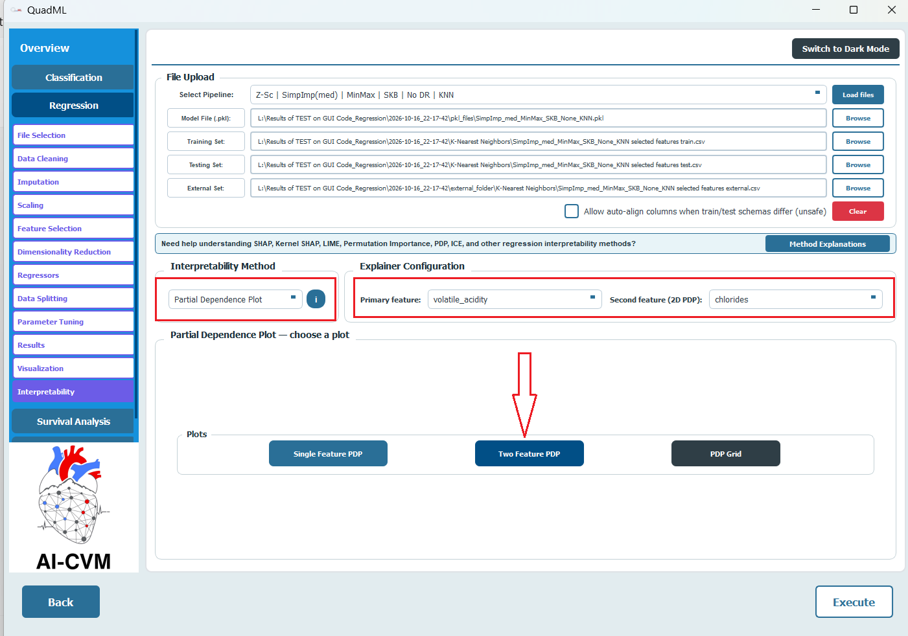

# Regression — Interpretability

Shows which features drive the predicted continuous value for a loaded fitted regression pipeline (global and local explanations). Use it after you choose a candidate from **Results**. It does **not** replace Test or External metrics for ranking models. Load the matching `.pkl` and feature CSVs, choose a method compatible with the model, set **Explain on**, then **Prepare Explainer**. Prefer **SHAP** when available; **Kernel SHAP** is a model-agnostic alternative that is usually slower. Positive attributions mean a **higher predicted target value**. Prefer **Test** or **External** for **Explain on** when judging which features matter on held-out data. There is no Class label control in Regression.

--8<-- "_snippets/interpretability-usage.md"

Load the matching `.pkl` and feature CSVs for one pipeline, choose a method and **Explain on** split, then compute / prepare the explainer:

SHAP session in progress — sample progress, global and local plot buttons (enabled when ready):

## Methods

| Approach | What it shows | Scope |
|----------|---------------|--------|
| **SHAP** | How each feature pushes the predicted value up or down | All rows and single rows |
| **Kernel SHAP** | Same idea as SHAP, model-agnostic; usually slower | All rows and single rows |
| **LIME** | Local explanation for one row | Single rows (aggregated views available) |
| **Permutation Importance** | Drop in R² / MAE / … when a feature is shuffled | All rows |
| **PDP** | Average prediction as one or two features vary | All rows |
| **ICE** | One curve per row as a feature varies | Single rows |

SHAP summary (global feature impact):

SHAP heatmap across instances:

SHAP decision plot:

SHAP dependence scatter of a feature:

SHAP waterfall for one instance:

Kernel SHAP computing / plot controls:

Kernel SHAP summary:

Kernel SHAP heatmap:

LIME session ready — Feature Importance and Local Explanation:

LIME aggregated feature importance:

LIME local explanation for one instance:

Permutation Importance — choose scoring (R², MAE, RMSE, …):

Permutation Importance plot:

Partial Dependence Plot controls (primary / second feature):

Two-feature PDP example:

ICE method and primary feature:

ICE plot with average curve:

## Common mistakes

- Loading features from a different combination than the `.pkl`
- Treating Train explanations as validation
- Using Interpretability instead of Test metrics to pick a model
- Running Interpretability without a successful fitted `.pkl`
