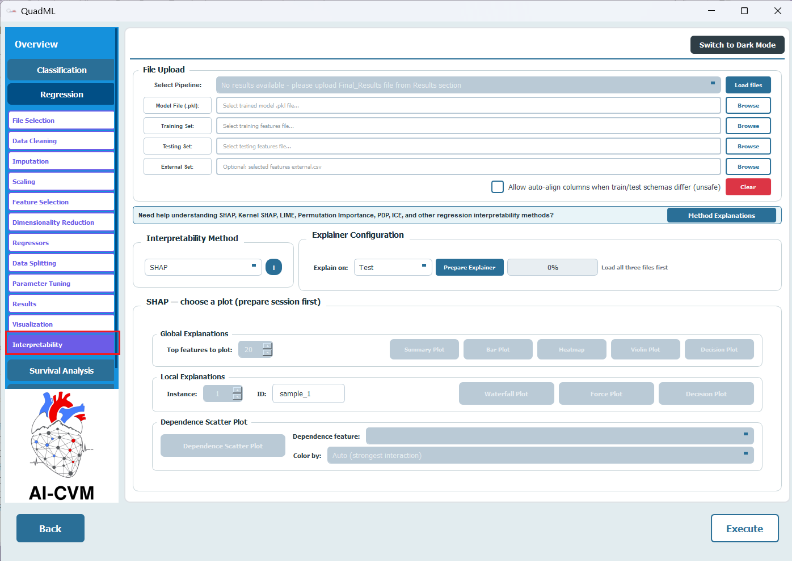
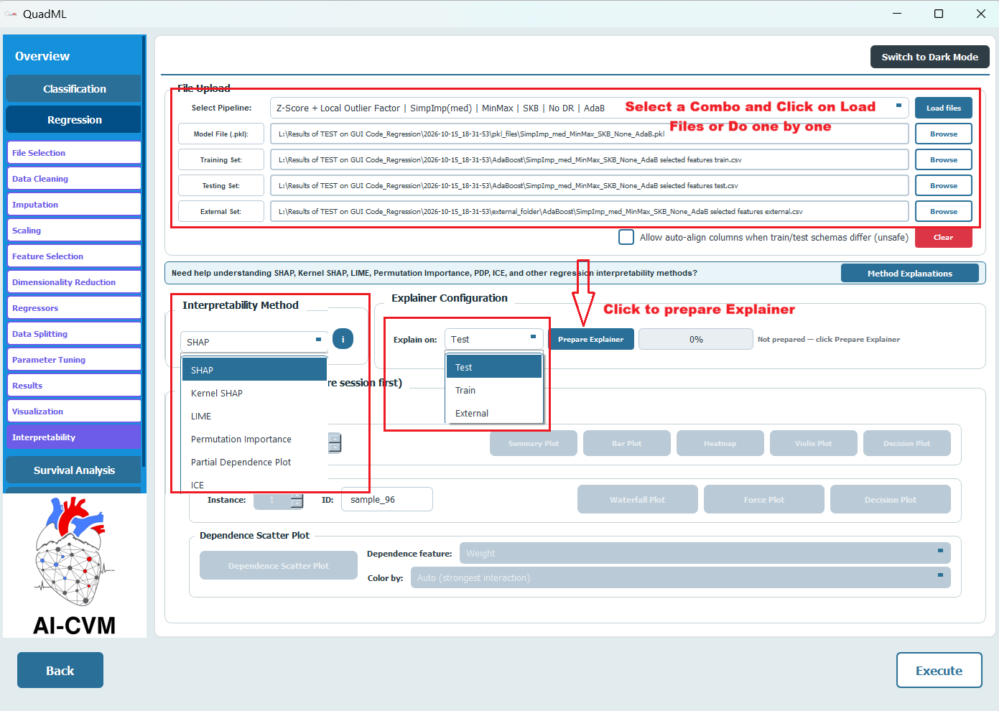
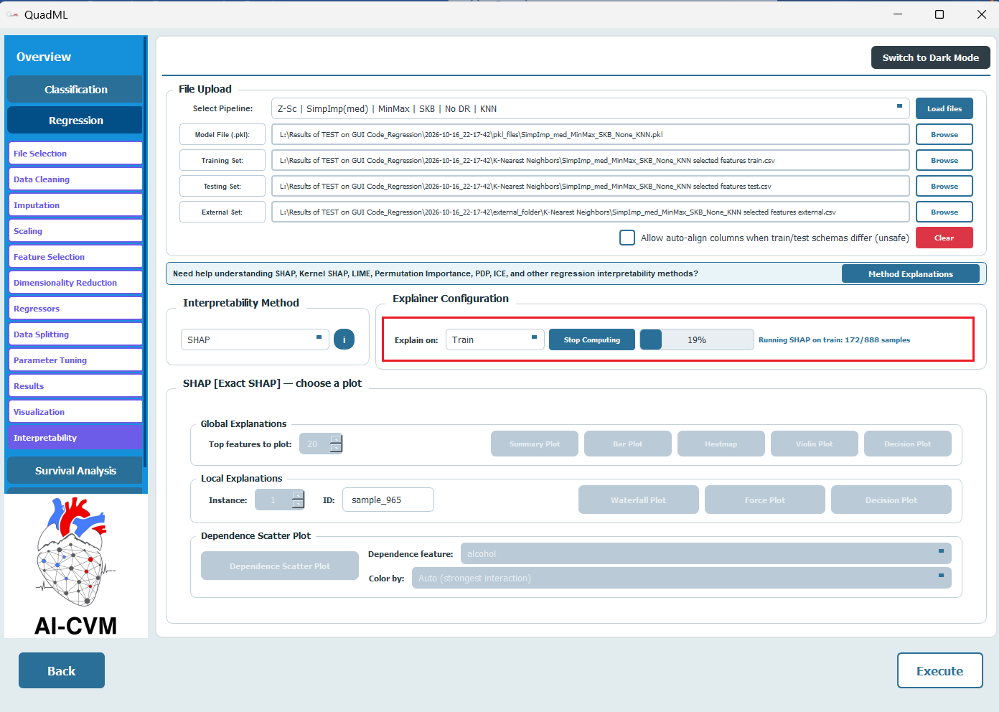
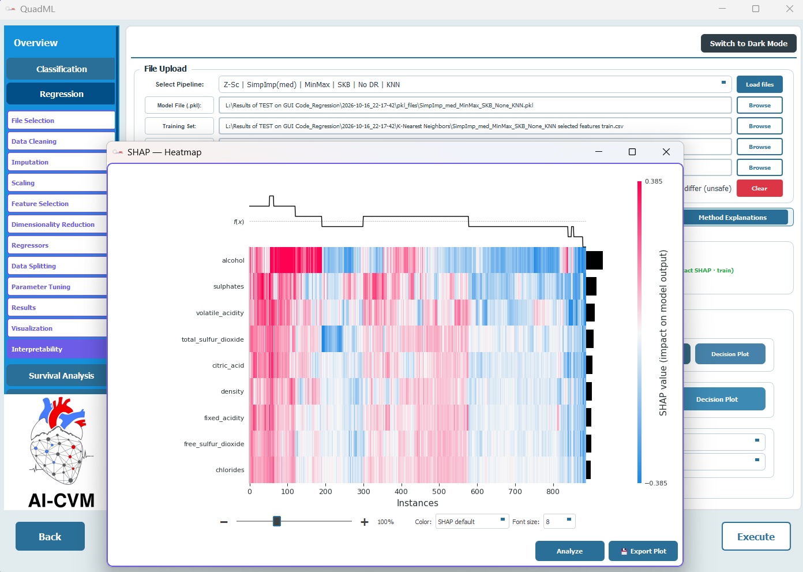
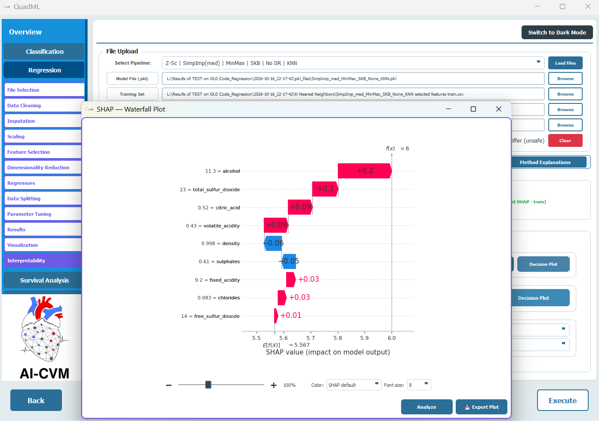
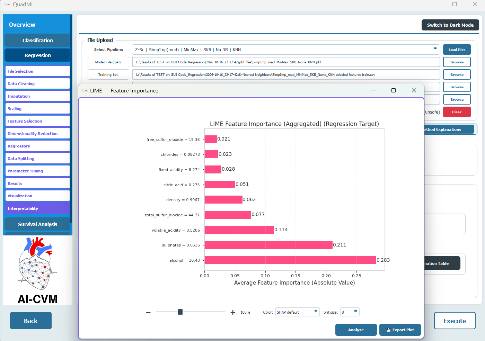
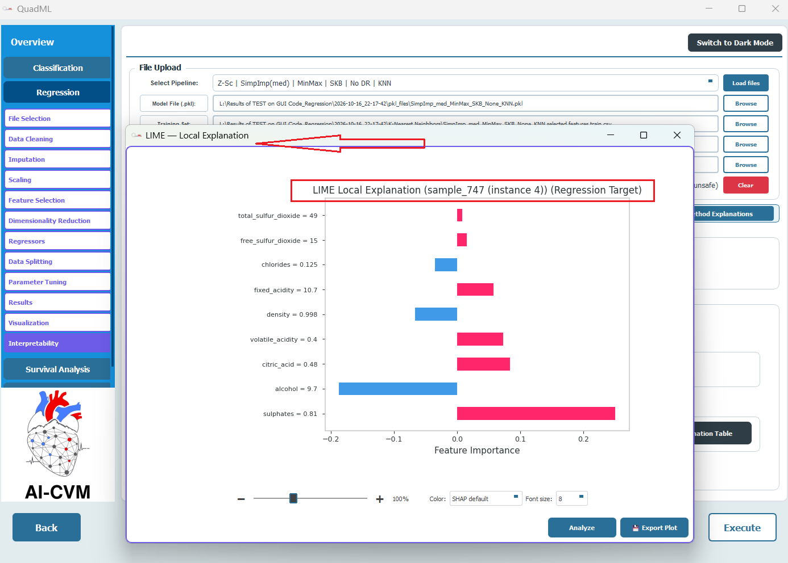
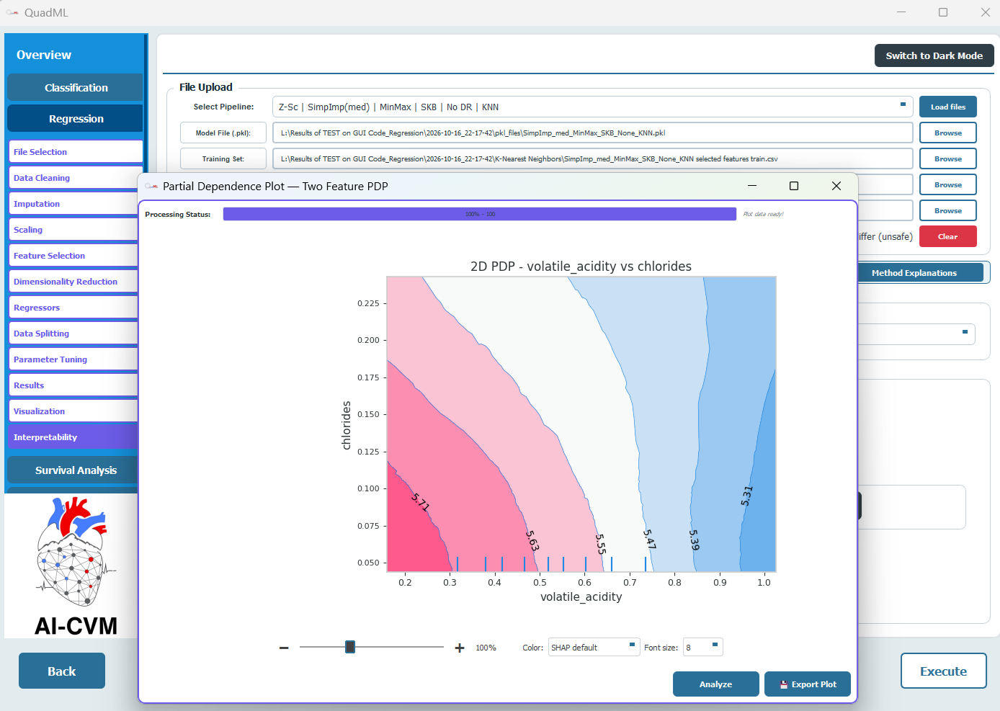
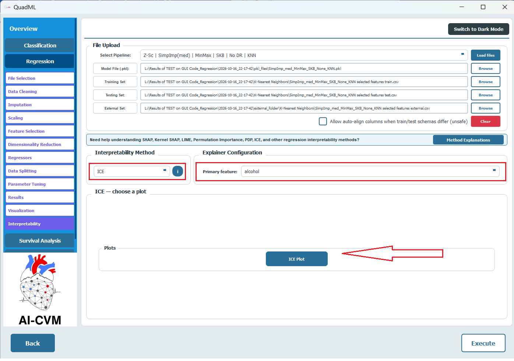
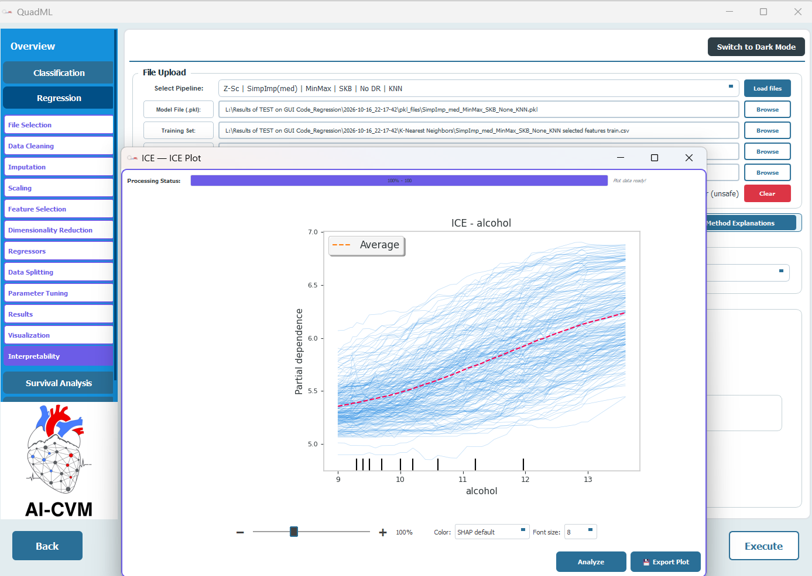

# Regression — Interpretability

**Where**: Regression → **Interpretability**

**Interpretability** explains **why** a fitted Regression pipeline predicts its continuous target: you load one completed model (`.pkl` plus its feature CSVs), prepare an explainer (SHAP, LIME, PDP/ICE, and related methods), and open local or global plots. Use it after Results to understand a chosen pipeline — it does **not** replace Test or External metrics for ranking performance.

Point Results (and then Interpretability) at the same dated run folder under your **Output Directory** — typically `Output Directory / YYYY-MM-DD_HH-MM-SS / Final_Results.csv`. That CSV lists the finished combinations; the matching `.pkl` and feature CSVs for a row live in that same run folder (or its subfolders). You can also Browse an older run’s `Final_Results.csv` if you want to explain a previous search.

There is **no Class label** control in Regression (that is Classification multi-class only). Most methods explain the predicted **numeric target**, not class probabilities.

---

## Recommended workflow

Results — load `Final_Results.csv` from the dated run folder (`Output Directory / <run timestamp>/`).

Interpretability — Select Pipeline → Load files (model `.pkl`, training features CSV, testing features CSV) from that same run.

1. Choose an explanation **method** (SHAP, LIME, PDP/ICE, …).
2. Click **Prepare Explainer** once — plot buttons stay disabled until this finishes.
3. If the page shows **Explainer Configuration** for that method, set those options before or after prepare as the UI allows.
4. Open plots from the grouped plot buttons.
5. Use the Browse fields only if you need to override the auto-filled `.pkl` or feature-CSV paths.

Most methods do **not** retrain the pipeline; they explain the loaded `.pkl`.

---

## Methods

### SHAP

**SHAP** breaks the predicted target value into per-feature contributions: positive values push the prediction up, negative values push it down. You can inspect one sample (local) or patterns across many samples (global).

Available plot groups include Summary, Waterfall, Force, Bar, Heatmap, Dependence Scatter, Violin, and Decision.

When the pipeline includes scaling, plot labels and SHAP dependence axes can show original (pre-scale) feature values; explainers still run in model (scaled) space.

### Kernel SHAP

**Kernel SHAP** estimates SHAP values for any model (not only trees) by sampling feature coalitions around `predict`. It uses the same style of contribution plots as SHAP, though the UI may show a smaller plot set, and it is usually slower than tree-based SHAP.

### LIME

**LIME** (Local Interpretable Model-agnostic Explanations) explains **one sample at a time**: it builds a simple local model around that instance to show which features pushed the continuous prediction up or down. Use it when you need a readable case-level story. The UI also offers aggregated importance and list views when you explain several instances.

### Permutation Importance

**Permutation Importance** ranks features **globally** by how much the model’s score falls when that feature’s values are randomly shuffled. A large drop means the feature mattered for performance on the chosen split. In **Explainer Configuration**, choose the scoring metric: **R²**, **MAE**, **RMSE**, **MSE**, or **MedAE**. Pick **Train**, **Test**, or **External**, prepare the explainer, and read the ranking plot. Use it for an overall “which columns drive the metric?” view, not for explaining one sample like LIME.

### Partial Dependence Plot (PDP)

**PDP** shows how the model’s **average** predicted target changes when you vary one feature (or a pair of features) across their range, while averaging over the other columns. Use it to see the overall relationship between a feature and the prediction. Available in Regression (not limited to binary Classification).

### ICE

**ICE** (Individual Conditional Expectation) draws one curve **per sample** as a single feature varies, with a dashed average (PDP overlay), so you can see how predictions change for individual rows rather than only the PDP average. Heterogeneous curves mean the feature effect differs across samples. Available in Regression.

---

## Display vs model space

When scaling is on, PDP / ICE / SHAP dependence axes can show original (pre-scale) feature values while the model still uses scaled inputs. After DR (PCA / ICA / Kernel PCA), explanations use the compressed component space as applicable.

---

## What is written to disk

Prepared explainers and related caches are stored under the current dated **run folder** (and its Interpretability subfolders) for that session, so you can reopen plots without rebuilding everything from scratch when paths stay valid.

Residual diagnostics and scalar metric charts belong in **Visualization**, not Interpretability — use this page for SHAP / LIME / PDP-style explanations of a loaded `.pkl`.

For the full in-app wording of each method, use the explanations bar or the **i** buttons on the Interpretability page.

---

## Common mistakes

- Loading features from a different combination than the `.pkl`
- Treating interpretability on Train as external validation
- Expecting a Class label control (Classification multi-class only)
- Looking for residual / MAE ranking charts here — those are on **Visualization** / **Results**
