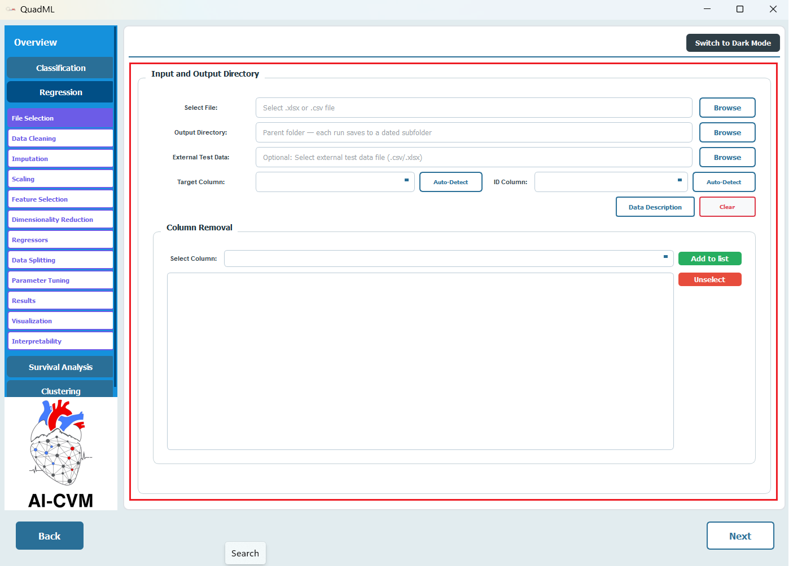

# Regression — Tutorial

End-to-end click path for a first Regression run. Keep the search small.

---

## 1. Start

1. Open QuadML and click on **Regression** from left panel and choose **File Selection**.
2. Click on **Browse** in Select File and choose a `.csv` / `.xlsx` with a numeric outcome.
3. Click on **Browse** in Output Directory and select a path to save results and files.
4. Set **Label Column** to the numeric target (or **Auto-Detect**).
5. Optional: ID Column, Column Removal, External file.

---

## 2. Preprocess

| Step | Choice |
|------|--------|
| Data Cleaning | **None** means skipping cleaning step |
| Imputation | Select a preferred method |
| Scaling | **None** means skipping scaling step / select a preferred method |
| Feature Selection | Select preferred method |
| Dimensionality Reduction | Select preferred method |

---

## 3. Models and split

1. **Regressors:** Selecting **Linear Regression** and **Random Forest** is good for first run.
2. **Data Splitting:** 80/20, Train on all data **off**.

---

## 4. Run

1. **Parameter Tuning:** Random Search, Balanced (or Fast), CPU/RAM 50/50.
2. Review the tree and click on **Start Procedure** and wait (or **Stop** to cancel).

---

## 5. Read output

1. **Metrics:** prefer **Test** MAE / RMSE / R².
2. **Visualization:** Residuals vs Predicted or a metric chart.
3. **Interpretability:** Load the pipeline; Prepare Explainer for SHAP or Permutation Importance.

**Success**: `Final_Results.csv` under `Your Folder\YYYY-MM-DD_HH-MM-SS\`.
