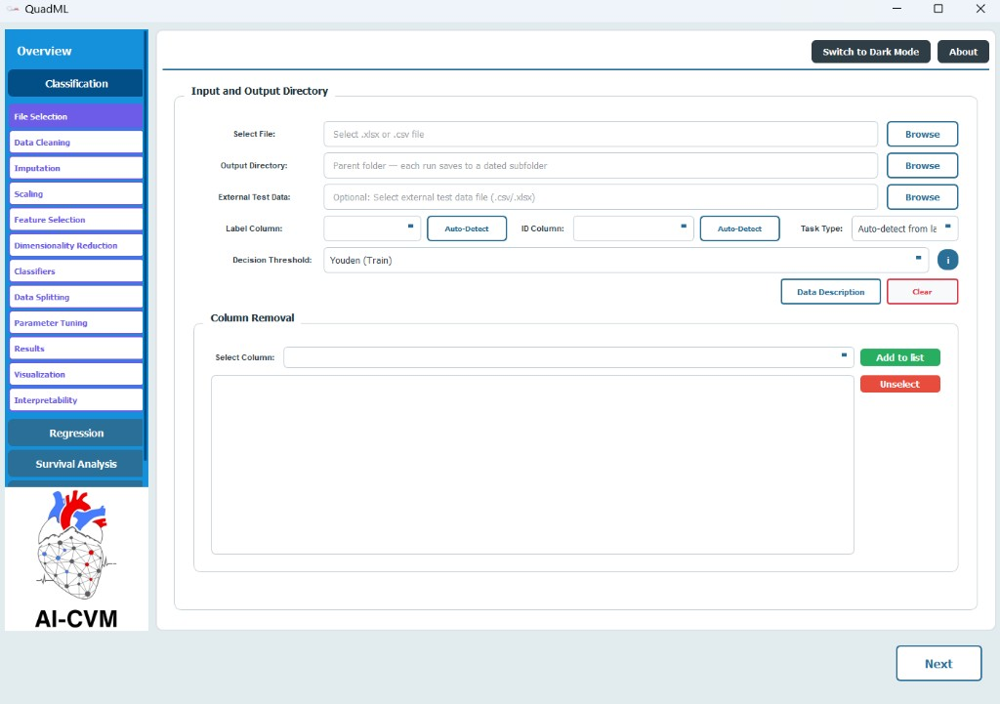

# Shared — File Selection

**Where**: Any mode → **File Selection**

Load the dataset, choose roles (label / target / survival columns / optional benchmark), optional external test file (supervised modes), column removal, and the **Output Directory** parent folder.

---

## What to click (common to all modes)

1. **Select File → Browse** — `.csv` or `.xlsx` (header row required).
2. **Output Directory → Browse** — parent folder; each **Start Procedure** creates a dated run subfolder `YYYY-MM-DD_HH-MM-SS`.
3. Optional **External Test Data** — second file for held-out evaluation (supervised modes that show it; required when **Train on all data** is on). **Not shown in Clustering.**
4. Review detected columns; use **Column Removal** to exclude IDs, text, or unused columns.
5. Choose a **Record ID** / **ID Column** when the mode offers it, or the no-ID option when samples have no identifier. **Clustering has no ID Column picker.**

Click **"i"** next to fields that show info buttons for the in-app wording.

---

## Mode-specific roles (summary)

| Mode | Extra File Selection choices |
|------|------------------------------|
| Classification | **Label Column**, **Task Type** (binary / multi-class), **Decision Threshold** (binary hard-label metrics) |
| Regression | **Label Column** as numeric **Target** (continuous outcome) |
| Survival Analysis | **Duration** and **Event / Censor** columns, **Event Coding**, **Eval. Horizons** |
| Clustering | Optional **Benchmark Label** for ARI / NMI / FMI only; no External Test Data; no ID Column picker |

---

## When data is actually read

Browsing a file loads a preview / identification path so columns appear. Full read → clean → encode for search runs when you click **Start Procedure** (see [Start, Stop, and resources](13-start-stop-and-resources.md)).

---

## What is written to disk

Nothing permanent until **Start Procedure** (and optional exports). The Output Directory must be set before a run; dated subfolders hold `Final_Results.csv`, pipelines, and reports.

---

## Common mistakes

- Forgetting **Output Directory**
- Changing label/target/survival columns after a long configure pass without re-checking Parameter Tuning’s configuration tree
- Enabling **Train on all data** without an external test file when the mode requires it
- Expecting External Test Data or an ID Column row in Clustering

---

## Mode manuals

- [Classification — File Selection](../classification/01-file-selection.md)
- [Regression — File Selection](../regression/01-file-selection.md)
- [Survival — File Selection](../survival/01-file-selection.md)
- [Clustering — File Selection](../clustering/01-file-selection.md)
