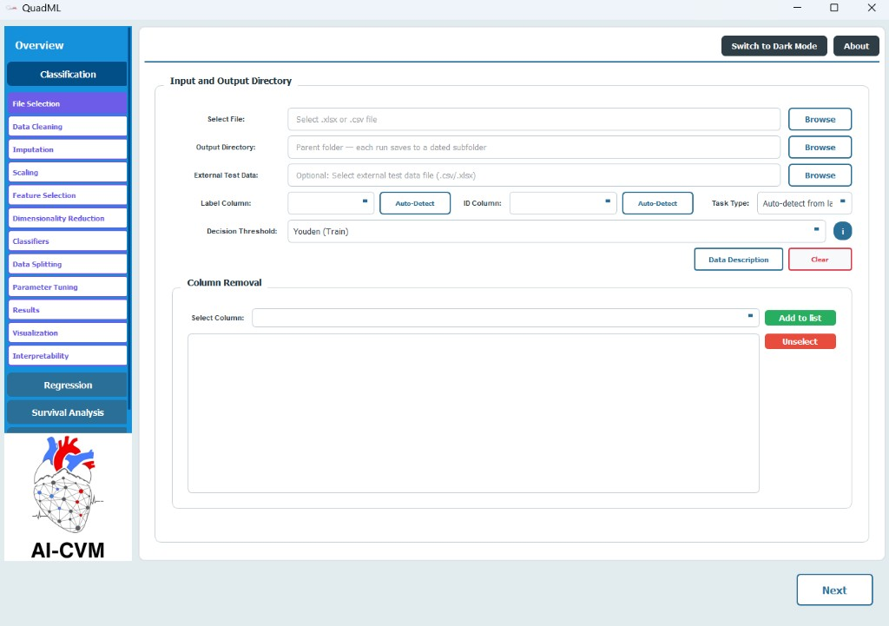

# Shared — cross-mode walkthrough

A short path through the **application shell** and **shared steps** before you specialize into one mode’s walkthrough.

---

## 1. Launch and pick a mode

1. Start QuadML (Welcome appears).
2. Optionally set light/dark theme.
3. Expand **Classification**, **Regression**, **Survival Analysis**, or **Clustering**.

Details: [Application shell](01-application-shell.md).

---

## 2. File Selection

1. Browse input `.csv` / `.xlsx`.
2. Set **Output Directory** (parent folder).
3. Set mode-specific roles (label / target / duration+event / clustering features + optional Benchmark Label).
4. Optional External Test Data and Record ID (when the mode shows them).

Details: [File Selection](02-file-selection.md).

---

## 3. Shared preparation steps

| Step | First-run choice |
|------|------------------|
| [Data Cleaning](03-data-cleaning.md) | **None** (optional Correlation Analysis off) |
| [Imputation](04-imputation.md) | **Simple Imputation** |
| [Scaling](05-scaling.md) | **Standard Scaler** (± **None**) |
| [Feature Selection](06-feature-selection.md) | **None** |
| [Dimensionality Reduction](07-dimensionality-reduction.md) | **None** (if the mode shows it) |

Leave extra methods unchecked until you need them.

---

## 4. Mode models and split

1. Open the mode’s model page (Classifiers / Regressors / Survival Models / Clustering Models). Pick a **small** set.
2. Survival: configure Descriptive Analysis if you need KM / Nelson–Aalen.
3. **Data Splitting** (supervised modes) — e.g. 80/20, Train on all **off**. Clustering skips this page.

Use the matching mode manual for exact model lists.

---

## 5. Search and run

1. Open **Parameter Tuning** or **Search Settings**.
2. **Fast** or **Balanced** budget; Random Search when shown; CPU/RAM **50 / 50**.
3. Review the configuration tree.
4. Click **Start Procedure**; wait for progress to finish (or **Stop** if needed).

Details: [Parameter Tuning](09-parameter-tuning.md) · [Start, Stop, and resources](13-start-stop-and-resources.md).

---

## 6. Inspect

1. **Results** — read abbreviated pipelines and metrics ([Results](10-results.md)).
2. **Visualization** — charts ([Visualization](11-visualization.md)).
3. **Interpretability** (if available) — load a fitted pipeline and explain ([Interpretability](12-interpretability.md)).

Success: dated folder under Output Directory with `Final_Results.csv`.

---

## 7. Optional exports

1. **Export Procedure Report** for a configuration snapshot.
2. Note the dated folder for pipelines, plots, and rebuild JSON.

Details: [Outputs, abbreviations, and reports](14-outputs-abbreviations-reports.md).

---

## Continue in a mode manual

- [Classification walkthrough](../classification/walkthrough.md)
- [Regression walkthrough](../regression/walkthrough.md)
- [Survival walkthrough](../survival/walkthrough.md)
- [Clustering walkthrough](../clustering/walkthrough.md)

---

## Maintainer map

[Shared modules map](15-shared-modules-map.md) · [Introduction](00-introduction.md)
