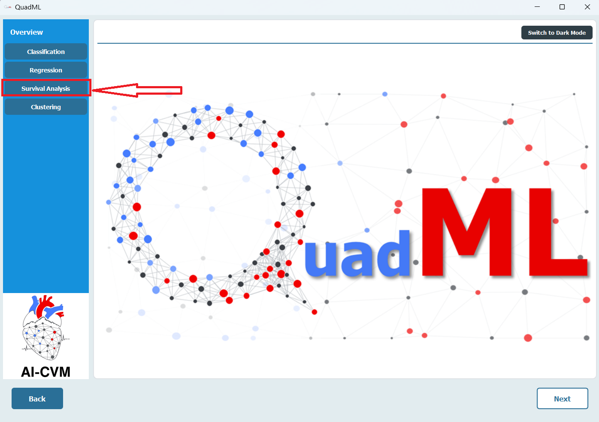

# Survival Analysis — Overview

**Survival Analysis** models **time-to-event** data: each row has a **duration** (follow-up) and an **event / censor** indicator (event observed vs still event-free at last contact).

In QuadML you can run descriptive curves (Kaplan–Meier / Nelson–Aalen) and/or covariate pipelines (Cox, AFT, RSF, …), then review discrimination, calibration, plots, and explanations. Everything runs locally; no data is uploaded.

### Clinical examples

- Time to death or transplant after diagnosis  
- Time to restenosis after stenting  
- Time to device failure with right censoring  

Use Survival for duration + event. For discrete labels use Classification; for a continuous outcome use Regression; for unlabeled grouping use Clustering.

Settings live under **Pipeline**. First run: [Tutorial](walkthrough.md).

### Suggested first configuration

| Step | Choice |
|------|--------|
| Cleaning | **None** |
| Imputation / Scaling / FS / DR | Simple Imputation, Standard Scaler, **None**, **None** |
| Descriptive | **Kaplan-Meier** |
| Models | **Cox Proportional Hazards** |
| Split | 80/20, Train on all data **off** |
| Search | **Fast** → **Start Procedure** |
