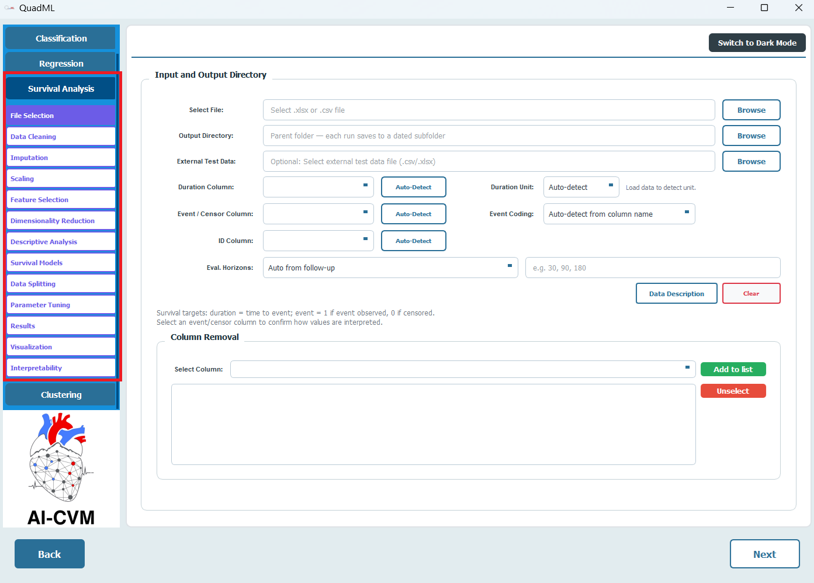

# Survival Analysis — Introduction

**Survival Analysis** models **time-to-event** data: each row has a **duration** (follow-up time) and an **event / censor** indicator (event observed vs still event-free at last contact). Typical examples are time to death, relapse, device failure, or any censored clinical or research endpoint.

In QuadML, Survival Analysis builds and compares full pipelines: you choose cleaning, imputation, scaling, feature selection, dimensionality reduction, descriptive methods (Kaplan–Meier / Nelson–Aalen), and covariate survival models; the search tries every combination you enable for covariate models, then reports discrimination, calibration, and time-dependent metrics, plots, and explanations. Everything runs locally — no data is uploaded.

Use this mode when outcomes are duration + event. For discrete categories use Classification; for a continuous numeric outcome use Regression; for unlabeled grouping use Clustering.

---

## Workflow map

After you click **Survival Analysis** on the left, the nested steps are:

| Order | Step | Role |
|------:|------|------|
| 1 | File Selection | Load data, **Duration** + **Event / Censor**, horizons, ID, output folder |
| 2 | Data Cleaning | Outlier / hygiene options (applied at Start Procedure) |
| 3 | Imputation | Fill missing values (searched for covariate models) |
| 4 | Scaling | Scale features (searched for covariate models) |
| 5 | Feature Selection | Survival-aware FS methods (or None) |
| 6 | Dimensionality Reduction | PCA / ICA / Kernel PCA (or None; no LDA) |
| 7 | Descriptive Analysis | Kaplan–Meier / Nelson–Aalen (no covariates) |
| 8 | Survival Models | Cox, AFT, RSF, DeepSurv, … |
| 9 | Data Splitting | Train/Test (or Train on all + External) |
| 10 | Parameter Tuning | Search settings + **Start Procedure** |
| 11 | Results | Pipeline metrics (`Final_Results.csv`) |
| 12 | Visualization | KM, calibration, risk groups, td-AUC, … |
| 13 | Interpretability | SurvSHAP, SurvivalLIME, Cox/AFT coefficients, … |

---

## What is different from Classification / Regression

- Outcomes are **Duration Column** + **Event / Censor Column** (not a single label or target)
- **Eval. Horizons** for td-AUC, IBS, and calibration
- **Descriptive Analysis** page for Kaplan–Meier and Nelson–Aalen
- Dimensionality Reduction is **None / PCA / ICA / Kernel PCA** (no LDA)
- Feature selection uses a survival allowlist (Cox-based / Cox-LASSO / Boruta, …)
- Do not rank covariate pipelines by C-index alone when absolute risk matters — check calibration (**Mean Cal**, **Slope**, **ICI**) first
- KM / Nelson–Aalen do not use imputation, scaling, FS, or DR (`N/A (not used)` on Results) and have no Interpretability

---

## Suggested first configuration

- Duration + event mapped, **Event Coding** correct, horizons **Auto from follow-up**
- Cleaning: **None** (or one feature-level method if needed)
- Imputation: **Simple Imputation**; Scaling: **Standard Scaler**; FS: **None**; DR: **None**
- Descriptive Analysis: **Kaplan-Meier**
- Survival Models: **Cox Proportional Hazards**
- Split: 80/20, Train on all data **off**
- Parameter Tuning: **Fast** budget → **Start Procedure**

Then follow the [walkthrough](walkthrough.md).
