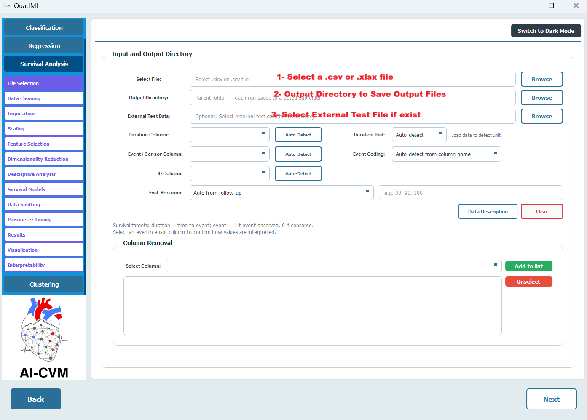
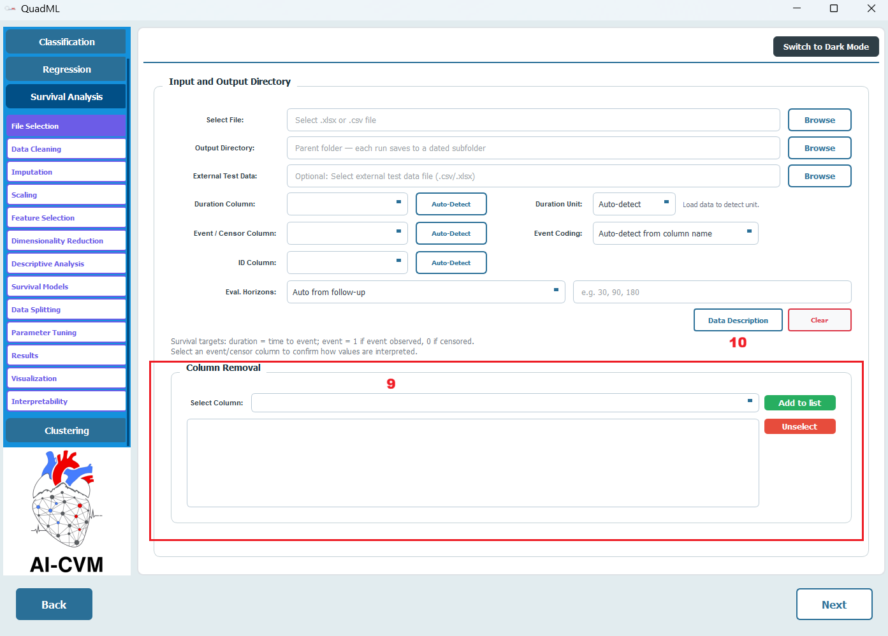

# Survival Analysis — File Selection

**Where**: Survival Analysis → **File Selection**

**Attention**: This is the first step. Nothing is written to the run folder until **Start Procedure** on Parameter Tuning.

## What you need

- A file with **.csv** or **.xlsx** format (first row = column names)
- A **Duration Column** (time to event or last follow-up)
- An **Event / Censor Column** (event observed vs censored)
- A writable **Output Directory** (parent folder; each run creates a dated subfolder `YYYY-MM-DD_HH-MM-SS`)

On-screen hint: duration = time to event; event = 1 if event observed, 0 if censored (unless you flip **Event Coding**).

See also [Prepare the data](../getting-started/07-prepare-the-data.md).

---

## What to click

### Input and Output Directory

1. **Select File → Browse** — choose the main dataset (`Select .xlsx or .csv file`).
2. **Output Directory → Browse** — choose a parent folder (`Parent folder — each run saves to a dated subfolder`).
3. Optionally **External Test Data → Browse** — second file with the **same feature columns** plus duration and event (required later if **Train on all data** is on).

### Duration, event, and coding

4. **Duration Column** — select or **Auto-Detect** (common names: `time`, `duration`, `survival_time`, …). **Duration Unit** can stay on Auto-detect until data is loaded.
5. **Event / Censor Column** — select or **Auto-Detect**.
6. **Event Coding:**
   - Auto-detect from column name
   - **1 = event observed, 0 = censored** (usual default)
   - **0 = event observed, 1 = censored**
7. **ID Column** — optional record ID. Choose **No ID Column** to force synthetic IDs (`sample_1`, `sample_2`, …). Use **Auto-Detect** for common ID names.

### Evaluation horizons

8. **Eval. Horizons** — time points (days) for td-AUC, IBS, and calibration. Horizons must fall below maximum training follow-up.

| Option | Meaning |
|--------|---------|
| Auto from follow-up (default) | Resolved from observed follow-up |
| Long-term (1 to 5 years) | Clinical year marks (may drop horizons if follow-up is short) |
| Short-term (30 / 90 / 180 / 365 d) | Day-based short horizons |
| Custom (days, comma-separated) | e.g. `30, 90, 180` |

### Column Removal and helpers

9. **Column Removal** — pick columns to exclude from modeling (**Add to list** / **Unselect**). Columns in the removal list are dropped when you start the procedure, not merely by listing them.
10. **Data Description** — after load, shows a pandas-style summary; can export CSV/Excel.
11. **Clear** — clears selected files and Output Directory so you can choose new ones.

---

## What is written to disk

Nothing yet. The dated run folder is created when you click **Start Procedure**.

---

## Common mistakes

- Starting without an **Output Directory**
- Mapping duration or event as ordinary features instead of outcome columns
- External file missing duration/event or with different feature names than the main file
- Choosing long-term 1y–5y horizons when follow-up is shorter than five years
- Leaving ID-only columns in as features instead of setting **ID Column** or using **Column Removal**
