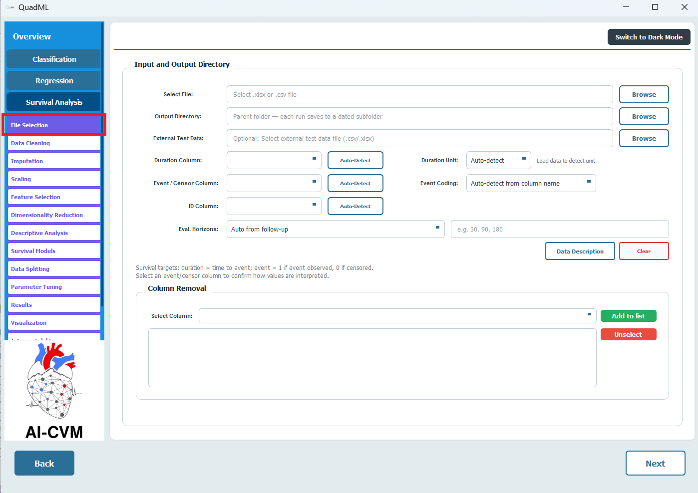
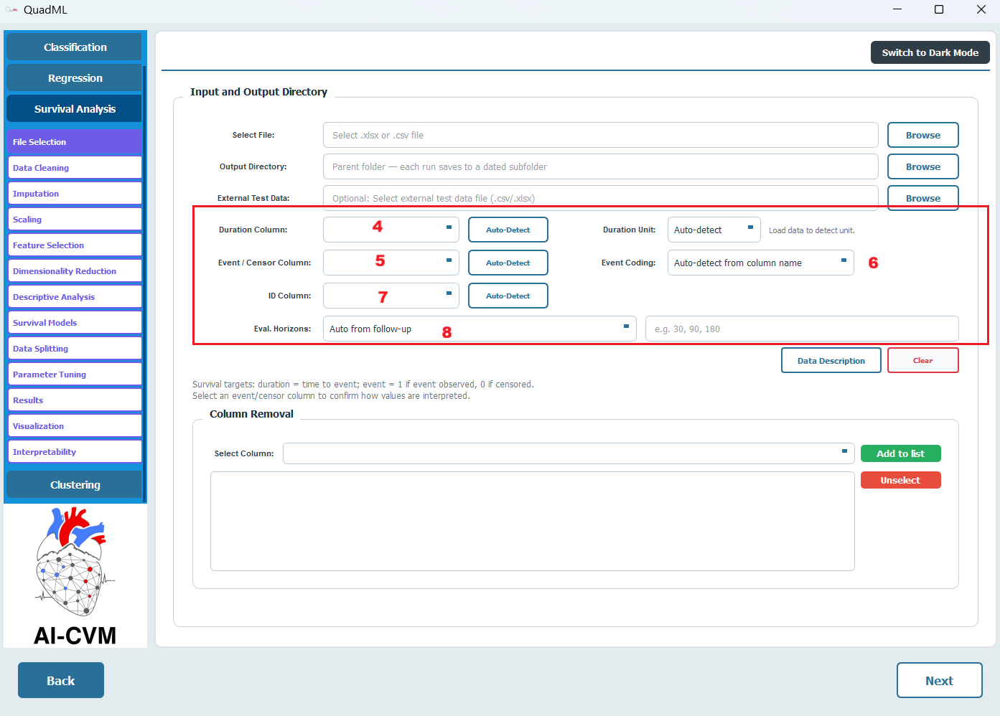

# Survival Analysis — File selection

This step is for loading your dataset, choosing the **Output Directory** where QuadML saves run results, and mapping the **Duration** and **Event / Censor** columns (plus evaluation horizons and optional ID, External Test Data, and Column Removal).

## Controls

| Control | What it does | When to use it |
|---------|--------------|----------------|
| **Select File** / **Output Directory** | Main data + parent output folder | Always |
| **External Test Data** | Second file with duration, event and same features | Hold-out; mandatory if Train on all data is on |
| **Duration Column** | Time to event or last follow-up | Always |
| **Event / Censor Column** | Event vs censored | Always |
| **Event Coding** | Which code means event observed | Match your file (often 1 = event) |
| **Eval. Horizons** | Time points for td-AUC / IBS / calibration | Default **Auto from follow-up** |
| **ID Column** / **Column Removal** | IDs / drop unused columns | As needed |

| Horizons option | Meaning |
|-----------------|---------|
| Auto from follow-up | From observed follow-up (default) |
| Long-term (1–5 years) | Clinical year marks (may drop if follow-up is short) |
| Short-term (30/90/180/365 d) | Day-based horizons |
| Custom | Comma-separated days |

## Common mistakes

- Mapping duration/event as ordinary features  
- External file missing duration/event  
- Long-term horizons when follow-up is short  
