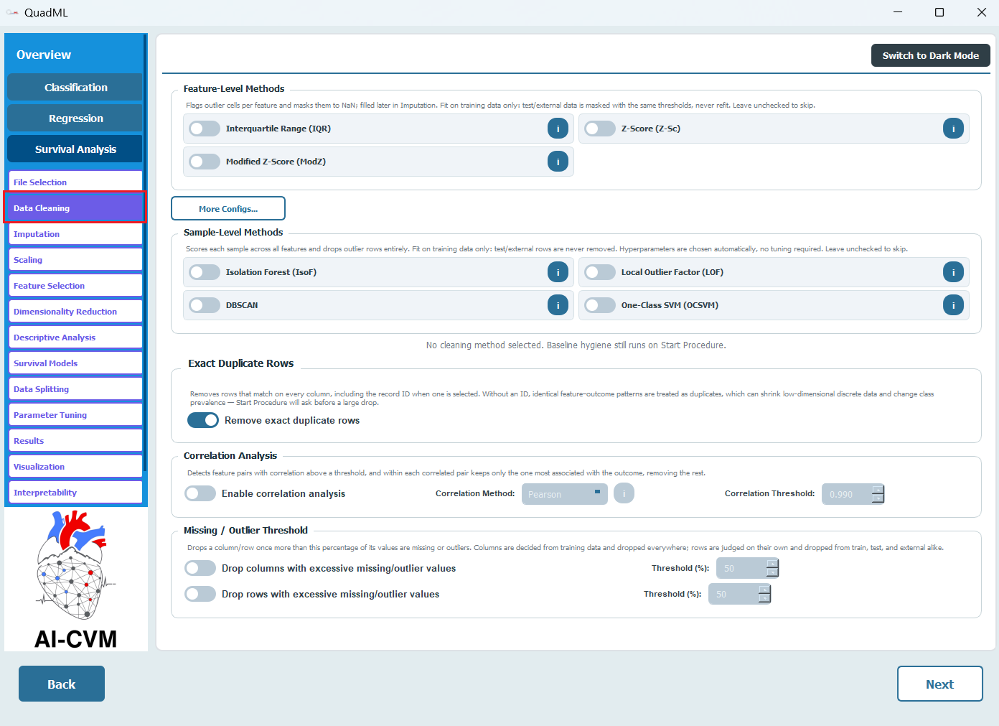

# Survival Analysis — Data cleaning

**Where**: Survival Analysis → **Data Cleaning**

Optional outlier handling before modeling. After sample-level drops, check remaining events / censoring.

--8<-- "_snippets/data-cleaning.md"

## Common mistakes

- Expecting the preview to change before **Start Procedure**
- Feature-level cleaning without Imputation for new NaNs
- Low correlation thresholds that drop many useful features
