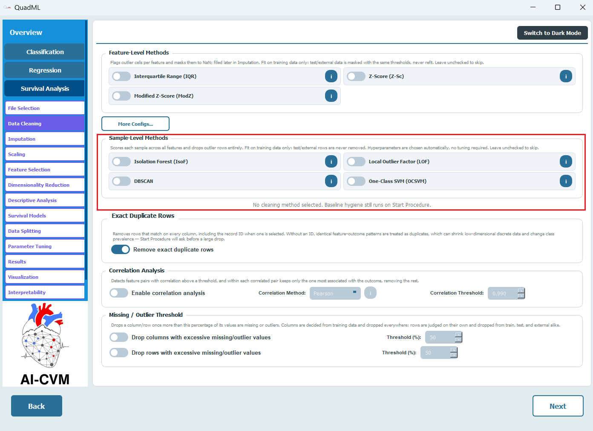

# Survival Analysis — Data cleaning

Data cleaning removes or corrects problematic values before modeling. It is applied when you click **Start Procedure** and offers:

- **Outlier detection, feature-level:** single extreme values are set to missing, then filled in by Imputation
- **Outlier detection, sample-level:** whole samples with unusual values overall are removed
- **Exact duplicate rows:** identical samples are removed (on by default)
- **Missing / outlier threshold:** features or samples with too many missing or outlier values are removed
- **Correlation analysis:** remove one feature from each highly correlated pair

After sample-level drops, confirm that enough events and censoring remain for reliable survival estimates.

--8<-- "_snippets/data-cleaning-feature-level.md"

--8<-- "_snippets/data-cleaning-sample-level.md"

## Common mistakes

- Expecting the preview to change before **Start Procedure**
- Feature-level cleaning without Imputation for new missing values
- Low correlation thresholds that drop many useful features
