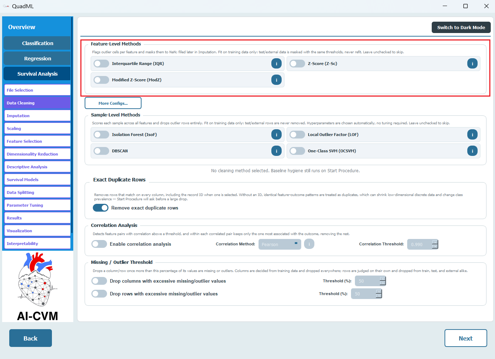
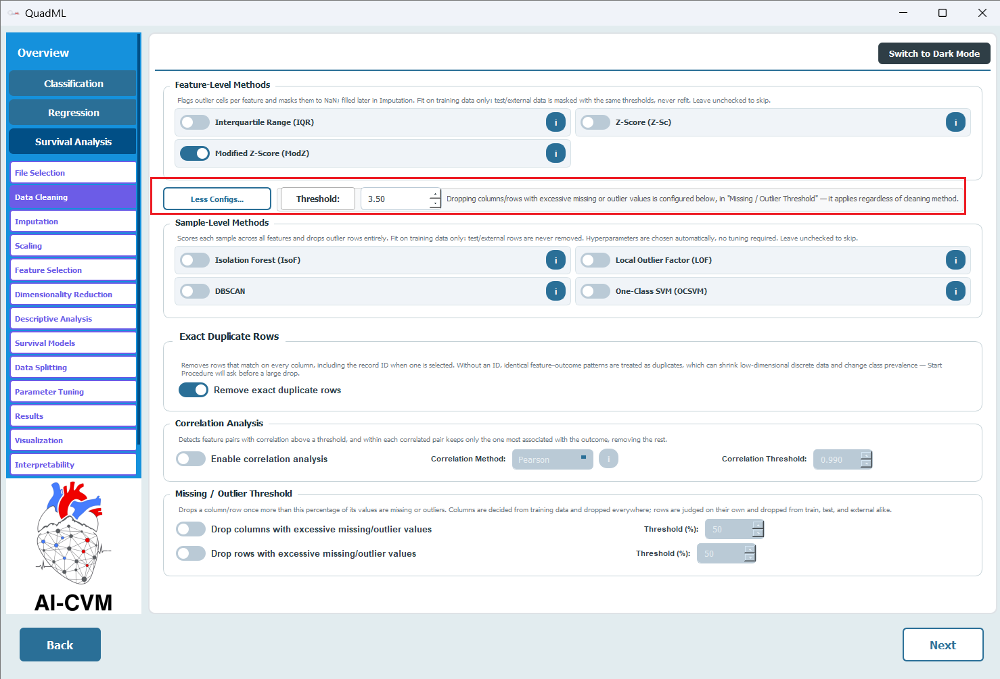
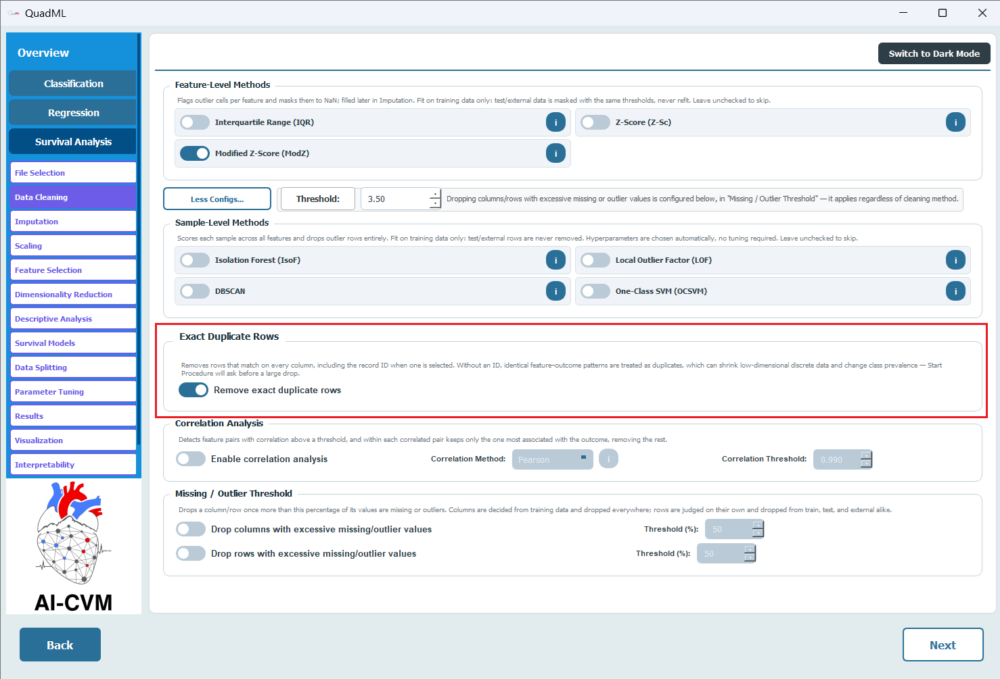
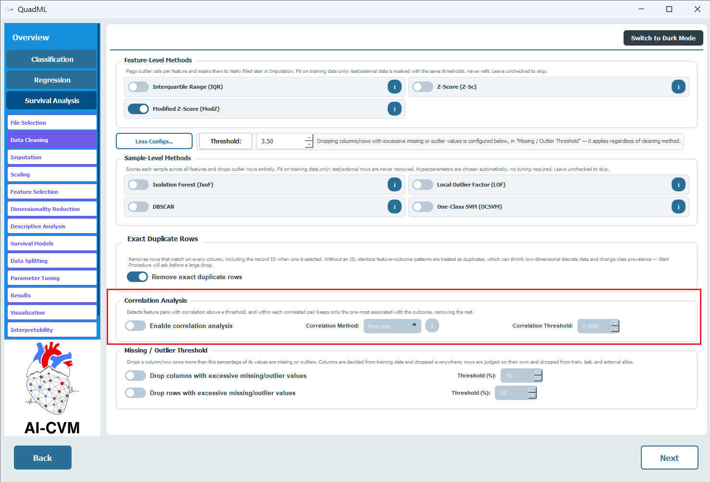
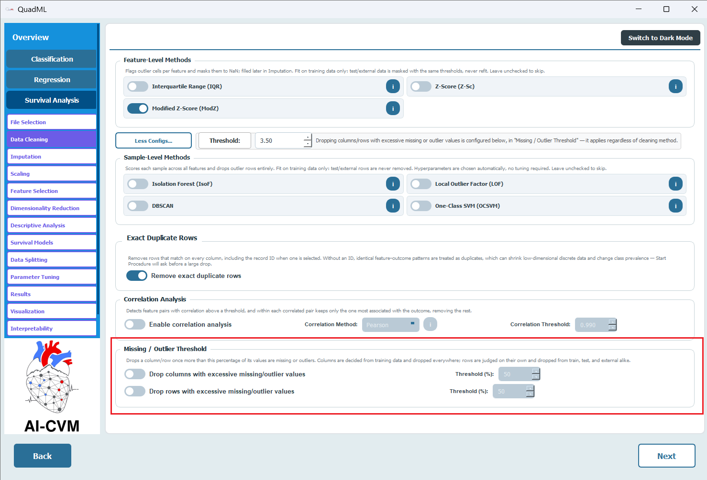

# Survival Analysis — Data Cleaning

**Where**: Survival Analysis → **Data Cleaning**

**Data Cleaning** prepares the dataset before modeling: optional outlier handling (flag extreme cells or drop outlier rows), exact-duplicate removal, correlation filtering, and missing/outlier thresholds. Choices here multiply with later Imputation / Scaling / models in the search. Cleaning does **not** run when you change a method card — it runs when you click **Start Procedure**.

## When to use it

**Attention**: If you do not choose any cleaning method, that means **None**.

- Use **None** on clean data (baseline hygiene still runs).
- Use a **feature-level** method to flag extreme **cells** (filled later in Imputation).
- Use a **sample-level** method to drop whole outlier **rows** (check remaining events / censoring afterward).

---

## Methods

### None

Leaving every method card unselected is **None**: QuadML skips outlier detectors. Baseline hygiene still removes duplicates, extreme-missing rows/columns, and all-zero rows/columns.

### Feature-level methods

| Method | Behaviour |
|--------|-----------|
| Interquartile Range | Per-feature IQR fences (default multiplier \(k = 1.5\)) |
| Z-Score | Per-feature z-score fences |
| Modified Z-Score | Robust (median-based) fences |

Outlier **cells** become missing and are handled on **Imputation**.

### Sample-level methods

| Method | Behaviour |
|--------|-----------|
| Isolation Forest | Multivariate; flagged rows dropped |
| Local Outlier Factor | Multivariate; flagged rows dropped |
| DBSCAN | Multivariate; flagged rows dropped |
| One-Class SVM | Multivariate; flagged rows dropped |

Hyperparameters for sample-level methods are chosen automatically from backend ranges (no user tuning on this page). Click **i** on a card for defaults, advantages, and disadvantages.

---

## What to click

1. Choose a method from the method cards (or leave all off for **None**).
2. Click **i** on a card for parameters, defaults, advantages, and disadvantages.
3. Open **More Configs** for feature-level methods when needed. Dropping columns or rows with excessive missing or outlier values is configured under **Missing / Outlier Threshold** below — it applies regardless of which cleaning method you pick.

### Duplicate Rows Challenge

**Remove exact duplicate rows** is a Data Cleaning hygiene option (enabled by default).

After you start the procedure, QuadML removes rows that match on every column — including the record ID when one is selected — and keeps the first occurrence of each unique row.

Rows that match on all features and the duration/event outcome but differ only by record ID are **not** removed; they are retained and reported separately as ID-only duplicates.

If no record ID is in use, identical feature–outcome patterns are treated as duplicates.

**Attention**: On low-dimensional discrete data, that can shrink the dataset and change the event / censoring mix. If no record ID is in use and more than 5% of rows would be dropped, **Start Procedure** asks for confirmation before removing them.

### Correlation Analysis

Optional step that removes redundant features (**off** by default). After the train/test split, it measures how strongly features move together (Pearson or Spearman). If two features are correlated at or above the threshold (default **0.99**), it keeps the one more related to the outcome and drops the other; the same columns are then dropped from Test and External.

When enabled, the run folder gets a correlation subfolder with CSV summaries of the filtered pairs.

### Missing and Outlier Threshold

Optional controls (**both off** by default; default threshold often **50%**).

Drops a **column** or **row** when more than the chosen percentage of its values are missing — or outlier cells cleared to NaN by a feature-level method (IQR, Z-Score, Modified Z-Score). With cleaning method **None**, only true missing values count.

- **Columns**: decided from training data, then dropped from Train, Test, and External alike.
- **Rows**: judged per dataset and dropped independently. On held-out data, only original missingness is counted (not train-fitted outlier masks).

---

## What is written to disk

After **Start Procedure**, the run folder includes cleaned data (for example `cleaned_data.csv` in original units).

---

## Common mistakes

- Expecting the on-screen data preview to change before **Start Procedure**
- Using sample-level drop when you only wanted to cap a few cells — use IQR / Z-Score / Modified Z-Score instead
- Dropping many rows with sample-level methods without checking remaining events / censoring
- Enabling Correlation Analysis with a low threshold and losing many useful predictors
