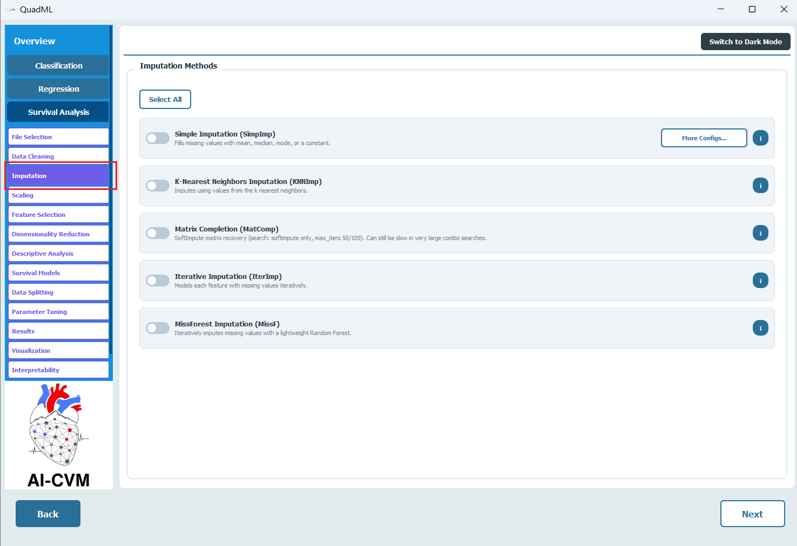

# Survival Analysis — Imputation

Fills missing feature values—including cells cleared by feature-level cleaning, so every searched **covariate** pipeline has complete inputs for next steps. Choose one or more imputers (Simple, KNN, Matrix Completion, Iterative, MissForest); only **Simple Imputation** exposes **More Configs** for the fill strategy (default **median**). Imputation is applied at **Start Procedure**. Enable only what you need because each extra imputer multiplies the search. Kaplan–Meier and Nelson–Aalen do not use imputation (`N/A` on Results).

--8<-- "_snippets/imputation.md"

## Common mistakes

- Checking every imputer with every scaler and model (product explosion)
- Assuming **mean** is the Simple Imputation default — QuadML default is **median**
- Feature-level cleaning without any imputer for the NaNs it creates
