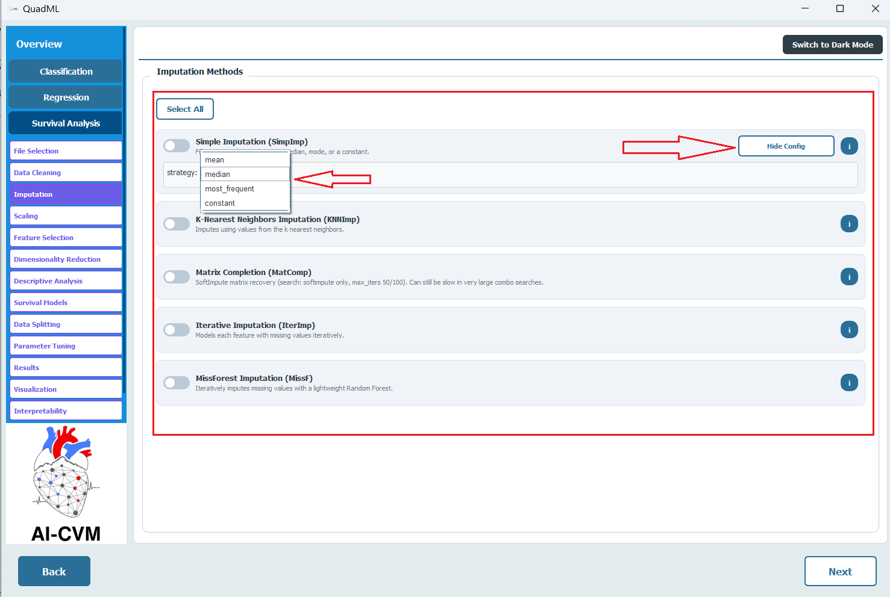
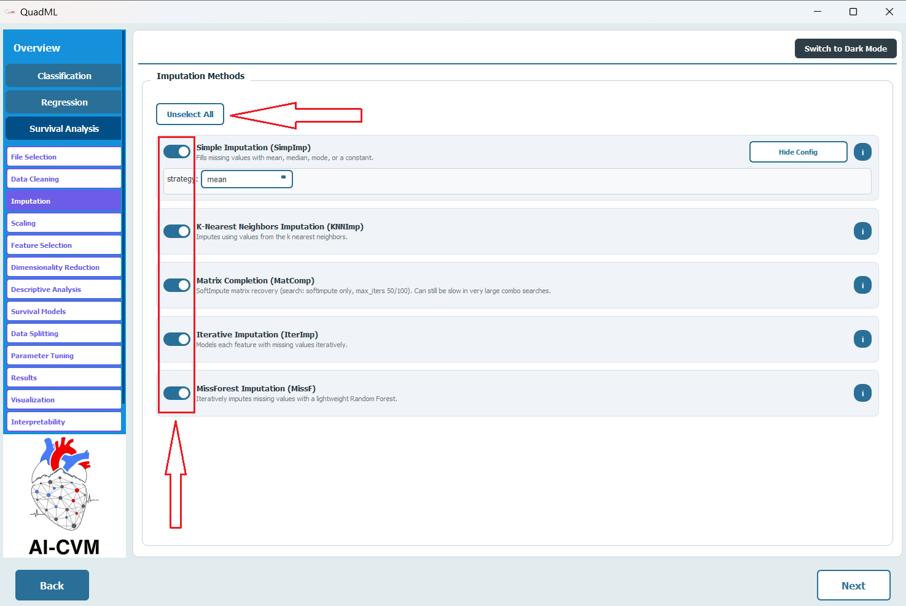

# Survival Analysis — Imputation

**Where**: Survival Analysis → **Imputation**

**Imputation** fills missing values in the features — including holes left when feature-level **Data Cleaning** cleared outlier cells to NaN — so every searched **covariate** pipeline has complete inputs for scaling and modeling. Enable **one or more** methods; QuadML crosses each checked method with your Scaling, Feature Selection, Dimensionality Reduction, and Survival Model choices.

**Kaplan–Meier** and **Nelson–Aalen** do not use imputation (`N/A (not used)` on Results).

---

## Methods

| Method | Short idea |
|--------|------------|
| **Simple Imputation** | Per-column fill: mean, median, most_frequent, or constant |
| **K-Nearest Neighbors Imputation** | Fill from nearest neighbors |
| **Matrix Completion** | SoftImpute-style matrix recovery (can be slow in large searches) |
| **Iterative Imputation** | Models each feature iteratively |
| **MissForest Imputation** | Iterative fill with a lightweight Random Forest |

**Simple Imputation** default strategy in QuadML is **median** (not mean). Only Simple Imputation has **More Configs** for strategy / `fill_value`; other methods are auto-optimized during search.

For a first run, enable **Simple Imputation** alone (or Simple + one other method). Avoid checking every method on a large dataset.

---

## What to click

1. Toggle the imputation method cards to include in the search (at least one should be on for covariate models).
2. Click **i** on a method for how it works, defaults, pros/cons, and a library link.
3. Optionally open **More Configs** on **Simple Imputation** to change strategy (median / mean / most_frequent / constant).
4. Use **Select All** / **Unselect All** if you need to manage many cards at once.

---

## What is written to disk

Imputed datasets and configs live in the dated run folder under your **Output Directory**. Results labels use short codes such as `SimpImp(med)`.

---

## Common mistakes

- Selecting every imputation method plus every scaler plus every survival model on a large dataset — the search grid grows multiplicatively
- Assuming **mean** is the Simple Imputation default — QuadML default is **median**
- Leaving all imputation methods unchecked when the dataset (or cleaned cells) still contains missing values and you plan to run covariate models
