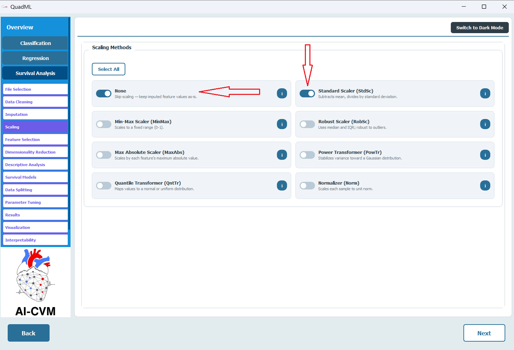
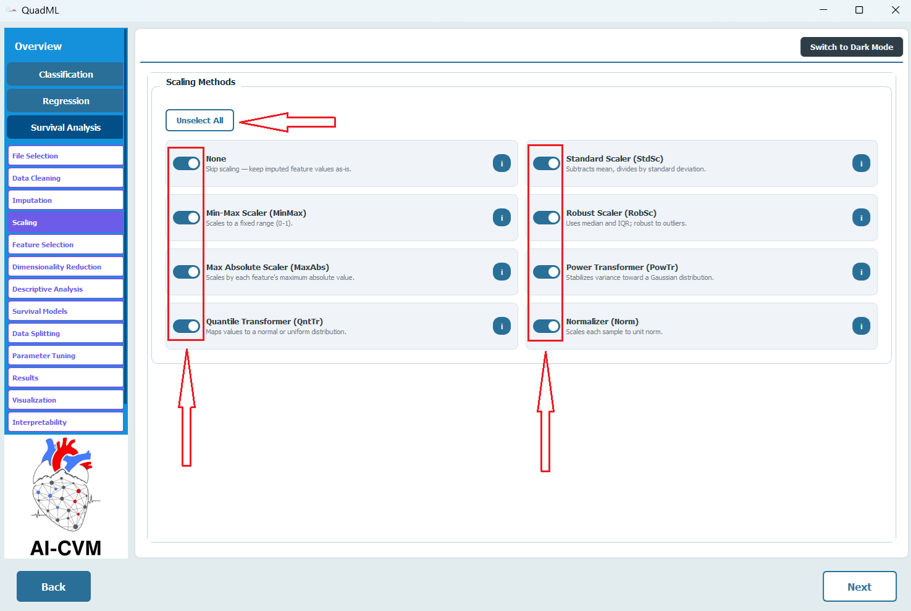

# Survival Analysis — Scaling

**Where**: Survival Analysis → **Scaling**

**Scaling** rescales imputed feature columns before Feature Selection, Dimensionality Reduction, and the survival model. Each checked method (including **None**) becomes part of the combinatorial search with Imputation × FS × DR × Survival Models. Cox / AFT and many linear-style models usually need scaling; some tree ensembles can work with **None**.

**Kaplan–Meier** and **Nelson–Aalen** do not use scaling (`N/A (not used)` on Results).

---

## Methods

| Method | Short idea |
|--------|------------|
| **None** | Skip scaling; keep imputed values as-is |
| **Standard Scaler** | Mean 0, variance 1 |
| **Min-Max Scaler** | Scale to a fixed range |
| **Robust Scaler** | Center/scale with robust statistics (median / IQR) |
| **Max Absolute Scaler** | Scale by max absolute value |
| **Power Transformer** | Stabilize variance / reduce skew (search may tune yeo-johnson / box-cox) |
| **Quantile Transformer** | Map to normal or uniform (search may tune distribution) |
| **Normalizer** | Scale each sample to unit norm (search may tune l1 / l2 / max) |

Selecting **None** keeps the imputed feature values unchanged for that pipeline branch.

For a first run, enable **Standard Scaler** and optionally **None**. Avoid checking every scaler on a large search.

---

## What to click

1. Toggle the scaling method cards to include in the search (at least **None** or one scaler for covariate models).
2. Click **i** on a card for how it works, defaults, pros/cons, and a library link.
3. Use **Select All** / **Unselect All** if you need to manage many cards at once.

There is no user **More Configs** panel for scaling on this page. Where a method has tunable options (Power Transformer, Quantile Transformer, Normalizer), Parameter Tuning explores them during the search.

---

## What is written to disk

The fitted scaler is stored inside the saved pipeline (`.pkl`). Results labels use short codes such as `StdSc` or `No scaling`.

When scaling is on, some Interpretability plots can show original (pre-scale) feature values on axes while the model still uses scaled inputs.

---

## Common mistakes

- Forgetting **None** when you want a no-scale baseline for tree ensembles
- Selecting every scaler on the first run
- Expecting KM / Nelson–Aalen to show a scaling method other than `N/A`
