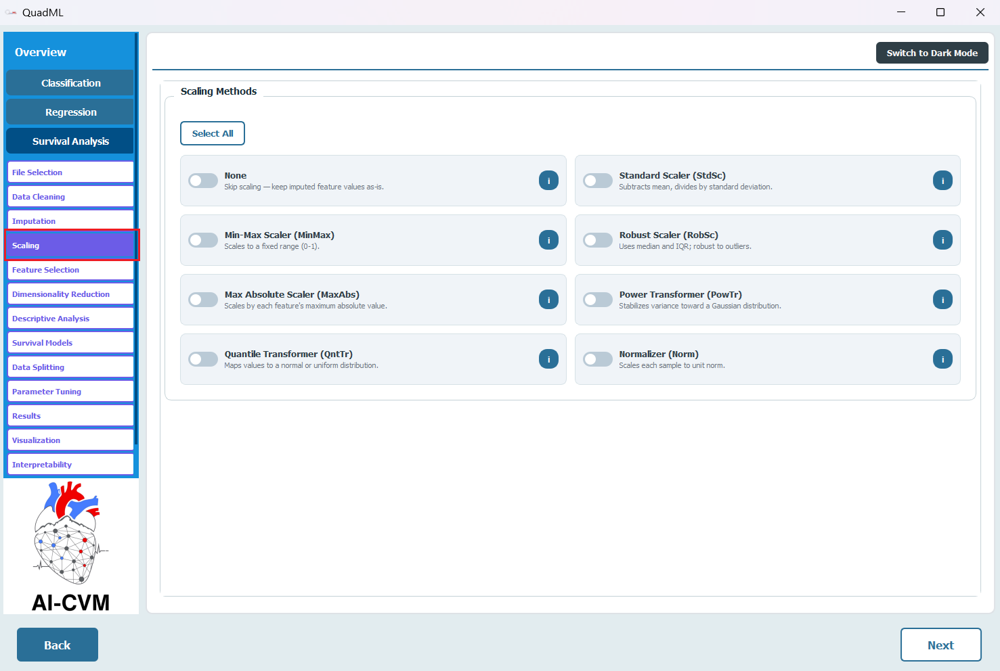

# Survival Analysis — Scaling

Rescales imputed feature values so every searched **covariate** pipeline has comparable numeric inputs for feature selection, dimensionality reduction, and survival models. Choose one or more scalers (Standard, Min-Max, Robust, Max Absolute, Power, Quantile, Normalizer) or **None** to leave values unchanged. Cox and AFT models usually need scaling; tree ensembles such as Random Survival Forest can often use **None**. Scaling is applied at **Start Procedure**. Enable only what you need because each extra scaler multiplies the search. Kaplan–Meier and Nelson–Aalen do not use scaling (`N/A` on Results).

--8<-- "_snippets/scaling.md"

## Common mistakes

- Linear / SVM-style models with only **None** on mixed-scale features
- Selecting every scaler on the first run
- Forgetting **None** when you want a tree-model baseline
