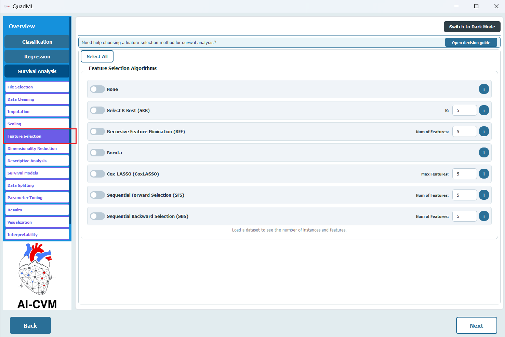

# Survival Analysis — Feature selection

Feature selection keeps the most useful original features and drops the rest. Unlike Dimensionality reduction, it doesn't create new features, so the selected ones stay interpretable. Each selected method is combined with each Dimensionality reduction method in the search, so the number of runs grows quickly. Survival shows a smaller set of methods suited to time-to-event data (for example Cox-based ranking and Cox-LASSO). Feature selection is fit on the training data only (within each cross-validation fold) and then applied to Test and External data. For most methods, the main parameter can be set in the method's settings, for example the number of features to keep. Kaplan–Meier and Nelson–Aalen do not use Feature Selection (`N/A` on Results).

--8<-- "_snippets/feature-selection-survival.md"

## Tips

- Keep **None** enabled if you want a full-feature baseline to compare against
- Sequential Forward/Backward with Cox can be very slow on large datasets
- Set *k* or related options in each method's settings before you start

## Common mistakes

- Turning off **None** when you still want a full-feature baseline
- Enabling Sequential Forward/Backward with a large feature budget on a first run
- Confusing this step with PCA (that is Dimensionality Reduction)
