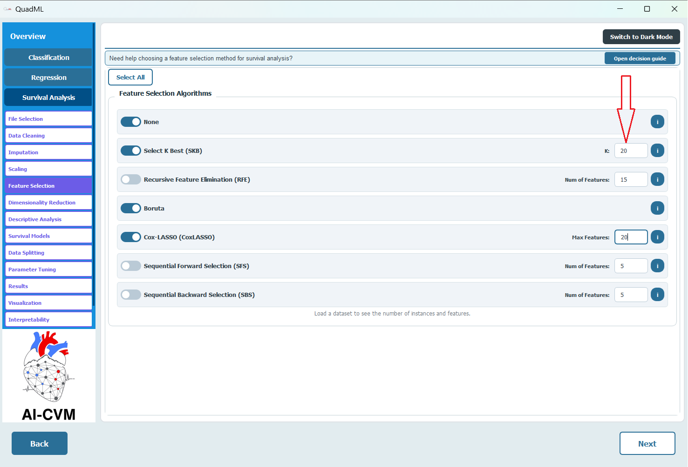
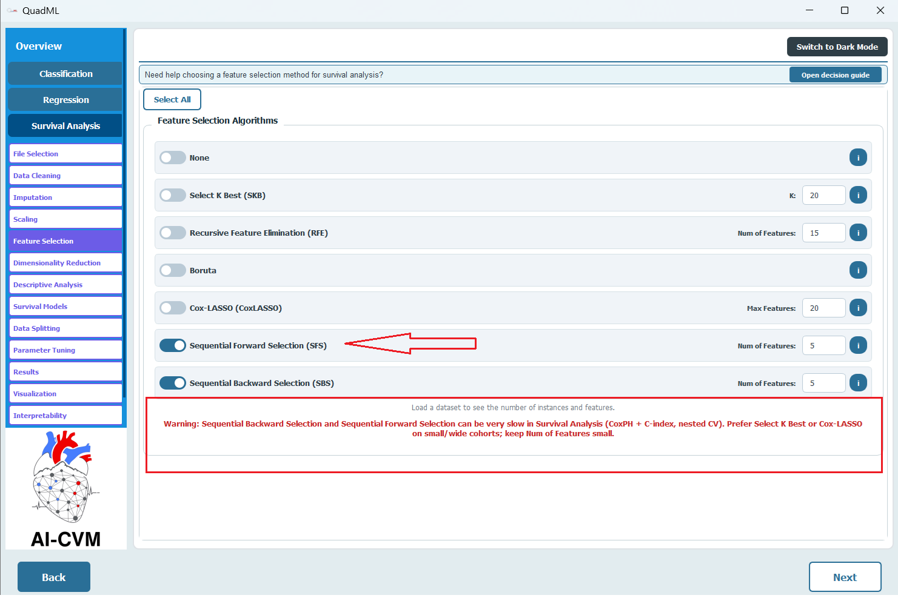
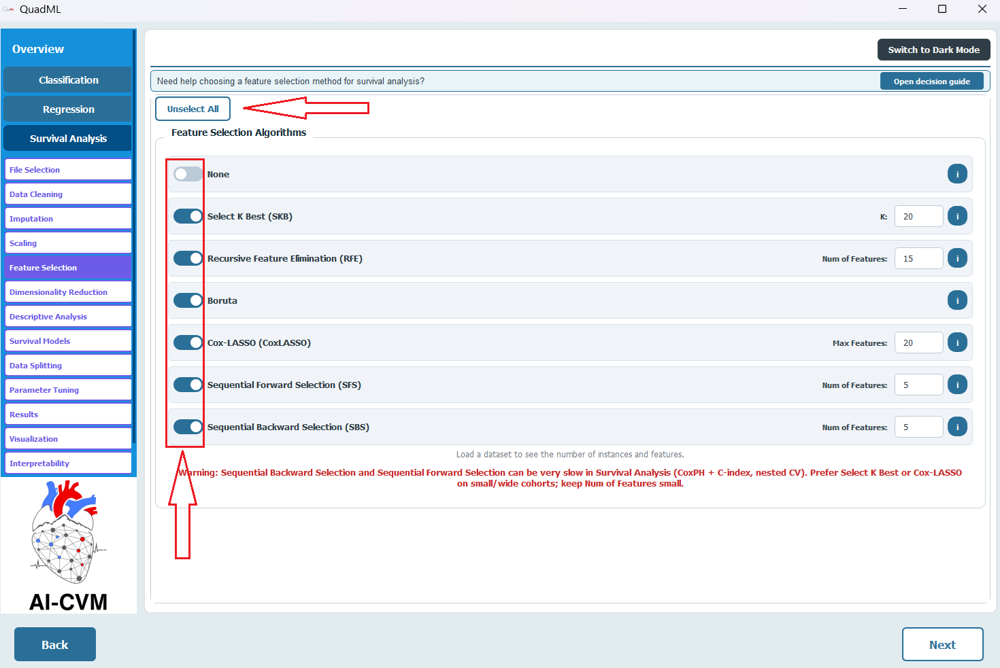

# Survival Analysis — Feature Selection

**Where**: Survival Analysis → **Feature Selection**

**Feature Selection** ranks or drops **original** covariate columns so each searched pipeline can keep a subset (or all) of the predictors. Survival uses a **restricted allowlist** of methods that respect duration + event (not generic classification / regression scoring). It is crossed with every checked Dimensionality Reduction method on the next page (FS × DR).

**None** means keep all eligible features after imputation and scaling (skip selection). On very wide datasets, prefer a filter (for example Select K Best or Cox-LASSO) instead of **None** alone if run time becomes too large.

**Kaplan–Meier** and **Nelson–Aalen** do not use feature selection (`N/A (not used)` on Results).

---

## Methods available in Survival

| GUI name | Notes |
|----------|-------|
| **None** | Keep every feature after impute/scale |
| **Select K Best** | Univariate CoxPH scoring (Harrell C-index) |
| **Recursive Feature Elimination** | CoxPH recursive elimination by coefficient magnitude |
| **Cox-LASSO** (canonical key: Lasso) | Coxnet L1 path; alpha via event-stratified CV when possible |
| **Sequential Forward Selection** | CoxPH + C-index (can be slow) |
| **Sequential Backward Selection** | CoxPH + C-index (can be slow) |
| **Boruta** | Relevance screen vs event indicator (not full Cox/C-index scoring) |

Methods such as Mutual Information (generic), Variance Threshold, Tree FS, Select Percentile, etc. are **not** on the Survival FS page. Use **More Configs** where shown to set the desired number of features.

PCA / ICA / Kernel PCA are **not** chosen here — they belong on **Dimensionality Reduction**. **LDA** is not available in Survival.

---

## What to click

1. Toggle the methods to include. Keep **None** as a baseline unless the feature count makes a full-feature search too expensive.
2. Click **?** / **i** on a method for a plain-language description and link.
3. Use **More Configs** where available (*k*, estimator, …).
4. Use **Select All** / **Unselect All** if needed — expect cost warnings for expensive methods.

Every selected Feature Selection method is crossed with every selected Dimensionality Reduction method (FS × DR).

**Warning:** Sequential Forward Selection and Sequential Backward Selection can be very slow on small cohorts with nested CV. Prefer Select K Best or Cox-LASSO first, and keep the feature budget small.

---

## What is written to disk

Selected-feature CSVs (with duration/event preserved for interpretability) and the fitted selector live in the dated run folder. Interpretability **Load files** should use the selected-features CSVs that match the `.pkl`.

---

## Common mistakes

- Looking for PCA / ICA / Kernel PCA on this page (those live under **Dimensionality Reduction**)
- Turning off **None** so you never see a full-feature covariate baseline (when the dataset is small enough)
- Leaving **None** on with a very high feature count and a long model list
- Loading Interpretability CSVs from a different combination than the model `.pkl`
- Enabling SFS/SBS with a large feature budget on the first smoke run
