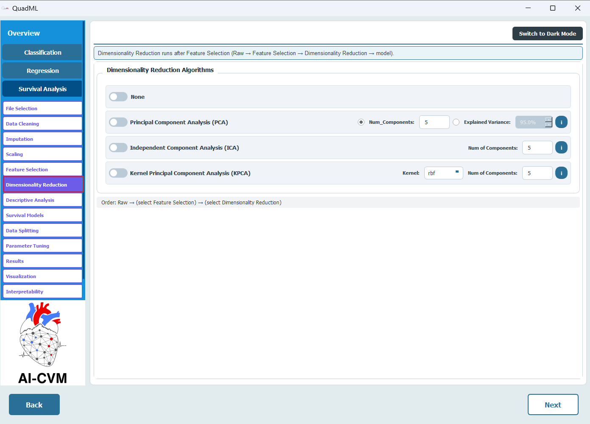

# Survival Analysis — Dimensionality reduction

**Where**: Survival Analysis → **Dimensionality Reduction**

**Task notes:** No LDA. KM / Nelson–Aalen skip DR (`N/A`).

--8<-- "_snippets/dimensionality-reduction.md"

## Common mistakes

- Looking for **LDA** outside Classification
- Many DR methods without a **None** baseline
- Pairing Clustering **Laplacian Score** with non-None DR
