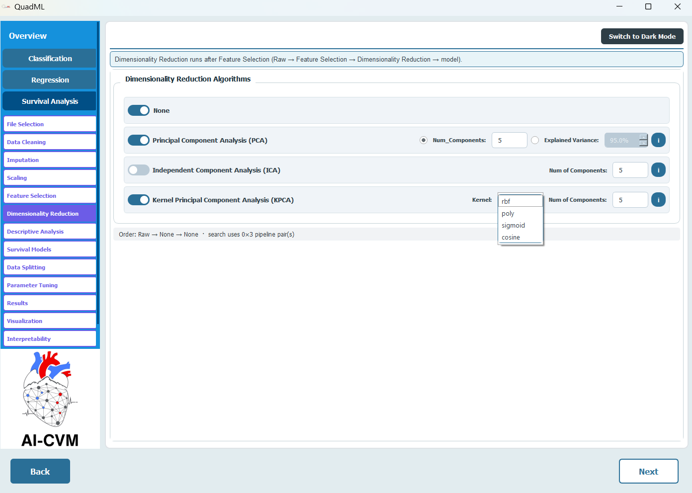

# Survival Analysis — Dimensionality reduction

Compresses the features kept by Feature Selection into fewer components or leaves those columns unchanged (**None**). Each FS method is crossed with each DR method in the search (FS × DR). **LDA is not available** here (Classification only). Enable only what you need because each extra method multiplies the search. After DR, Interpretability refers to components, not original feature names. Kaplan–Meier and Nelson–Aalen do not use Dimensionality Reduction (`N/A` on Results).

--8<-- "_snippets/dimensionality-reduction.md"

Choose methods and set options. For example PCA component count or explained variance, and the Kernel PCA kernel:

## Common mistakes

- Looking for **LDA** outside Classification
- Many DR methods without a **None** baseline
- Pairing Clustering **Laplacian Score** with non-None DR
