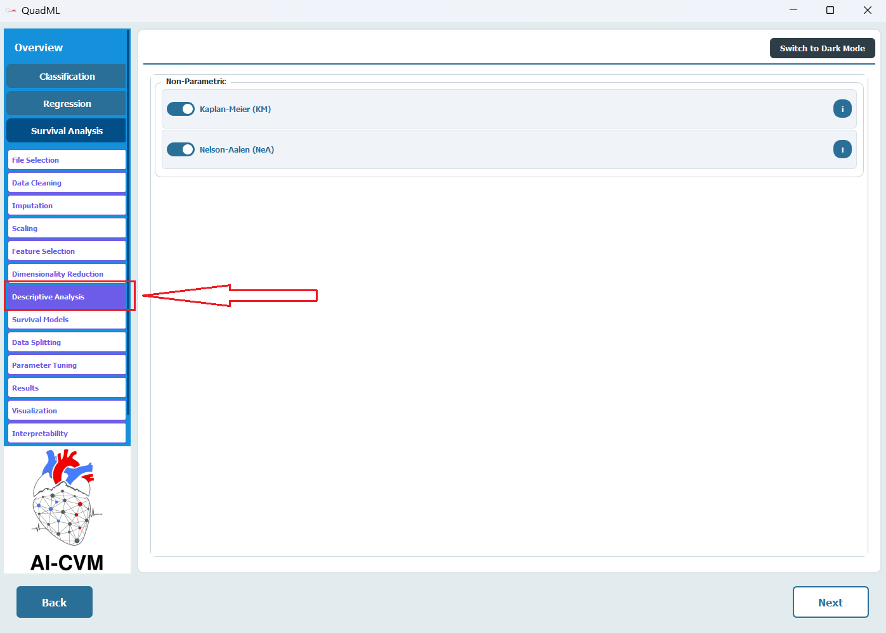

# Survival Analysis — Descriptive analysis

Chooses non-parametric **cohort** estimators that describe overall survival or cumulative hazard from duration and event status **without covariates**. This is not a data-summary or table-preview screen. **Kaplan–Meier** estimates the cohort survival curve \(S(t)\); **Nelson–Aalen** estimates the cohort cumulative hazard \(H(t)\). You can run descriptive models alone, covariate models alone (on **Survival Models**), or both and select at least one model here or on Survival Models before **Start Procedure**. Descriptive models do not use imputation, scaling, feature selection, or dimensionality reduction (`N/A` on Results) and have no Interpretability step. Use **Visualization** for curves.

## Methods

| Model | What it does | When to use it |
|-------|--------------|----------------|
| **Kaplan-Meier** | Cohort survival \(S(t)\); median survival when defined | Baseline survival curve |
| **Nelson-Aalen** | Cohort cumulative hazard \(H(t)\) | Cumulative hazard view |

## Common mistakes

- Looking for KM on the Survival Models page  
- Expecting SurvSHAP for descriptive models  
