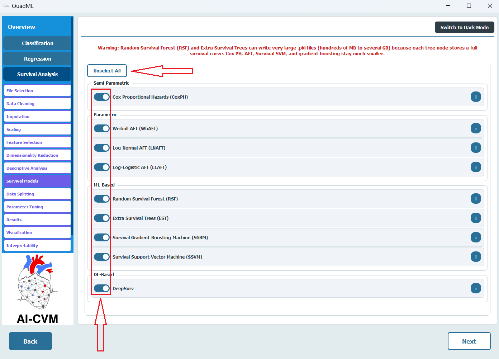

# Survival Analysis — Survival Models

**Where**: Survival Analysis → **Survival Models**

**Survival Models** are the **covariate (predictive)** models that use features plus duration/event. Kaplan–Meier and Nelson–Aalen are on **Descriptive Analysis**, not here.

Check one or more models; each checked model is crossed with every Imputation × Scaling × Feature Selection × Dimensionality Reduction combination you enabled earlier. Hyperparameters are explored later on **Parameter Tuning** (Grid or Random Search), not typed by hand as the main workflow on this page.

For a first run: **Cox Proportional Hazards** (plus **Kaplan-Meier** on Descriptive Analysis).

**Attention**: Generated `.pkl` files for some models — especially **RSF**, **SSVM**, and **SGBM** (and often **Extra Survival Trees**) — can be **very large** (hundreds of MB to several GB). Tree-based survival models may store full survival curves in nodes; SSVM artifacts can also grow quickly. Check free disk space before a wide search, and avoid selecting all of these on a large cohort for a first run.

---

## Models (GUI names)

| GUI name | Short code | Type |
|----------|------------|------|
| Cox Proportional Hazards | CoxPH | Semi-parametric |
| Weibull AFT | WbAFT | Parametric |
| Log-Normal AFT | LNAFT | Parametric |
| Log-Logistic AFT | LLAFT | Parametric |
| Random Survival Forest (RSF) | RSF | ML-based |
| Extra Survival Trees | EST | ML-based |
| Survival Gradient Boosting Machine (SGBM) | SGBM | ML-based |
| Survival Support Vector Machine (SSVM) | SSVM | ML-based |
| DeepSurv | DeepSurv | DL-based |

GUI sections follow: Semi-Parametric → Parametric → ML-Based → DL-Based.

---

## Notes by model family

- **Cox / AFT / RSF / SGBM / DeepSurv**: discrimination (C-index, td-AUC), IBS, and calibration when \(S(t)\) is available
- **SSVM**: ranking-oriented; no \(S(t)\) → no SurvSHAP and some calibration / decision-curve plots are unavailable
- **DeepSurv**: slower; needs more resources
- **RSF / EST / SGBM / SSVM**: see the **Attention** note above on large `.pkl` sizes

---

## What to click

1. Toggle one or more covariate models (or **Select All** / **Unselect All** carefully).
2. Click **i** on a card for how the method works in QuadML and a library link.
3. Continue to **Data Splitting** and **Parameter Tuning** to set the split and start the search.

---

## What is written to disk

Fitted pipelines (`.pkl`) live under the dated run folder, named by combination (including short codes for earlier steps and the model).

---

## Common mistakes

- Enabling every ML model on a large cohort for a first run — the product grows multiplicatively with imputer / scaler / FS / DR
- Ignoring the large-`.pkl` warning for RSF / SSVM / SGBM (and EST)
- Expecting Kaplan–Meier on this page (it is on **Descriptive Analysis**)
- Starting with DeepSurv alone on a small machine or tiny cohort
