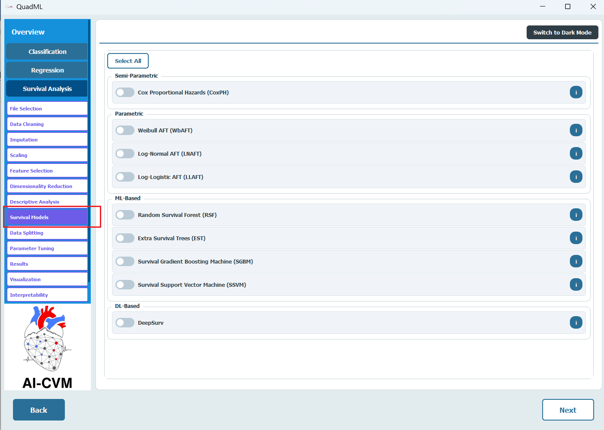

# Survival Analysis — Models

Chooses survival algorithms that map features, duration, and event status to predicted risk or survival. Each selected model is trained and evaluated in the search and is crossed with every Imputation × Scaling × Feature Selection × Dimensionality Reduction combination you enabled, so the total number of pipelines is a product of those choices. Non-parametric cohort curves (Kaplan–Meier, Nelson–Aalen) live on **Descriptive Analysis**, not on this page. Enable only what you need because each extra model multiplies the search and some ensembles can write large `.pkl` files.

## Models

| Model | How it works | Short code |
|-------|--------------|------------|
| Cox Proportional Hazards | Semi-parametric hazard model with covariates | CoxPH |
| Weibull AFT | Parametric accelerated failure time (Weibull) | WbAFT |
| Log-Normal AFT | Parametric AFT with log-normal errors | LNAFT |
| Log-Logistic AFT | Parametric AFT with log-logistic errors | LLAFT |
| Random Survival Forest | Forest of survival trees | RSF |
| Extra Survival Trees | Extremely randomized survival trees | EST |
| Survival Gradient Boosting | Boosted trees for survival | SGBM |
| Survival Support Vector Machine | Ranking-oriented SVM (no \(S(t)\)) | SSVM |
| DeepSurv | Neural Cox-style model | DeepSurv |

**Point:** Consider that **RSF / EST / SGBM / SSVM** models can write very large `.pkl` files.

## Common mistakes

- Enabling every ML model on a large cohort for a first run  
- Looking for KM on this page (it is on Descriptive Analysis)  
- Ignoring disk space for RSF / SSVM / SGBM  
