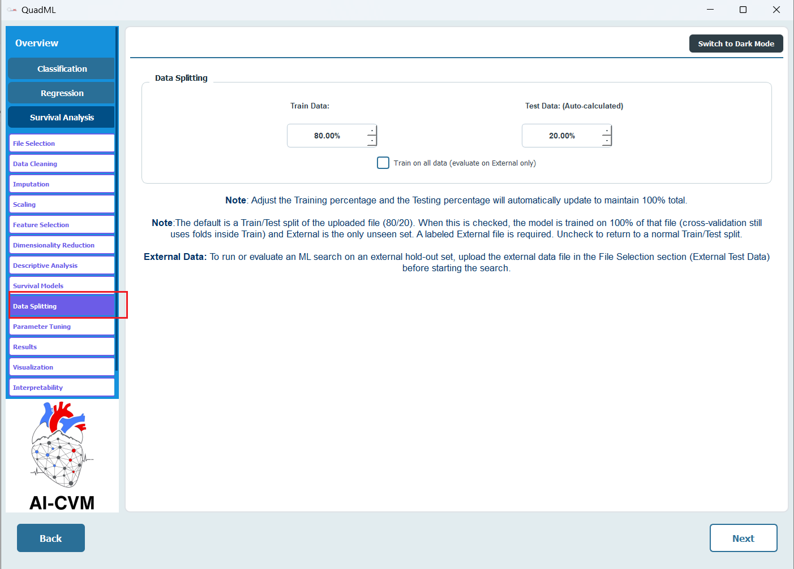

# Survival Analysis — Data splitting

Chooses how the main dataset is divided into **Train** and **Test** (and whether **External** is the only hold-out) before Parameter Tuning and scoring. The survival outcome is **duration + event**, not a single class label, so splits are not stratified by class. The default is an internal **80% / 20%** Train/Test split. When **Train on all data (evaluate on External only)** is checked, there is no internal Test split—External becomes the only unseen set and a compatible External file with duration and event columns is required on File Selection. Cross-validation during Parameter Tuning uses folds inside Train. Check cohort-comparison p-values on Results when comparing Train and Test.

--8<-- "_snippets/data-splitting.md"

## Common mistakes

- Checking **Train on all data** without External — **Start Procedure** will refuse
- Comparing Test metrics from a normal split with External metrics from a train-on-all run as if they were the same design
- Extremely small test percentages on tiny datasets
