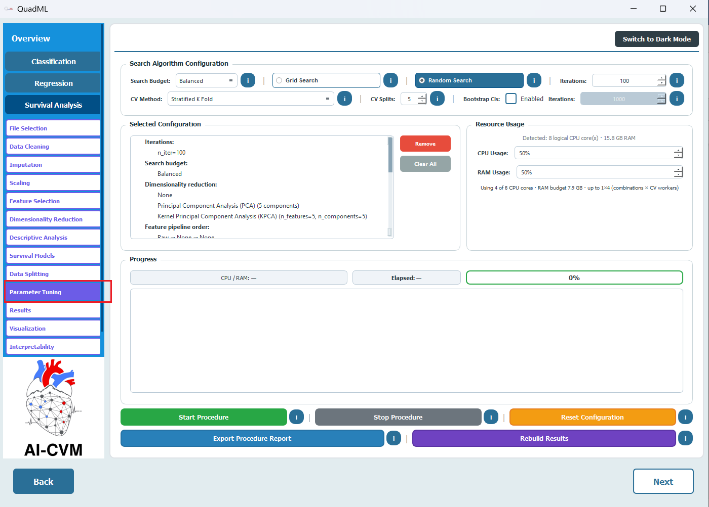

# Survival Analysis — Parameter tuning

**Where**: Survival Analysis → **Parameter Tuning**

Sets search budget and algorithm, then starts the run. No Imbalance Handling panel.

--8<-- "_snippets/search-run.md"

--8<-- "_snippets/start-stop-resources.md"

**Task notes:** CV may include **Stratified K-Fold** (event-aware) when events are scarce. Horizons for td-AUC / IBS / calibration are set on **File Selection**.

**Tip:** Check the configuration tree before Start. Use **Fast** for a first Survival run.

## Common mistakes

- Starting with every method checked — combination count is a product
- Ignoring Resource Usage on large searches
- Changing File Selection roles after configuring without re-checking the tree
- Closing the app instead of **Stop**
- Setting CPU/RAM to 100% on a machine you still need for other work
- Starting again without noticing a new dated folder was created
