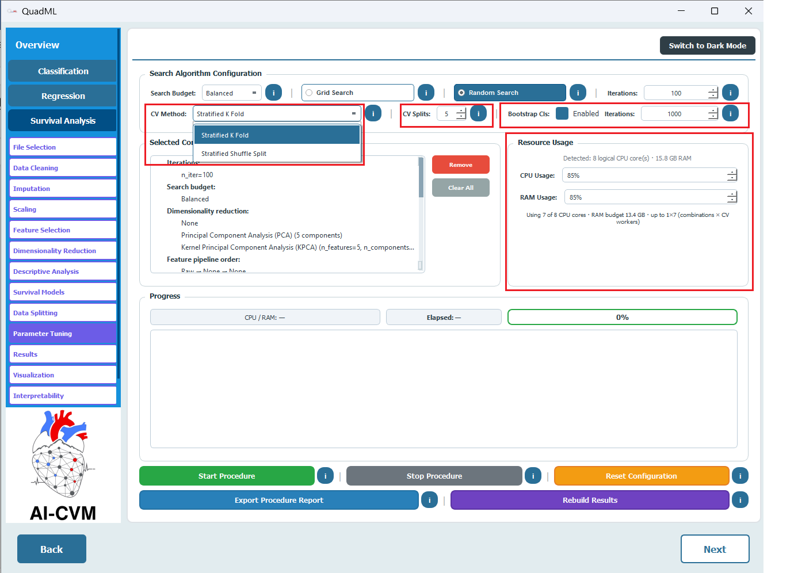
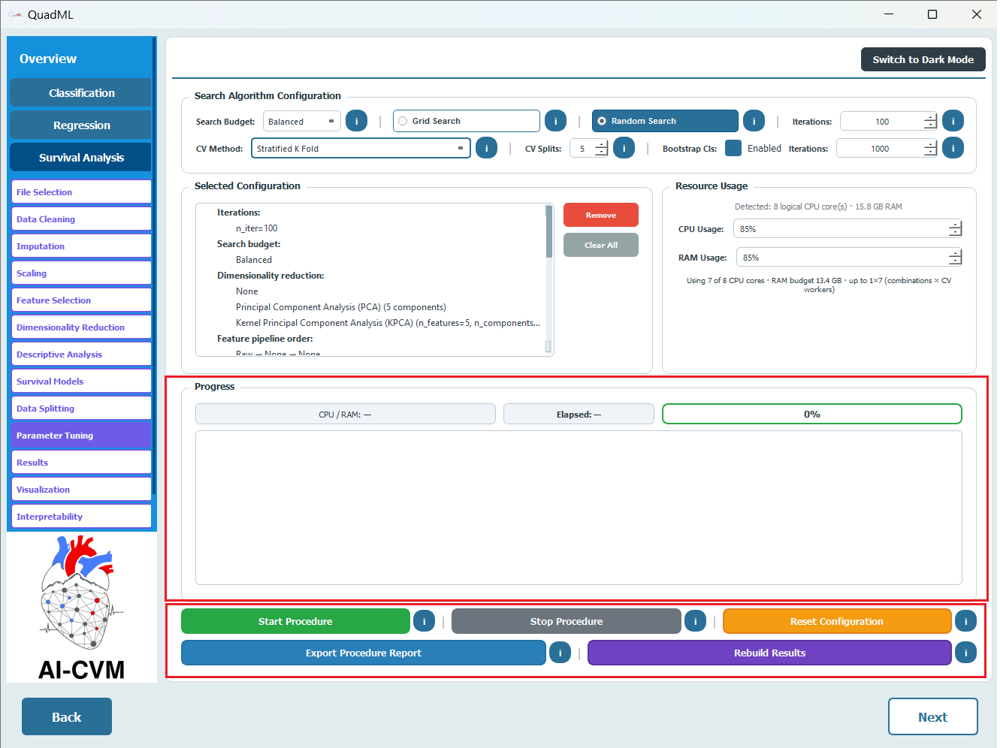

# Survival Analysis — Parameter tuning

Sets how QuadML searches the pipeline and model combinations you enabled earlier, then starts the run with **Start Procedure**. Choose a **Search Budget** (Fast / Balanced / Thorough), a search algorithm (Grid or Random Search), cross-validation folds, optional Bootstrap CIs, and CPU/RAM limits; review the selected configuration tree before you start. There is **no Imbalance Handling** panel in Survival. Cross-validation may include **Stratified K-Fold** (event-aware) when events are scarce. Evaluation horizons for td-AUC, IBS, and calibration are set on **File Selection**, not here. Prefer **Fast** for a first Survival run; use **Stop** to cancel and keep partial outputs in the dated run folder.

--8<-- "_snippets/search-run.md"

Selected configuration tree and **Start** / **Stop** / **Reset** / **Export** / **Rebuild Results**:

--8<-- "_snippets/start-stop-resources.md"

## Common mistakes

- Starting with every method checked — combination count is a product
- Ignoring Resource Usage on large searches
- Changing File Selection roles after configuring without re-checking the tree
- Closing the app instead of **Stop**
- Setting CPU/RAM to 100% on a machine you still need for other work
- Starting again without noticing a new dated folder was created
